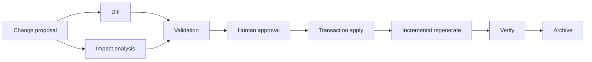

# Change Manager 吸收 OpenSpec 方法论的评审意见

> 日期：2026-11-24
> 被修改文档：`dev-docs/planning/2026-11-24-需求全文生成执行计划.md`
> 参考：`thirdparties/OpenSpec`（REF-003，MIT，只读参考；仅吸收方法论，不作为运行时依赖）
> 处理结论：将 Rule Studio Change Manager 纳入 D0 / K0 / P2；不影响 P0-A、P0-B、P1 的交付范围。

## 结论

值得吸收 OpenSpec 的 Change Manager 方法论，但不安装 OpenSpec CLI，也不让 Rule Studio 依赖其运行时。

当前 Rule Studio 有 Proposal + Transaction：

| 已有能力 | 当前定位 |
| --- | --- |
| Proposal | 单个提案的用户审批和生命周期 |
| Transaction | 已批准提案的安全文件写入、回滚与崩溃恢复 |
| Stage Workflow | 需求文档生成的阶段产物与增量重跑 |

缺少的是上层的 Change Management：一次跨多个文件、多个对象、多个阶段、多个 AI Session 的变更包如何组织、恢复、验证与归档。

## OpenSpec 值得吸收的部分

| OpenSpec 概念 | Rule Studio 吸收方式 |
| --- | --- |
| Change Package | 一个 Change 目录组织一次变更的提案、派生差异、验证、审批、影响和验证报告 |
| Artifact Graph | 固定轻量依赖图：按变更类型判断可生成 / 被阻塞的产物；不实现通用 Schema 引擎 |
| Lifecycle | create / update / continue / approve / apply / regenerate / verify / archive；支持跨会话恢复 |
| Archive | 仅把完成 Change 移入历史，保留全部材料；**不负责再次合并正式文件** |

## 不吸收的部分

| OpenSpec 能力 | 不吸收原因 |
| --- | --- |
| OpenSpec CLI 运行时依赖 | Rule Studio 需本地、结构化、可控的领域内核；不引入外部 CLI 依赖 |
| 通用可配置 Schema 引擎 | 过度设计；Rule Studio 先固定轻量图即可 |
| Markdown Delta Spec 解析器 | 规则、配置、Document Block 已是结构化对象，直接记录结构化 op 更可靠 |
| Archive 合并 Delta Spec 到正式 Spec | 正式写入只能由既有 Transaction 负责；Archive 只能归档，不能再修改事实 |
| 强制生成所有 proposal/spec/design/tasks 文档 | 变更按需产生材料，避免仪式化 |

## 建议的 Change Package

```text
<kb>/.rule-studio/
  changes/
    active/
      CHG-001/
        change.json               # Change 的唯一事实源：意图、范围、成员 Proposal、生命周期
        artifacts/
          diff.json               # 派生
          validation-report.json  # 派生
          impact-report.json      # 可选派生
          approval.json           # 人工审批记录
          verify-report.json      # 最终验证记录
    archive/
      2026-11-24-CHG-001/
        ...完整包...
  proposals/
    DOC-P-001.json                # 仍是 Proposal 事实源，Change 只引用它
  transactions/
    TX-001/
  workflow/
    task-001/
```

### Change 与 Proposal / Transaction 的关系

- **Change**：一次业务变更的容器，可包含多个 Proposal；负责材料依赖、进度、恢复、验证、归档。
- **Proposal**：一个结构化操作的审批对象；沿用既有 Proposal 状态机。
- **Transaction**：一个 approved Proposal 的文件写入执行器；沿用既有 Transaction 状态机。

Change 不替代 Proposal，Proposal 不替代 Transaction。

## 轻量 Artifact Graph



- 纯表达变更：不需要 `impact-report.json`；Diff → Validation → Approval。
- 规则 / 配置变更：需要 Diff、Impact、G1-G4 Validation。
- 文档结构变更：需要 Outline Diff、覆盖检查。
- Artifact 依赖是「可以继续产生什么」的提示，不是强制瀑布式门禁；与 OpenSpec `fluid not rigid` 一致。

## 生命周期

```text
Change: draft → ready → approved → applying → regenerating → verifying → verified → archived
异常：rejected / stale / blocked / failed

Proposal: draft → ready → approved → applied
                  ↘ rejected / stale / failed

Transaction: preparing → prepared → writing → committed
                                      ↘ rolled_back / recovery_failed
```

- `update`：同一 Change 的意图和范围仍成立时，更新其中 Proposal；任何已生成的 Diff / Validation / Impact 必须按输入 Hash 失效。
- `continue` / `resume`：会话或进程中断后，从 `change.json` 与 Artifact Graph 找到下一个可执行产物。
- `verify`：检查最终文档、规则、引用和数值与 Change 要求一致。
- `archive`：Verify 通过后，移动整个包；**不得再次修改规则或文档事实**。

## 修改执行计划的要求

1. **D0**：增加 Change Manager 的模型、状态、Artifact Graph 与 Archive 边界设计。
2. **K0**：增加 Change Package 契约、Artifact 状态 / 输入 Hash、恢复入口和统一存储边界。
3. **P0-A / P0-B / P1**：不变；只消费 Change Manager 契约，不实现 Change Manager。
4. **P2**：实现 Change Manager，与对话编辑接入；一个 Change 可含多个关联 Proposal。
5. 新增 P2 验收：多 Proposal、失效传播、依赖阻塞、跨会话恢复、重新审批、Transaction 后 Verify、Verify 后 Archive、Archive 不改事实、Change 可追溯 Transaction 与最终文档版本。

## 参考核对

OpenSpec 源码与文档实测：

- `docs/concepts.md`：Change 是独立文件夹，含 proposal/design/tasks/delta specs；Artifact Schema 声明 `requires` 依赖；Archive 把 Delta Spec 合并进正式 Spec 后移动 Change 到 archive。
- `src/core/archive.ts`：实现归档及 spec 合并。
- `src/core/artifact-graph/`、`src/commands/workflow/`：Artifact Graph 与 workflow 命令实现。

Rule Studio 只吸收 Change Package、Artifact Graph、Lifecycle、Archive 的组织思路；正式写入仍由自身 Transaction 完成。
