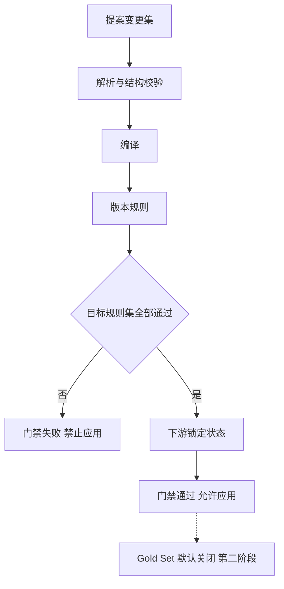
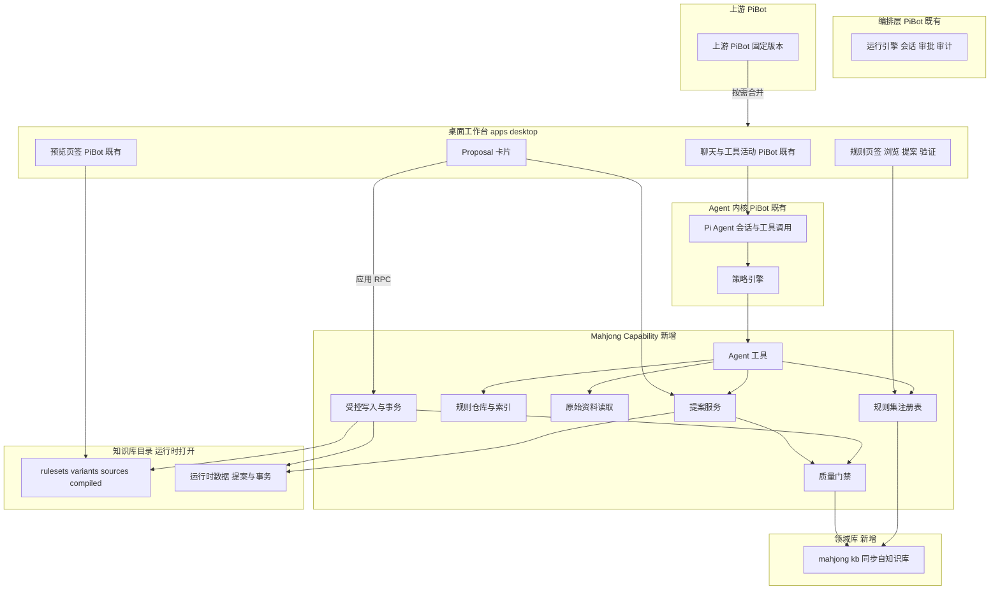
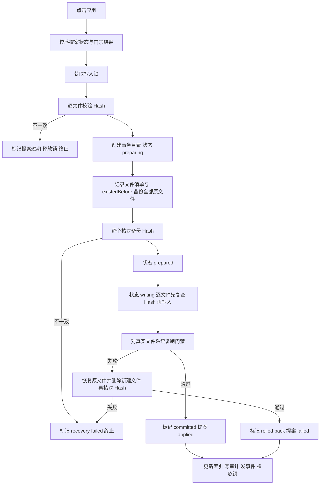

# Mahjong Rule Studio 需求文档

> 依据：`dev-docs/design/新增规则聊天窗口.md`（设计讨论稿，含两版架构：自建 React + Hono 方案、PiBot 二开方案）、`dev-docs/planning/2025-11-24-执行计划.md`（v3.2 架构冻结版）、仓库实测（`git log`、`schemas/`、`compiler/`、`dev-docs/progress/执行进度.md`）、PiBot 源码核验（上游 `main` commit `152425f`：`AGENTS.md`、`NOTICE`、`.nvmrc`、`packages/brain/src/core/capability.ts`、`packages/brain-app/src/index.ts`、`packages/protocol/src/aggregate/api.ts`、`tools.ts`、`packages/plugins/src/brain/knowledge/tools.ts`、`apps/desktop/src/renderer/features/side-pane/SidePane.tsx`）
> 评审依据：`dev-docs/design/2026-11-24-RuleStudio执行计划评审意见.md`、`dev-docs/design/2026-11-24-RuleStudio执行计划评审意见-第2轮.md`（主要针对执行计划；需求文档同步修订受影响处）
> 日期：2026-11-24
> 状态：初稿，待评审
> 已定决策：第一阶段本地单人使用。**开发基座待定**：PiBot 方案已于 2026-11-24 终止（备份在分支 `archive/rule-studio-pibot`），新路线见 `dev-docs/design/2026-11-24-RuleStudio技术路线对比.md`

## 修订记录

| 版本 | 日期 | 变更 |
| --- | --- | --- |
| v1 | 2026-11-24 | 初稿：核对设计稿前提、确定范围与不变量、功能需求、架构决策、验收与风险 |
| v1.1 | 2026-11-24 | 合并 `main` 后更新第一节第 9 行的现状描述 |
| v1.2 | 2026-11-24 | 按评审意见修订（`dev-docs/design/2026-11-24-RuleStudio执行计划评审意见.md`）：第一节第 7 至 9 行按实测补充环境与 fork 状态；I-1 改为显式工具白名单，I-9 改为显式状态机，新增 I-13、I-14；FR-01、FR-10、FR-19 修订；8.1 的 G1 改为解析加校验、G5 默认关闭；AD-1、AD-3、AD-5 修订，新增 AD-13；10.3 事务改为显式状态机并支持新建文件回滚；安全表、验收（AC-3、AC-6，新增 AC-14、AC-15）、风险、待决策同步。实测校正两项并按实测写入：`corepack` 命令在 Node 26 上不可用；`unresolved.yaml` 的宽泛 catch 已在 `23e9dff` 修复 |
| v1.3 | 2026-11-24 | 合并 `main` 后同步：第一节新增第 11 行（`content_hash`、KB Phase 3 / 4 完成）；I-4、FR-12、G3 扩展为「升版本并更新 `content_hash`」；R-13 标为已修复；示例中的示意 ID（`HJ-R-BANK-02`、`HJ-R-GANG-01`）按实测换成真实卡 `HJ-R-LUNZHUANG`、`HJ-K-GANGKAI` |
| v1.4 | 2026-11-24 | 按第二轮评审意见修订：并入 `main` 的 `167b111`（测试基线 86）；事务改为先取写入锁再校验 Hash、写入前逐文件复查（I-9、10.3）；修订提案必须显式指定 `proposalId`（10.2）；Gold Set 授权后可开启自动运行（FR-19）；AC-2 的前缀长度与执行计划 A-1 统一为 2～4 位 |
| v1.5 | 2026-11-24 | 合并 `main` 的第一阶段冻结（`decdf12`）后同步：第一节新增第 13 行；I-4、G3 写明版本递增由 Studio 门禁检查，KB 编译器不做这项检查（`AGENTS.md` 第 4 条）；Gold Set 门禁（FR-19、G5）区分「测试通过」与「用例已人工核验」（27 verified / 33 draft）；基线 88 |
| v1.6 | 2026-11-24 | 方向调整：新增「需求覆盖与补齐」能力，独立文档 `dev-docs/design/2026-11-24-RuleStudio需求覆盖与补齐.md`（FR-21 至 FR-28、I-15 至 I-20、AD-10 至 AD-13、AC-16 至 AC-22）。原「知识库质量审计」定位作废：Schema 校验只能保证卡写得合规，不能回答原文要求是否漏提取。另同步：PiBot 基座方案已于本日终止（见 `dev-docs/progress/执行进度.md`），文档内与 PiBot 相关的架构前提以该记录为准 |
| v1.7 | 2026-11-24 | 需求覆盖与补齐的定位与优先级确定（细节在增补文档）：规则结构化是基础设施、需求覆盖是质量保障，两者不是并列开发线路；新增 AD-14（规则原子与需求原子分离）与 I-21（需求必须从原文独立提取，不得从规则卡反推）；优先级 P0 保持现有结构化 → P1-P3 原子需求与覆盖分析 → P4-P5 补齐建议与提案；第一阶段范围收窄为原文 `2.3.3 算分规则` 单章节实验 |
| v1.8 | 2026-11-24 | 新增第二个核心能力「需求全文生成与变体差异标注」，独立文档 `dev-docs/design/2026-11-24-需求全文生成与变体差异标注.md`（FR-29 至 FR-37、I-22 至 I-28、AD-15 至 AD-20、AC-24 至 AC-31）：复用编译器得有效规则集，按对局流程分章生成完整需求全文，派生变体带五种来源标记与段落级差异；需求覆盖与补齐是其上游质量门 |
| v1.9 | 2026-11-24 | 需求全文生成并入「Document Block + 对话式段落编辑 + 增量重生成」（细节见增补文档）：Stage 3 改为生成文档块、Stage 6 改为渲染、新增 Stage 7 对话式段落编辑与按依赖最小重跑；新增片段级来源追踪、四种编辑行为分流（表达 / 规则 / 补充 / 结构）、重生成不覆盖人工修改（段落四态）；产品定位明确为三层（规则知识库 / 文档生成引擎 / AI 需求编辑器）与闭环原则。编号扩至 FR-43、I-34、AD-26、AC-37 |
| v2.0 | 2026-11-24 | 按 `2026-11-24-需求全文生成与变体差异标注评审意见.md` 修订该能力（细节见增补文档 v1.2）：所有变体共用同一套章节模板；差异标记拆成来源关系 / 规则状态 / 差异审核三维（第一版不支持删除，`changeTypes` 无 `removed`）；Document Block 引用拆四类并接入原子需求，`block_id` 与章节解耦；三个修改通道（规则 / 表达 / 结构）统一走提案与 `based_on_document_version` 校验；实施拆 P0-A / P0-B / P1 / P2 与上游覆盖节奏对齐，AC-24 增设原子需求表达检查。编号扩至 FR-50、I-41、AD-33、AC-45 |

## 一、对设计讨论稿前提的核对与纠正

设计讨论稿由两段对话拼成，第一段基于 `7762eee`（Phase 1 完成）评估现状，第二段转向 PiBot 二开。本节按仓库实测逐条核对，与实测不一致的以实测为准。

| # | 设计稿表述 | 实测结果 | 对本需求的影响 |
| --- | --- | --- | --- |
| 1 | 「目前还没有正式的 `variants/` 目录和规则编译器，萧山规则派生尚未完成」 | **过时**。Phase 2（`2c6c094`）与 Phase 2.6（`fc3d555`）已完成：`variants/xiaoshan/` 47 张卡、`compiler/compile.ts` 可用、`compiled/xiaoshan/` 86 条规则、31 个测试通过；`main` 另有一个修复提交 `23e9dff` | 不必等「Phase 2 → 2.6 → 3」再启动 Rule Studio；变种维护（Phase D）可与 KB Phase 3 并行 |
| 2 | 「规则 ID 前缀硬编码 HJ / XS，要在开发前改成 manifest 驱动」 | **属实**。`schemas/rule.ts` `ruleIdPattern`、`schemas/config.ts`、`schemas/unresolved.ts`、`compiler/validator.ts` `extractBodyRefs`、`compiler/compile.ts` `rewriteBody` 与闭合检查正则均写死 `HJ\|XS`；`validator.ts` 用 `rs.dir.startsWith("variants")` 判规则集类型 | 列为 Phase A 必做，否则 Studio 无法在内存中叠加校验，也无法新增地方麻将 |
| 3 | 「PiBot 的 Capability 架构可插拔，新增 Capability 只需新包 + 组合根一行」 | **属实但不完整**。`BrainCapability` 接口与 `brain-app` 组合根确认存在；但 RPC 方法、事件、工具规格必须在 `packages/protocol/src/aggregate/api.ts` 与 `tools.ts` 中 spread 才能进入协议表。PiBot 的 Plugin SDK 只支持 MCP stdio 连接，不能注册 RPC 与 UI | **必须 fork，不能只做只读参考**。只读 submodule 方案无法承载任何 Studio 功能 |
| 4 | 「PiBot 自带知识库只支持 Obsidian / Notion 只读检索」 | **属实**。`knowledge/tools.ts` 只有 `knowledge_search` 与 `knowledge_read` | 规则提案、写入、校验必须自建 Mahjong Capability |
| 5 | 「PiBot 工作区变更恢复仅 macOS」 | **属实**。README 原文：Every change is listed, reviewable and, on macOS, restorable from automatic checkpoints | Windows 下事务备份与回滚必须自建，不可依赖 PiBot |
| 6 | 「PiBot 采用 Apache-2.0，可 Fork 二开」 | **属实但有限制**。`NOTICE` 明确「Pi Bot / PiBot」名称与 Logo 不在许可范围内，fork 不得以暗示背书的方式使用 | 二开产品必须改名（Mahjong Rule Studio），保留 LICENSE / NOTICE / THIRD_PARTY_NOTICES 并注明衍生关系 |
| 7 | 未提及 | PiBot `.nvmrc` 指定 Node `26.11.1`，`engines.node` 为 `^22.12.0 \|\| ^24.0.0 \|\| >=26.0.0`，`packageManager` 固定 `pnpm@12.14.0`；本机 Node `24.18.0`（满足 engines，与 `.nvmrc` 不同），未安装 pnpm。Node.js 从 25 起不再捆绑 Corepack，26.11.1 上没有 `corepack` 命令 | 环境前置任务：正式开发用 26.11.1，pnpm 用 `npm i -g pnpm@12.14.0` 安装；KB 的 Node 24 代码可在 Node 26 下运行 |
| 8 | 未提及 | KB 用 Zod 3（`^3.24.0`），PiBot 锁定 Zod `4.6.5` | 默认不迁移：进 fork 的 `@pibot/mahjong-kb` 作为独立包继续用 Zod 3，RPC 契约用 Zod 4，二者只交换普通对象（AD-5） |
| 9 | 「新建独立仓库 MahjongRuleStudio」 | 用户已决定：在本仓库分支 `mickorz/Mahjong-Rule-Studio` 开发，PiBot 作为 submodule 放 `thirdparties/`。编写时该分支落后 `main` 一个提交（`23e9dff`），已于 2026-11-24 合并（`ab76048`）；fork `mickorz/PiBot` 已创建，submodule 已添加（`3f9136d`，跟踪 fork 的 `main`） | 与 `CLAUDE.md`「thirdparties 只读」冲突，需修订规范（见 AD-10） |
| 10 | 「`compiled/xiaoshan/` 86 条规则」与「完整萧山 = (N − a) + b」 | 进度文档已修正公式为 **N + b**（modified 卡替换后自身进产物） | 需求文档沿用修正后公式 |
| 11 | 文档编写后 `main` 的新变化 | `b6e06d4`：manifest 增加 `content_hash`（基础规则内容指纹），编译时比对，内容变化而版本未变则报错。`b78230f`：KB Phase 3（60 条 Gold Set、4 个计算纯函数）与 Phase 4（`AGENTS.md`）完成，测试 85 个 | I-4、FR-12、G3 扩展为「升版本并更新 `content_hash`」；Phase E 不再等待 KB Phase 3；Studio Skill 的内容来源 `AGENTS.md` 已就绪 |
| 12 | 第二轮评审依据的是远程分支旧版（v1.1） | `main` 又新增 `167b111`（修 Phase 3 审查问题：新增 `npm run typecheck`、清零类型错误、测试 80）；本分支并入后 86 个测试、typecheck 通过 | 基线同步为 86；第二轮评审新增的 5 项（写锁顺序、`proposalId`、恢复用例、前缀长度、自动运行开关）写入本文档与执行计划 v2.2 |
| 13 | 文档未反映 `main` 的第一阶段冻结 | `decdf12`：Gold Set 27 verified / 33 draft（33 条判定类用例待人工核验）；`AGENTS.md` 第 4 条纠正为「编译器不检测忘升 `version`，版本递增是发布流程约束」；冻结声明：不新增版本基线机制、不扩展编译器、不新增基础设施 | I-4、G3 写明版本递增由 Studio 门禁检查；Gold Set 门禁报告区分测试通过与人工核验；Phase A 不改变编译语义（见执行计划） |

## 二、目标

**一句话**：让策划通过自然语言完成麻将规则的查询、讨论、修改、变种派生与验证；每一项修改都有来源、有 Diff、有审批、有事务记录；规则文件（Markdown + YAML）始终是唯一事实源。

三个核心价值，也是后续所有取舍的判据：

1. AI 能否**读懂**麻将规则（底座、变种、继承、依赖、对照四种关系不混）。
2. AI 能否**正确维护**底座规则与地方变种（只写差异、`modified` 卡完整、底座升版、变种锁定不自动跟随）。
3. AI 修改后能否**通过完整验证**（Schema、引用、槽位、编译、发布门槛，后续 Gold Set）。

### 类比理解

- **Word 修订模式**：Rule Studio 之于 MahjongRuleKB，像开了「修订模式」的 Word。AI 是执笔助理，它写下的每一处改动都是「修订标记」，策划逐条接受或拒绝；接受之前，文档本体一字不动。
- **Git Pull Request**：Proposal 是 PR，质量门禁是 CI，应用是合并。Agent 只有「push 到 feature 分支」的权限（生成提案），没有「merge」的权限（写盘）。合并按钮在策划手里。
- **编译器与编辑器**：MahjongRuleKB 是编译器（Schema、Validator、Compiler），Rule Studio 只是编辑器。编辑器不应复制编译器的逻辑，而应调用它。这决定了 AD-3 的同步策略。

## 三、用户与场景

**用户**：策划，单人，本地 Windows 10 / 11。会看 Diff、会自己 `git commit`；不要求会写 TypeScript。

**前置条件**：本机装有 Node（PiBot 开发与 KB 门禁需要，见 AD-4、FR-19）；已配置至少一个支持 Tool Calling 的模型（复用 PiBot 的模型 Provider）。

| # | 场景 | 用户动作 | 期望结果 | 覆盖需求 |
| --- | --- | --- | --- | --- |
| S1 | 规则问答 | 「萧山和杭州的财神规则有什么区别？」 | AI 读取 `HJ-C-CAISHEN`、`XS-C-CAISHEN`、`HJ-R-CAISHEN`、`XS-M-PIAOCAI` 与对应原始资料，指出 `XS-C-CAISHEN` 为 `disputed` + `release_blocker`，不擅自裁决 | FR-07、FR-03 |
| S2 | 引用修改底座 | 左栏点开 `HJ-R-LUNZHUANG`（轮庄），「引用到对话」，输入「轮庄条件补充流局时原庄连庄的例外」 | 产生一个提案：修改 `rulesets/hangzhou/rules/hj-r-lunzhuang.md` + 升 `manifest.version` 并更新 `content_hash`；展示 Diff、证据、门禁结果；点击应用后写入，`sources/` 不变 | FR-05、FR-08、FR-09、FR-10、FR-11、FR-12 |
| S3 | 底座升版后的变种 | S2 应用后 | 提示「萧山仍锁定杭州 1.0.0，N 张卡受影响（其中 M 张 modified 需复核）」（数字由影响分析实时得出）；策划可发起「升级萧山锁定到新版本」提案，门禁对萧山重新编译通过后应用 | FR-17 |
| S4 | 新建地方变种 | 「新增桐庐麻将，基础规则参考杭州」 | 创建 `variants/tonglu/`（manifest、`id_prefix: TL`、空 config、空 unresolved），按对话逐条生成 added / modified 卡；只写差异；编译产物 `releasable` 状态正确 | FR-15、FR-16 |
| S5 | 修改继承规则 | 「萧山沿用杭州杠上开花（`HJ-K-GANGKAI`），但增加一项限制」 | AI 生成 `origin: variant` + `change_type: modified` + `base_rule_ref: HJ-K-GANGKAI` 的**完整有效卡**，含「杭麻」对照槽，而非一句差异说明 | FR-16、I-6 |
| S6 | 裁决未决项 | 策划口头裁决「翻财神由翻财神决定」 | 提案：`XS-U-001` 填 `resolution`、`status: confirmed`；同步更新 `XS-C-CAISHEN`；门禁通过后萧山 blocker 减一 | FR-18 |
| S7 | 资料矛盾 | 萧山配置表与术语表矛盾 | AI 不得默认任一方；产生 `disputed` + `candidates`，要求策划确认 | I-7 |

## 四、范围

### 4.1 第一阶段（MVP）必须

知识库工作区、规则集与规则浏览、规则卡引用、只读问答与比较、提案生成、Diff 审核、进程内质量门禁、人工应用（含 Hash 校验与事务回滚）、底座升版规则、提案独立持久化。

### 4.2 第二阶段

新建变种、修改继承规则、底座影响分析与变种锁定升级、未决项管理、Gold Set 门禁、审计与提案历史。

### 4.3 明确不做（非目标）

| 功能 | 决策 | 理由 |
| --- | --- | --- |
| 多人在线协作、账号与权限 | 不做 | 已定本地单人 |
| 向量数据库、独立知识图谱 | 不做 | 当前规则规模（杭州 61 + 萧山 47）用内存索引足够 |
| 通用 Agent 工作流平台 | 不做 | 只做好麻将规则维护 |
| PiBot 的电脑操作、浏览器、自动化例程、远程、手机端、中继、外部编码 Agent、Office、图片生成 | 禁用 | 与规则维护无关，且扩大攻击面与维护成本 |
| 自建 React + Vite + Hono + SSE 服务 | 不做 | 已被 PiBot 方案取代 |
| 自动 `git commit` / `push` | 不做 | 策划自行检查差异后提交 |
| 删除规则卡 | 不做 | 会破坏引用关系，需要专门的废弃与迁移机制 |
| 槽位级继承 | 不做 | 沿用 v3.2 决策：MVP 只支持整卡替换 |
| 独立于 PiBot 的 Web 管理界面 | 不做 | v3.2 已冻结「不做 Web 管理界面」，Studio 是 PiBot 桌面应用内的功能 |

## 五、产品形态与交互

### 5.1 布局

桌面端三栏。PiBot 已有：左侧会话栏、中间聊天、右侧 Side Pane（现有页签：任务 / 变更 / 浏览器 / 预览）。Studio 新增：Side Pane 页签「规则」、聊天内的 Proposal 卡片、设置中的知识库目录。

```text
+----------------------+------------------------------------+---------------------------------+
| 会话栏（PiBot 既有） | 聊天（PiBot 既有）                 | 规则（新增页签）                |
|                      |                                    |                                 |
| 新对话               | [规则集：杭州麻将 v1.0.0]          | [浏览] [提案] [验证]            |
|  ------------------- |                                    |                                 |
| 规则问答 ...         | 策划：`HJ-R-LUNZHUANG` 轮庄条件    | 规则集                          |
| 萧山财神差异 ...     |   补充流局时原庄连庄的例外         |   杭州麻将  base  1.0.0         |
| 新建桐庐 ...         |                                    |   萧山麻将  variant 0.1.0       |
|                      | AI：                               |   桐庐麻将  variant 0.1.0       |
|                      |   [工具] mahjong_read_rule         | 类型：判定 时序 计数 记录       |
|                      |   [工具] mahjong_read_source       |     公式 查表 入账 界面         |
|                      |   [工具] mahjong_propose_change    | 搜索：[ID 或关键词]             |
|                      |   +----------------------------+   |  ------------------------------ |
|                      |   | 规则修改提案  等待确认     |   | hj-r-lunzhuang 轮庄             |
|                      |   | 修改 2 个文件              |   |   -> 预览页签打开卡全文         |
|                      |   | 门禁：通过                 |   |   [引用到对话]                  |
|                      |   | [查看详情] [应用] [拒绝]   |   |                                 |
|                      |   +----------------------------+   |  ------------------------------ |
|                      |                                    | [提案] 列表与详情：理由 证据    |
|                      |                                    |   逐文件 Diff  影响分析  门禁   |
|                      | 输入消息...                        | [验证] 门禁报告                 |
+----------------------+------------------------------------+---------------------------------+
```

### 5.2 右侧「规则」页签

| 子视图 | 内容 |
| --- | --- |
| 浏览 | 规则集切换（类型、版本、基础锁定、是否可发布）；按 11 类筛选；按 ID / 名称 / 正文关键词搜索；每条显示 ID、名称、状态、blocker 标记；点击在「预览」页签打开卡全文（优先复用 PiBot 既有 FilePreviewPane，可行性待 Spike 确认）；「引用到对话」 |
| 提案 | 全部提案（按状态筛选）；详情：修改理由、证据引用（可点开规则或原始资料）、逐文件 Diff、影响分析、门禁报告；操作：应用、拒绝、继续讨论 |
| 验证 | 最近一次门禁报告的结构化展示：结构校验、编译、版本规则、下游锁定状态、Gold Set（第二阶段） |

### 5.3 引用

| 引用类型 | 形态 | MVP |
| --- | --- | --- |
| 规则卡 | 「引用到对话」把规则 ID 以反引号形式插入输入框；Agent 调用 `mahjong_read_rule` 读取全文、版本、来源 | 必须 |
| 原始资料 | 第一阶段：复制 `sources/` 文件路径与段落文本粘贴到对话，Agent 用 `mahjong_read_source` 读取；第二阶段：选区引用（文件、章节、行范围） | 降级为手动 |
| 其他规则集 | 对话中直接点名规则集或规则 ID，Agent 用比较工具同时读取两边 | 必须 |

三种 Schema 引用的语义在 UI 与 Agent 工具返回中都必须区分展示，不可合并：

| 字段 | 含义 | 编译处理 |
| --- | --- | --- |
| `base_rule_ref` | 继承关系 | 保留原 ID |
| `compares_to` | 对照关系（「杭麻」槽） | 保留原 ID |
| `depends_on` | 真实依赖 | 按 `rule_aliases` 重写 |

### 5.4 执行过程可观察

复用 PiBot 聊天内的工具活动展示（ToolActivity）。Studio 额外要求：

1. 工具结果中的大型 JSON（提案、门禁报告）不在聊天里整段展示，渲染为结构化卡片，可折叠查看原始内容。
2. 门禁运行期间在「验证」子视图显示当前检查项与结果。
3. 应用事务的每一步（校验 Hash → 备份 → 写入 → 门禁 → 提交或回滚）在 Proposal 详情中可见。

## 六、核心不变量

以下规则在所有阶段、所有代码路径中成立。任何一条被打破视为缺陷，不是功能取舍。

| # | 不变量 | 说明 |
| --- | --- | --- |
| I-1 | 麻将 Bot 下发给模型的工具集合等于显式白名单，不含任何通用写文件、补丁、Shell、通用工作区修改工具 | Agent 只能产生 Proposal。白名单按阶段启用；运行中的工具发现也只能加载白名单所在分组。**移除 PiBot Capability 不等于收回工具**：命令执行、文件写入等由 PiBot 内核提供，必须单独限制（AD-13） |
| I-2 | 正式写入只由 UI「应用」按钮触发的 RPC 执行 | Agent 在对话中说「已修改」不产生任何写入 |
| I-3 | `sources/` 只读；`compiled/` 只由编译器生成 | Capability 的路径白名单不包含对二者的写权限 |
| I-4 | 杭州底座任何卡或配置变更，必须在同一提案内升 `manifest.version` 并更新 `content_hash` | `content_hash`（基础内容指纹）由服务端按提案应用后的内容计算，Agent 不提供。KB 编译器只校验指纹一致与 `base.version` 匹配，检测不了「更新了指纹但忘升版本」（`AGENTS.md` 第 4 条）；这项发布流程约束由 Studio 的门禁 G3 检查，缺任一项门禁失败，错误信息明确指向缺失项 |
| I-5 | 变种 `base.version` 不自动跟随底座 | 底座升版后下游锁定失配是「待升级」提示：不阻塞底座提案应用，但阻塞该变种可发布 |
| I-6 | `modified` 卡必须是完整有效规则 | 门禁按 KB 的槽位策略（base / inherited / modified / added）校验 |
| I-7 | 影响判定、算分、结算金额的未决内容不得被 AI 默认为 `confirmed` | AI 只能产生 `unresolved` / `disputed` + `candidates`，由策划裁决并填 `resolution` |
| I-8 | 应用前对每个触及文件做 Hash 校验 | 与提案生成时不一致 → 提案标记 `stale`，禁止覆盖，要求重新生成 |
| I-9 | 多文件写入走显式状态机的事务 | 先取写入锁再校验 Hash；`preparing` → `prepared` → `writing` → 提交或回滚；备份全部完成并核对后才允许写入，写入前逐文件复查；新建文件回滚时删除；崩溃后下次启动按事务日志与状态恢复（10.3） |
| I-10 | 应用后不自动 `git commit` / `push` | 只改工作区 |
| I-11 | 可以保存 ≠ 可以发布 | 存在未决或争议时允许保存草稿，编译产物 `releasable: false` |
| I-12 | Agent 不提供文件路径 | 提案只含规则集 ID 与规则 ID；路径由服务端按注册表推导 |
| I-13 | 领域层是纯函数 | 解析、校验、编译不触碰文件系统、不修改输入；结果与编译次数、变种顺序无关（AD-3） |
| I-14 | Gold Set 门禁只能由用户显式触发 | 运行知识库目录里的 `npm test` 等于执行该目录的代码：默认关闭、首次确认、固定命令；Agent 没有任何可触发它的工具（FR-19） |

## 七、功能需求

优先级：MUST（第一阶段）/ SHOULD（第二阶段）/ LATER（后续）。阶段列对应执行计划 Phase。

| ID | 需求 | 描述 | 优先级 | 阶段 |
| --- | --- | --- | --- | --- |
| FR-01 | 知识库工作区 | 选择、切换 KB 根目录；校验目录含 `rulesets/`、`schemas/`、`package.json`；持久化；未设置时在「规则」页签提示并引导选择 | MUST | B |
| FR-02 | 规则集发现 | 扫描 `rulesets/*` 与 `variants/*` 的 manifest；展示 kind、version、base 锁定、`id_prefix`、是否可发布（读 `compiled/*/manifest.yaml` 的 `releasable`，无产物时实时编译） | MUST | B |
| FR-03 | 规则浏览 | 按规则集、类型、状态筛选；按 ID、名称、正文关键词搜索；查看卡全文；查看来源定位；查看 `base_rule_ref` / `compares_to` / `depends_on` 三类关系与反向依赖 | MUST | B |
| FR-04 | 原始资料阅读 | 只读打开 `sources/` 下文件；从规则卡的 `sources[].section` 跳转到对应章节 | MUST | B |
| FR-05 | 引用规则卡 | 「引用到对话」把规则 ID 插入输入框 | MUST | B |
| FR-06 | 引用原始资料片段 | 选区引用：文件路径 + 章节 + 行范围 + 文本 | SHOULD | D |
| FR-07 | 只读问答与比较 | Agent 通过只读工具回答；比较两个规则集或两张规则卡；工具调用过程可见 | MUST | B |
| FR-08 | 提案生成 | `mahjong_propose_change` 产生结构化提案：变更列表、理由、证据引用；每项变更含规则集、规则 ID、操作类型、完整新内容；服务端补齐路径与原文件 Hash | MUST | C |
| FR-09 | 提案审核 | 查看理由、证据、逐文件 Diff（新增 / 修改）、影响分析、门禁结果；继续讨论后 Agent 可修订提案；拒绝 | MUST | C |
| FR-10 | 质量门禁 | 对提案做不落盘的内存叠加，运行 KB 的解析、结构校验与编译，一次性列出全部错误，输出结构化报告（见第八节）；下游锁定状态作为提示项 | MUST | C |
| FR-11 | 应用 | 显式点击 → Hash 校验 → 事务写入 → 门禁复验 → 提交或回滚并报告；更新索引；事件通知前端 | MUST | C |
| FR-12 | 版本升级与内容指纹 | 底座变更提案必须含 `update_manifest`（新 `version` 与服务端计算的新 `content_hash`），否则门禁失败并指出缺失；Agent 可补该变更 | MUST | C |
| FR-13 | 会话与历史 | 复用 PiBot 多会话；提案独立于会话持久化，重启后可继续处理 | MUST | C |
| FR-14 | 模型配置 | 复用 PiBot 模型 Provider；要求 Tool Calling | MUST | B |
| FR-15 | 新建变种 | 通过对话创建 `variants/<dir>/`：manifest（含 `id_prefix`、base 锁定）、空 config、空 unresolved；后续只写差异 | SHOULD | D |
| FR-16 | 修改继承规则 | 「沿用但加限制」转为 `modified` + `base_rule_ref` 的完整卡 | SHOULD | D |
| FR-17 | 底座影响分析 | 底座变更提案展示下游每个变种的 inherited / modified / 依赖卡清单与锁定状态；「升级变种锁定」作为独立提案 | SHOULD | D |
| FR-18 | 未决项管理 | 新增、裁决 `unresolved.yaml` 条目；裁决必须填 `resolution`；blocker 影响 `releasable` | SHOULD | D |
| FR-19 | Gold Set 门禁 | 默认关闭，只能由用户在界面主动触发；每个知识库目录首次执行前确认（显示执行目录、固定命令、超时）；授权后用户可开启「应用后自动运行」（默认关，按知识库目录记忆）；有超时、取消、输出记录并写审计；报告区分「测试通过」与「用例已人工核验」（当前 27 verified / 33 draft）；Agent 无触发途径；本机无 Node 时明确「不支持」而非跳过 | LATER | E |
| FR-20 | 审计与历史 | 应用、拒绝写入 PiBot 审计日志；提案历史列表 | SHOULD | E |
| FR-21 至 FR-28 | 需求覆盖与补齐 | 原子需求拆解、六态覆盖判定、缺口六要素、按目标文件分组、补齐转提案 | MUST | MVP |
| FR-29 至 FR-50 | 需求全文生成与变体差异标注 | 变体共用章节模板、三维标记、段落级差异、Document Block 四类引用与片段级追溯、对话式段落编辑（提案+版本校验）、增量重生成 | SHOULD | P0-A 单章节 → P0-B 杭州全文 → P1 萧山 → P2 编辑 |

## 八、质量门禁

### 8.1 分层



| 层 | 内容 | 实现 | 对应用的影响 |
| --- | --- | --- | --- |
| G1 解析与结构校验 | 逐文件解析（YAML 元数据 Zod）后：ID 唯一、ID 前缀与 manifest 的 `id_prefix` 一致（规则卡、config、config.ui、未决清单）、ID 前缀段与类型一致、必填槽位、引用闭合 | `@pibot/mahjong-kb`（同步自 KB `parser/` 与 `compiler/validator.ts`）；所有错误一次列出 | 失败则禁止应用 |
| G2 编译 | 版本锁定、映射冲突、依赖闭合、发布门槛汇总 | `@pibot/mahjong-kb`（同步自 KB `compiler/kernel.ts`），编译到内存不落盘，不修改输入 | 失败则禁止应用 |
| G3 版本规则 | 目标为底座时，变更集是否含 `manifest.version` 升级与新的 `content_hash`。指纹不符由 G2 编译报出；版本未递增编译器不报错，只有本层检查 | Capability 内规则，加 `@pibot/mahjong-kb` 的 `rulesetContentHash` | 失败则禁止应用 |
| G4 下游锁定状态 | 目标为底座时，逐个变种：锁定版本是否匹配；匹配则试编译，失配则标「待升级」 | `@pibot/mahjong-kb` | **只展示**，不计入本提案通过条件（I-5） |
| G5 Gold Set | KB `npm test`（执行知识库目录内的代码） | 宿主端口运行，结果解析；默认关闭，用户触发，首次确认，固定命令 | 第二阶段；不计入自动通过条件；报告同时给出每条用例的人工核验状态（verified / draft）；无 Node 时显式「不支持」 |

**通过条件**：G1 + G2 + G3 对目标规则集全部通过。

### 8.2 保存与发布

| 概念 | 条件 | 影响 |
| --- | --- | --- |
| 可以保存（提案可应用） | 第八节通过条件 | 允许写入工作区 |
| 可以发布（产物 `releasable: true`） | 编译后无 `release_blocker: true && status != confirmed` 的规则卡、配置项、未决条目 | 由编译器判定；Studio 只展示，不绕过 |

## 九、架构决策

| ID | 决策 | 理由 | 代价与缓解 |
| --- | --- | --- | --- |
| AD-1 | **fork PiBot 作为开发基座**。submodule 路径 `thirdparties/PiBot`，指向 fork `mickorz/PiBot`（跟踪其 `main`，开发直接在该分支上）；上游 `w01fb0ss/PiBot` 的 `upstream/main`（初始为 `152425f`）作为合并基线 | 注册 Capability 必须修改 `packages/protocol/src/aggregate/*` 与 `packages/brain-app/src/index.ts`；Plugin SDK 只支持 MCP，不能注册 RPC 与 UI | 上游更新需手动合并；固定 commit、按需合并、登记 REFERENCES |
| AD-2 | **仓库边界**：KB 仓库保持「规则知识库」（数据、schemas、compiler、tests）；Studio 代码全部在 fork 内：`packages/mahjong-kb`、`packages/mahjong-contract`、`packages/mahjong`、`apps/desktop` 渲染层。KB 目录在运行时作为工作区打开 | KB 不混入桌面应用代码；KB 可独立测试与演进 | 两个仓库协同：KB 改领域代码后需同步（AD-3） |
| AD-3 | **KB 领域代码以同步复制方式进 fork**，不在运行时 import。KB 的三个纯领域目录 `schemas/`、`parser/`、`compiler/` 整体同步到 `packages/mahjong-kb/src/kb/`，相对导入不变；`cli/` 不同步。KB 侧以纯度测试保证这三个目录不引用 `node:` 模块，并提供 `npm run sync:studio` 与 `npm run sync:check`（逐文件比对哈希，不一致、缺失或多出即失败） | 运行时 import 外部目录的 `.ts` 依赖 Electron 内置 Node 的类型剥离行为，且应用版本会绑死构建时的知识库代码版本；策划机器可能没有 Node。同步检查让漂移无法被忽略 | 改 KB 领域代码后多一步同步；`sync:check` 进 fork 的 `pnpm check` 前置说明 |
| AD-4 | **门禁 G1 至 G4 在进程内运行**，对提案做内存叠加，不写盘、不起子进程。Gold Set（G5）需要 Node 时走宿主端口，端口缺失时返回显式「不支持」 | 策划无需安装 Node 即可使用门禁；符合 PiBot「`packages/*` 不为 Agent 命令 spawn 子进程」与「不支持就明说」的约束 | G5 在无 Node 机器上不可用，UI 明示 |
| AD-5 | **Zod 保持双主版本：KB 与 `@pibot/mahjong-kb` 用 Zod 3，PiBot RPC 契约用 Zod 4**；不迁移 | 两者只交换普通对象与类型，不互相嵌入 Schema 实例；pnpm 允许工作区内多主版本共存；不迁移就没有「校验行为悄悄变化」的风险 | 需验证 fork 的边界检查不禁止双 Zod 主版本（Spike S-7）；不通过时才回到迁移方案 |
| AD-6 | **提案存储用文件**：`<kb>/.rule-studio/` 下 JSON + 事务目录，加入 `.gitignore`。不用 SQLite | 提案与 KB 目录绑定、可 grep、随目录迁移；无需迁移脚本；PiBot 的 `node:sqlite` 留给需要查询能力时再引入 | 单写入锁；并发由本地单人前提保证 |
| AD-7 | **Agent 领域知识用 PiBot Skill 承载**（SKILL.md，内容来自 KB `AGENTS.md`），工具由 Capability 注册并经 PiBot 策略引擎。只读工具与 `mahjong_propose_change` 均 allow（后者不写盘）；审批发生在 Proposal 卡，不用通用审批卡 | 不重复造审批；审批界面需要展示 Diff 与门禁，通用审批卡不够 | 需确认内置 Skill 的打包方式（Spike S-4） |
| AD-8 | **裁剪 PiBot 功能**：组合根只保留桌面运行所需 Capability 与 mahjong；禁用电脑操作、浏览器、例程、远程、手机端、中继、外部 Agent、Office、图片 | 缩小攻击面与维护面 | 最小集合需实验确定（Spike S-2） |
| AD-9 | **产品改名 Mahjong Rule Studio**；fork 仓库命名不暗示背书；保留 LICENSE、NOTICE、THIRD_PARTY_NOTICES，增加衍生说明 | `NOTICE` 名称与 Logo 条款 | 无 |
| AD-10 | **修订 `CLAUDE.md` thirdparties 规则**：增加「开发基座（fork）」类别，允许在该类别下修改；`thirdparties/REFERENCES.md` 登记 REF-001 | 现行规则「只读」与用户决策冲突 | 规则修订随 Phase 0 提交 |
| AD-11 | **ID 前缀由 manifest 声明**：manifest 增加 `id_prefix`；Zod 只校验通用格式；校验器按注册表核对前缀 | 新增地方麻将不改 Schema | Phase A 完成，KB 测试覆盖 |
| AD-12 | **validator 与 compile 显式接收 `kind`**，不依赖目录名 | Studio 在内存中叠加时没有真实目录 | Phase A 完成 |
| AD-13 | **麻将 Bot 使用显式工具白名单**（`MAHJONG_BOT_TOOL_ALLOWLIST`，按阶段启用），并有运行时测试断言实际下发给模型的工具集合 | PiBot 的命令执行、文件写入等工具由内核提供，移除 Capability 不会收回它们；工具发现还能在运行中继续加载分组 | 注入点由 Spike S-9 确定；找不到时在 fork 内加 Bot 级白名单字段 |

### 9.1 架构



### 9.2 fork 内改动范围

| 位置 | 改动 | 阶段 |
| --- | --- | --- |
| `packages/mahjong-kb/`（新） | `@pibot/mahjong-kb`，L2，依赖 `zod`（与 KB 同主版本）、`yaml`；`src/kb/` 下的 `schemas/`、`parser/`、`compiler/` 为同步目录，顶部注明「生成自 MahjongRuleKB，勿手改」 | A、B |
| `packages/mahjong-contract/`（新） | `@pibot/mahjong-contract`，L2，依赖 `protocol-base`、`zod`；RPC 方法表、事件表、工具规格、共享 Schema | B |
| `packages/mahjong/`（新） | `@pibot/mahjong`，L2；`src/brain/capability.ts`、`registry.ts`、`repository.ts`、`source-reader.ts`、`workspace.ts`、`tools.ts`、`rpc.ts`、`proposals/`、`gate/`、`mutation/`、`store/` | B、C、D |
| `packages/protocol/src/aggregate/api.ts` | spread `MahjongMethods`、`MahjongEvents`；事件加入 `EventEnvelopeSchema` | B |
| `packages/protocol/src/aggregate/tools.ts` | spread `mahjongTools`；`mahjongToolGroup` 入组 | B |
| `packages/brain-app/src/index.ts` | `capabilities()` 加入 `mahjongCapability()`，裁剪无关 Capability | B |
| `apps/desktop/src/renderer/features/mahjong/`（新） | 页签与卡片组件 | B、C |
| `apps/desktop/src/renderer/features/side-pane/use-side-pane.ts` | `SidePaneTab` 增加 `"rules"` | B |
| `apps/desktop/src/renderer/features/settings/` | 知识库目录设置行 | B |
| `apps/desktop/`（资源） | 内置 Skill | B |
| `apps/desktop/src/main/` | G5 宿主端口（用户授权后运行固定的 `npm test`） | E |

fork 内的工程规范以 PiBot `AGENTS.md` 为准：TypeScript strict、ESM、pnpm workspace；UI 文案走 `@pibot/i18n` 且中英同改；颜色只用 `@pibot/ui` 主题 token；每个 RPC 用 zod 定义；工具必经策略；合并前 `pnpm check`。本仓库 `CLAUDE.md` 对 fork 内代码不适用，但对 KB 仓库与本仓库文档适用。

## 十、数据与持久化

### 10.1 运行时目录

```text
<kb>/.rule-studio/            # 加入 .gitignore；是运行时数据，不是第二套知识库
├── proposals/                # 提案，一文件一提案
│   ├── <proposal-id>.json
│   └── ...
├── transactions/             # 事务，一目录一事务
│   └── <tx-id>/
│       ├── manifest.json     # 状态、文件清单（path、existedBefore、原始与新 Hash）、时间
│       └── originals/        # 原文件备份，保持相对路径
└── index.json                # 规则索引缓存，可重建，不作为事实源
```

### 10.2 提案结构（要点）

| 字段 | 说明 |
| --- | --- |
| `id`、`status` | `draft` / `ready` / `approved` / `applied` / `rejected` / `stale` / `failed` |
| `targetRuleset` | 规则集 ID |
| `baseRevision` | 提案生成时的 `rulesetVersion` 与每个触及文件的 sha256 |
| `changes[]` | `op`：`create_rule` / `update_rule` / `create_config` / `update_config` / `update_manifest` / `create_variant` / `create_unresolved` / `resolve_unresolved`；`ruleId`；`before`；`after`（完整文件内容）；`path`（服务端推导）；`update_manifest` 里的 `content_hash` 由服务端按提案应用后的内容计算 |
| `rationale` | 修改理由 |
| `evidence[]` | `{ type: rule / source / config, id 或 source+section, title, excerpt }` |
| `impact` | 底座变更时的下游影响分析 |
| `gate` | 最近一次门禁报告 |
| `session` | 产生它的会话与话题 ID（仅用于回链，不承担状态）。修订提案必须显式指定 `proposalId`，不按会话自动合并 |
| `createdAt`、`updatedAt` | 时间 |

第一阶段不支持删除规则卡。提案独立于聊天记录：一个会话可产生多个提案；关闭窗口或重启后提案仍在。

### 10.3 事务



每次状态迁移都原子写 `manifest.json`。写入只可能在 `writing` 及之后发生，所以日志里的状态本身就说明「规则文件可能已被改动」，恢复逻辑不依赖对代码顺序的假设。

写入锁在 Hash 校验之前获取，校验、备份、写入全程持锁，避免「校验通过后、取锁前」被外部编辑插入。进入 `writing` 后每个文件写入前再比对一次原始 Hash，有变化即中止并回滚。从最后一次复查到实际写入之间仍有一个极短的窗口，没有操作系统级文件锁就无法消除；它由事务备份与写入后的门禁复验兜底。

逐文件清单记录 `path`、`existedBefore`、原始与新 sha256。回滚时 `existedBefore: true` 的文件从 `originals/` 恢复并核对 Hash；`existedBefore: false` 的文件（`create_rule` 等新建文件，第一阶段就有）直接删除并清理因此产生的空目录。

启动时扫描 `transactions/`，按状态恢复：

| 状态 | 含义 | 恢复动作 |
| --- | --- | --- |
| `preparing` | 备份未完成，尚未写入任何规则文件 | 删除事务目录，提案回到可重新应用的状态 |
| `prepared` | 备份完整，尚未写入 | 恢复原文件（幂等），标记 `rolled_back` |
| `writing` | 可能已写入部分文件 | 恢复原文件、删除新建文件并核对 Hash，标记 `rolled_back`；核对失败则 `recovery_failed` |
| `committed` | 已提交 | 保留结果与备份 |
| `rolled_back` | 已回滚 | 保留记录 |
| `recovery_failed` | 备份损坏，或恢复后 Hash 不符 | 保留现场，界面提示人工处理，不自动重试 |

## 十一、安全与权限

| 项 | 决策 |
| --- | --- |
| 运行模式 | 本地单人，复用 PiBot 桌面应用（无遥测、密钥不出 brain、审计） |
| 文件访问白名单 | Capability 只在 KB 根目录下读写；写：`rulesets/`、`variants/`、`.rule-studio/`；读：另加 `sources/`、`compiled/`、`schemas/`、`compiler/`、manifest；拒绝 `..` 与符号链接逃逸 |
| 原始资料 | 只读 |
| Agent 工具权限 | 显式白名单（AD-13）：只读工具加提案工具；不含通用写文件、补丁、Shell、通用工作区修改工具；运行时测试断言 |
| 正式写入 | 仅 UI 显式操作 |
| 外部修改 | Hash 校验（策划可能同时用 VS Code 改 Markdown） |
| 并发 | 单写入锁；同一时间只允许一个事务 |
| 外部代码执行 | 仅 Gold Set（G5）：默认关闭、用户触发、首次确认、固定命令、超时与取消、审计；Agent 无触发途径 |
| Git | 不自动 commit / push |
| 路径来源 | 永远由服务端从规则集 ID 与规则 ID 推导，Agent 不传路径 |

## 十二、验收标准

| # | 验收项 | 对应 |
| --- | --- | --- |
| AC-1 | `git submodule status` 显示 `thirdparties/PiBot` 指向 fork 的固定 commit；`pnpm dev` 在 Windows 上启动桌面应用并完成一次对话 | Phase 0 |
| AC-2 | KB 新增一个 `variants/<x>/`（2～4 位大写字母前缀，夹具覆盖 2 位与 4 位）时，不改任何 Schema 代码即可通过校验与编译 | Phase A |
| AC-3 | `npm run sync:check` 通过；KB 纯度测试通过（同步目录不引用 `node:` 模块）；`@pibot/mahjong-kb` 在 fork 内 `pnpm typecheck`、`pnpm lint` 通过 | Phase A |
| AC-4 | 策划通过聊天问「萧山和杭州财神规则的区别」，AI 回答引用正确的规则 ID，并指出 `XS-C-CAISHEN` 为 `disputed`，不擅自裁决 | Phase B |
| AC-5 | 「引用到对话」后 AI 能读取该卡全文、版本与来源 | Phase B |
| AC-6 | 麻将 Bot 实际运行时下发给模型的工具集合等于白名单，工具发现加载不到其他分组；对话中要求 AI 直接改文件会被拒绝并转为提案 | Phase B、C |
| AC-7 | 通过聊天修改一张杭州规则卡：提案含卡文件与 manifest 升版；Diff 与门禁在 UI 可见；应用后 `sources/` 无变化，`npm run compile` 在 KB 目录通过 | Phase C |
| AC-8 | 提案生成后用外部编辑器修改同一文件再点应用：提案标记过期，文件未被覆盖 | Phase C |
| AC-9 | 人为制造门禁失败（例如删除必填槽位）：应用后文件恢复原样，提案 `failed` 并附报告 | Phase C |
| AC-10 | 杭州升版后，萧山提案详情显示「锁定 1.0.0 待升级」及受影响卡清单；升级锁定提案应用后萧山编译通过 | Phase D |
| AC-11 | 通过聊天新建桐庐变种并生成不少于 3 张 added 与 1 张 modified 卡，编译产物 `releasable` 与 blocker 数正确 | Phase D |
| AC-12 | 裁决 `XS-U-001` 后，萧山 blocker 从 3 减到 2 | Phase D |
| AC-13 | 用户触发 Gold Set 后结果展示在「验证」子视图，首次执行有确认；无 Node 机器显示「不支持」 | Phase E |
| AC-14 | 编译器不修改输入；同一输入重复编译、多个变种按不同顺序编译，结果一致（已由 `tests/compiler/compile-purity.test.ts` 提前覆盖，Phase A 迁移后保留） | Phase A |
| AC-15 | 事务在 `preparing`、`prepared`、`writing` 任一状态中断后，下次启动恢复，规则文件与事务前一致；新建文件被删除 | Phase C |

## 十三、风险

| # | 风险 | 可能性 | 影响 | 应对 |
| --- | --- | --- | --- | --- |
| R-1 | PiBot 在本机 Windows 无法构建或运行（Node 26.11.1、pnpm 12.14.0、Electron、sandbox-runtime 补丁） | 中 | 高，全部阻塞 | Spike S-1 时间盒一天，最先执行；失败则回到自建方案评估 |
| R-2 | 裁剪 PiBot Capability 后桌面应用无法启动 | 中 | 中 | Spike S-2 确定最小集合，必要时保留空壳 |
| R-3 | 上游 PiBot 更新合并冲突（聚合文件被我们修改） | 高 | 中 | 聚合文件只做 spread，改动保持最小；固定 commit，按需合并 |
| R-4 | KB 领域代码同步漂移 | 中 | 中 | `sync:check`；fork 的 `pnpm check` 说明中要求先跑 |
| R-5 | fork 的边界检查不允许双 Zod 主版本共存 | 低 | 中 | Spike S-7；不通过时才迁移 KB 到 Zod 4（KB 测试与人工核对） |
| R-6 | LLM 生成的规则卡不完整或格式错误 | 高 | 中 | 门禁拦截；Skill 明确写法；提案可修订；错误信息回传给 Agent 自纠 |
| R-7 | 底座升版后变种编译失败被误判为提案失败 | 中 | 中 | 门禁分层：G4 只展示（I-5） |
| R-8 | 策划机器没有 Node | 高 | 低（G1 至 G4 进程内）/ 中（G5） | G5 显式「不支持」 |
| R-9 | 名称与 Logo 许可 | 低 | 低 | AD-9 |
| R-10 | 两个仓库协同增加认知负担 | 中 | 中 | 工作流指南文档；同步脚本一键完成 |
| R-11 | 移除 Capability 后 PiBot 内核仍向麻将 Bot 提供命令执行、文件写入等工具 | 中 | 高 | 显式白名单加运行时断言（AD-13、AC-6）；Spike S-9 |
| R-12 | Gold Set 门禁执行了不可信知识库目录里的代码 | 低 | 中 | 默认关闭、用户触发、首次确认、固定命令（I-14） |
| R-13 | Compiler 修改输入，门禁结果被污染（第二个变种或复用内存索引时） | 已修复 | 高 | 已于 2026-11-24 修复并加回归测试 `tests/compiler/compile-purity.test.ts`；Phase A 迁移时保留约束（I-13、AC-14） |

## 十四、待决策

| # | 决策 | 建议 | 阻塞 |
| --- | --- | --- | --- |
| 1 | fork 仓库名称与归属 | **已定（2026-11-24）**：GitHub fork `mickorz/PiBot`，submodule 跟踪其 `main` | 已解除 |
| 2 | 是否在 MVP 就裁剪 PiBot 功能 | 是，Spike S-2 后定最小集合 | Phase 0 |
| 3 | 原始资料选区引用是否进 MVP | 否，MVP 手动粘贴 | Phase B |
| 4 | Gold Set 门禁是否要求策划机器安装 Node | 不要求；无 Node 时明示不支持 | Phase E |
| 5 | 应用显示名、图标 | Mahjong Rule Studio；图标另议 | Phase 0 |

## 十五、术语

| 术语 | 含义 |
| --- | --- |
| KB | MahjongRuleKB，本仓库，规则知识库 |
| 底座 / base | `rulesets/hangzhou/`，基础规则集 |
| 变种 / variant | `variants/<name>/`，只描述相对底座的差异 |
| 规则卡 | 一个 Markdown 文件，YAML front matter 元数据 + 槽位正文 |
| Proposal | 结构化变更提案，Agent 产出，策划审批 |
| 门禁 / Gate | 对提案运行的结构校验、编译、版本规则与下游状态检查 |
| 应用 / Apply | 把已审批提案写入工作区的事务 |
| Capability | PiBot 的能力包，分 contract 与实现两个包 |
| 注册表 | 规则集元信息（kind、version、base 锁定、id_prefix、路径）的内存表 |

## 参考引用

- 设计讨论稿：本仓库 `dev-docs/design/新增规则聊天窗口.md`
- KB 执行计划 v3.2：本仓库 `dev-docs/planning/2025-11-24-执行计划.md`
- KB 进度：本仓库 `dev-docs/progress/执行进度.md`
- 评审意见：本仓库 `dev-docs/design/2026-11-24-RuleStudio执行计划评审意见.md`
- PiBot 上游仓库：<https://github.com/w01fb0ss/PiBot>（核验 commit `152425febf89487f6494e002122646fdd3bb041a`）
- PiBot fork（开发基座）：<https://github.com/mickorz/PiBot>
- PiBot 工程规范：<https://github.com/w01fb0ss/PiBot/blob/main/AGENTS.md>
- PiBot Capability 接口：<https://github.com/w01fb0ss/PiBot/blob/main/packages/brain/src/core/capability.ts>
- PiBot 组合根：<https://github.com/w01fb0ss/PiBot/blob/main/packages/brain-app/src/index.ts>
- PiBot 内核工具目录（Capability 之外的内建工具组）：<https://github.com/w01fb0ss/PiBot/blob/main/packages/brain/src/runtime/tools/tool-catalog.ts>
- PiBot 协议聚合（方法与事件）：<https://github.com/w01fb0ss/PiBot/blob/main/packages/protocol/src/aggregate/api.ts>
- PiBot 协议聚合（工具）：<https://github.com/w01fb0ss/PiBot/blob/main/packages/protocol/src/aggregate/tools.ts>
- PiBot 知识库工具：<https://github.com/w01fb0ss/PiBot/blob/main/packages/plugins/src/brain/knowledge/tools.ts>
- PiBot NOTICE（名称与 Logo 条款）：<https://github.com/w01fb0ss/PiBot/blob/main/NOTICE>
- PiBot README（平台支持、macOS 检查点恢复）：<https://github.com/w01fb0ss/PiBot/blob/main/README.md>
- PiBot `package.json`（`engines` 与 `packageManager`）：<https://github.com/w01fb0ss/PiBot/blob/main/package.json>
- Corepack 随 Node.js 分发的版本范围（14.19.0 起，不含 25.0.0）：<https://www.npmjs.com/package/corepack>
- Apache License 2.0：<https://www.apache.org/licenses/LICENSE-2.0>
