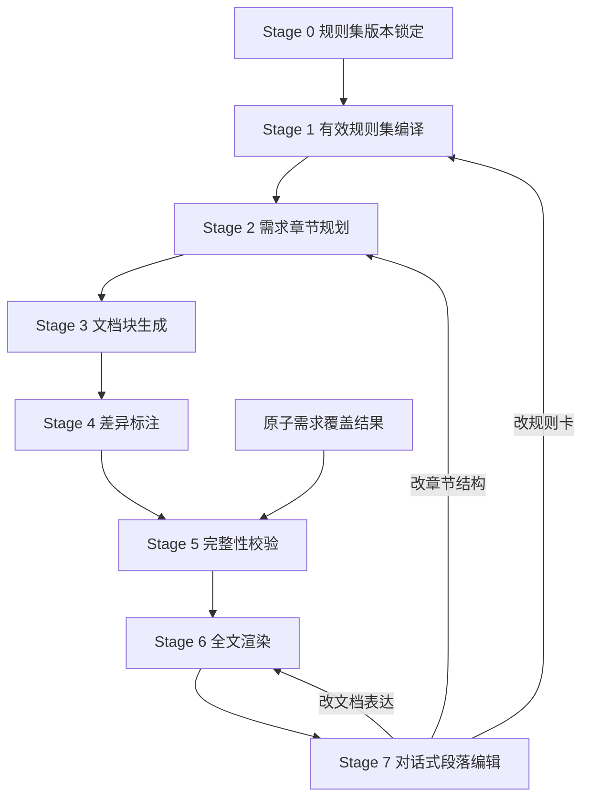

# 需求全文生成与变体差异标注（设计文档）

> 日期：2026-11-24
> 性质：`dev-docs/design/2026-11-24-RuleStudio需求文档.md` 的功能增补（第二个核心能力）。编号延续增补体系：不变量 `I-22` 起、功能需求 `FR-29` 起、架构决策 `AD-15` 起、验收 `AC-24` 起。
> 与上一个增补的关系：`dev-docs/design/2026-11-24-RuleStudio需求覆盖与补齐.md`（需求原子化）是本文的**上游质量门**，本文不得绕过它。
> 来源：用户 2026-11-24 对话中的方向说明；事实按仓库实测校正，见附录。

## 修订记录

| 版本 | 日期 | 变更 |
| --- | --- | --- |
| v1 | 2026-11-24 | 初稿：定位为「结构化规则 → 完整需求文档」生成引擎而非 Markdown 拼接；两种文档能力与五种差异标记；四个现有缺口；Stage 0-6 工作流与产物目录；三个正式产物；三阶段实施优先级 |
| v1.1 | 2026-11-24 | 并入「Document Block + 对话式段落编辑 + 增量重生成」：Stage 3 改为生成文档块、Stage 6 改为渲染、新增 Stage 7 对话式段落编辑与回流规则；新增文档块模型（片段级来源追踪）、四种编辑行为分流（表达 / 规则 / 补充 / 结构）、对话编辑三个必须解决的问题（修改范围、重生成不覆盖人工修改、多对多来源）；数据产物扩充 `editorial-overrides.yaml`、`proposals/`、`history/`；实施改为 P0 预留字段 / P1 变体与追溯 / P2 对话编辑；补三层产品定位与闭环原则（I-29 至 I-34、FR-38 至 FR-43、AD-21 至 AD-26、AC-32 至 AC-37） |

## 一、定位

**不是把 Markdown 卡片拼接起来**，而是建设一个「结构化规则 → 完整需求文档」的**生成引擎**。

要解决三个问题：

1. 把几十到上百张规则卡重新组织成一份完整、连贯、可交付的需求文档。
2. 切换麻将变体时自动生成对应完整需求，并保留基座继承关系。
3. 全文中明确标注：哪些沿用杭州、哪些被修改、哪些是新增，**具体改了什么**。

产品定位一句话：

> MahjongRuleKB 不应该只有一堆结构化规则卡，还应能根据任意一个麻将变体，自动生成一份完整、连贯、带差异溯源的游戏需求文档，成为后续游戏开发的需求入口。

### 产品最终形态：三层 + 一个闭环

| 层 | 内容 |
| --- | --- |
| 底层：结构化规则知识库 | 基础规则、地方变体、配置、来源、依赖 |
| 中层：需求文档生成引擎 | Stage Workflow、Document Block、全文差异、来源追踪 |
| 上层：AI 需求编辑器 | 选择段落、对话修改、补充需求、提案审核、增量重生成 |

闭环：结构化规则 → 自动生成完整需求 → 人工阅读 → 选中段落对话修改 → 生成提案 → 更新规则或文档表达 → 自动重新生成。

核心原则：**AI 可以通过对话修改需求，但不能绕过结构化规则知识库直接修改最终事实。**

因此本文不只是「生成器」设计，还包括 **Document Block 模型（第六节）、四种编辑行为分流（第七节）、对话编辑三个必须解决的问题（第八节）**。其中文档块与来源追踪属于 **P0 必须预留**，对话编辑 UI 属于 **P2 实现**（第十一节）。

## 二、现有基础（已具备大部分条件）

| 项 | 实测 |
| --- | --- |
| 杭州规则卡 | 61 张 |
| 萧山差异卡 | 47 张 |
| 杭州配置项 | 25 项（20 玩法 + 5 界面） |
| 萧山编译后规则 | 86 条（继承 4 / 替换 18 / 新增 25，另 39 条纯继承展开） |

编译器已经支持：杭州基础 + 萧山差异合并、`inherited` / `modified` / `added`、规则 ID 映射与引用重写、未决项与 `release_blocker` 状态传递、基础内容指纹 `content_hash` 与版本锁定校验。

**关键结论：文档生成不需要重新实现规则继承机制，直接复用 Compiler 的 `compileVariant` 结果即可。**不需要改编译器。

## 三、两种文档能力（不要只做一个 Markdown 导出）

### 3.1 完整需求文档生成

| 变体 | 章节组织（沿用策划熟悉的顺序） |
| --- | --- |
| 杭州（基础版本） | 游戏规则概述、基础名词与概念、开局与发牌、行牌规则、三摊承包、算分规则、番型规则、结算流程、UI 交互及表现、不适用规则、待确认事项 |
| 萧山（派生版本） | 杭州基座中仍生效的内容、萧山修改后的完整规则、萧山新增规则、萧山专属配置、待裁决规则 |

两者都是**完整文档**，不是规则卡列表，也不是差异清单。

组织方式沿用 `sources/hangzhou/hangzhou-core-flow.md` 这类策划熟悉的结构（玩法选项 → 名词 → 开局 → 行牌 → 承包 → 算分 → 番型 → 结算 → 不适用 → 待确认）。

### 3.2 全文差异标注

五种标记：

| 标记 | 含义 | 展示 |
| --- | --- | --- |
| 基座沿用 | 萧山资料主动声明沿用杭州规则（`change_type: inherited`） | 蓝色 |
| 变体修改 | 萧山替换杭州原规则（`modified`） | 橙色 |
| 变体新增 | 杭州没有，萧山新增（`added`） | 绿色 |
| 默认继承 | 萧山未点名，按继承约定生效（编译产物里 39 条继承展开中未被 variant 声明的部分） | 灰色 |
| 待裁决 | 尚未确认（`status: unresolved` / `disputed` 或 `release_blocker: true`） | 红色 |

**「明确继承」与「默认继承」必须分开**：前者是萧山资料主动声明沿用，后者是因为没提及而按继承约定处理。两者在策划确认时的心智负担完全不同。

两种阅读模式：

- **完整阅读模式**：只显示最终生效规则，适合交付。
- **差异对照模式**：显示基座、修改、新增、删除与变化摘要，适合审核。

## 四、现有架构的四个缺口

### 缺口 1：规则卡没有文档章节顺序

现有目录按规则类型分类（`guize/`、`shixu/`、`zhuangtai/`、`gongshi/`、`biaoge/`、`jiesuan/`、`jiemian/`），完整需求文档要按实际对局流程组织。轮庄属于开局与下一局流程，摊数属于局内状态，承包属于特殊结算，庄闲倍率属于算分 —— 不能按目录直接拼接。

**需要新增一个文档章节映射层**（独立于规则卡）：

```yaml
sections:
  - id: opening
    title: 开局与发牌
    rules: [HJ-R-DINGZHUANG, HJ-R-LUNZHUANG, HJ-T-FAIPAI]
  - id: gameplay
    title: 行牌规则
    rules: [HJ-R-CHI, HJ-R-PENG, HJ-R-GANG-BUPAI]
  - id: settlement
    title: 结算规则
    rules: [HJ-P-ZIMO-RUZHANG, HJ-P-CHENGBAO-RUZHANG]
```

一张卡可被多个章节引用，但**正文只在主章节完整展开**，其他章节交叉引用，避免重复描述。

### 缺口 2：差异只到卡片级，到不了文字级（最重要的技术问题）

现有 Schema 能回答「哪张卡来自萧山、替换了哪张杭州卡」（`origin`、`change_type`、`base_rule_ref`、`compares_to`），但回答不了**具体哪句话变了**。

实测例子（萧山 `XS-R-ZHUANGJIA-02` 连庄与换庄，`change_type: modified`，`base_rule_ref: HJ-R-LUNZHUANG`）：

- 杭州 `HJ-R-LUNZHUANG`：胡牌者坐庄；流局由原庄连庄；连庄后仍是三牢、8 倍，三牢封顶。
- 萧山 `XS-R-ZHUANGJIA-02`：庄家自摸或流局时原庄继续坐庄；闲家自摸时赢家接庄；牢数 = 上局实际牢数 + 1；牢数无上限，每加一牢庄闲倍率翻倍。

整卡标橙色，读者仍不知道到底改了哪几条。因此需要新增一层：

**规则差异片段（Rule Change Segments）**

```yaml
# 结构示意，段内内容必须由规则卡对照产生并经人工确认，不得直接当成已裁决规则
- change_id: XS-CHANGE-001
  base_rule_ref: HJ-R-LUNZHUANG
  variant_rule_ref: XS-R-ZHUANGJIA-02
  changes:
    - type: replace
      subject: 连庄条件
      before: 胡牌者坐庄，流局原庄连庄
      after: 庄家自摸或流局时原庄继续坐庄
    - type: replace
      subject: 牢数
      before: 固定三牢、8 倍封顶
      after: 连庄前牢数 = 上局实际牢数 + 1，无上限
    - type: add
      subject: 牢数倍率
      after: 每增加一牢，庄闲倍率翻倍
```

**生成方式**：AI 生成语义差异**候选**，人工确认后才成为正式差异记录。不能把未经核验的文本 Diff 直接标成确定的业务变化 —— 措辞不同可能表达同一规则，措辞相近也可能条件已变。

### 缺口 3：配置项的差异来源在编译后丢失

实测（`compiler/compile.ts` 的 `compileVariant`）：

| 层 | 配置项 `XS-C-QIANGGANGHU` |
| --- | --- |
| 源 `variants/xiaoshan/config.yaml` | `origin: variant`、`change_type: modified`、`base_rule_ref: HJ-C-QIANGGANGHU`、`value: disabled` |
| 编译产物 `compiled/xiaoshan/config.yaml` | `origin: base`、无 `change_type`、无 `base_rule_ref`、`value: disabled` |

即：**规则卡的变体元数据在编译后保留**（`compiled/xiaoshan/guize/xs-r-zhuangjia-02.md` 仍有 `compiled_origin: variant`、`change_type`、`base_rule_ref`、`compares_to`），但**配置项的变体元数据被归一化掉了**。

因此文档生成不能只读 `compiled/xiaoshan/config.yaml`，必须同时读：

1. 杭州原始配置 `rulesets/hangzhou/config.yaml`（+ `config.ui.yaml`）
2. 萧山差异配置 `variants/xiaoshan/config.yaml`
3. 编译后的最终配置

三者比对才能判定某参数是继承、修改还是新增。

**这项处理放在文档生成层，不修改已冻结的编译器。**

### 缺口 4：不能把未决规则伪装成完整需求

萧山当前有 3 条 `release_blocker: true` 的未决项（`XS-U-001` 财神归属冲突、`XS-U-002` 飘财第 3 次及以上豪杠飘倍数缺失、`XS-U-003` 十风倍数未单列），另有 2 张卡（`XS-K-FANXING`、`XS-K-LIANGANG`）与 1 条配置（`XS-C-CAISHEN`）标了 `release_blocker`。

文档生成必须保留这些状态：可以生成完整草稿，但不能因生成成功就把萧山标成「规则完整、可发布」。

## 五、Stage 执行架构（0-7）

「Stage 流程」= **分阶段执行、保留中间产物**，而不是一次性让 Agent 读全部卡片生成全文。原六阶段保留，但 **Stage 3 改为生成文档块、Stage 6 改为渲染**，并新增 **Stage 7 对话式段落编辑**。



| Stage | 输入 | 动作 | 产物 |
| --- | --- | --- | --- |
| 0 | 规则集、基座版本、变体版本、生成任务 ID | 锁定版本与范围，记录输入 Hash | `input-manifest.json` |
| 1 | 规则集 | 调既有 Compiler 得最终有效规则集；合并配置；取未决项与阻塞状态；建规则来源索引 | `effective-ruleset.json` |
| 2 | 模板 + 有效规则集 | 建游戏流程章节；把卡与配置分配到章节；检查未分配项 | `document-outline.yaml` |
| 3 | 章节规划 | **生成 Document Block（不是直接生成 Markdown）**：每段建立稳定 ID 与片段级来源 | `document.json`（块） |
| 4 | 文档块 + 有效规则集 | 五种标记判定；段落级差异；变化摘要 | `provenance.json`、`changes.json` |
| 5 | 上游全部产物 + 需求覆盖结果 | 规则覆盖、需求覆盖、来源追踪、差异正确性、未决项检查 | `validation-report.md` |
| 6 | 文档块 + 标注 | 渲染 Markdown（同一份块数据可渲染「纯净全文」与「差异对照」两种视图） | `需求全文.md` |
| 7 | 选中段落 + 对话 | 意图识别 → 分流四种编辑行为 → 生成提案 → Diff → 人工确认 → 应用 → 触发回流 | `proposals/DOC-P-*.json` |

### Stage 7 的回流机制

| 改动类型 | 回流起点 | 说明 |
| --- | --- | --- |
| 改规则卡 / 配置 | Stage 1 | 重新编译 → 重新规划 → 重新生成块；受影响的块标「需复核」 |
| 改文档表达 | Stage 6 | 只更新文档编辑层并重渲染相关章节；不重跑上游 |
| 改章节结构 | Stage 2 | 重跑 Stage 2 及下游 |

**不是每次编辑都重跑全部 Stage。**必须按 Stage 依赖图做增量执行（见 AD-26）。

### 产物目录（工作流产物，不进正式知识库结构）

```text
documents/<variant>/
  document.json            # 文档块、章节、段落结构（Stage 3 产物）
  需求全文.md               # 渲染结果（Stage 6）
  provenance.json          # 每段/每片段的来源与规则关联（Stage 4）
  changes.json             # 变体相对基座的段落级差异（Stage 4）
  editorial-overrides.yaml # 纯文档表达层的人工修改（Stage 7 产物）
  proposals/               # 对话产生的修改提案
    DOC-P-001.json
  history/                 # 生成与修改历史
    v1/ v2/
  workflow/                # 各 Stage 中间产物（input-manifest、effective-ruleset、outline、sections）
```

## 六、Document Block（文档块模型）

这是整个能力能否长期稳定运行的关键。**不要先生成一大段 Markdown 再回头识别段落，而是先生成结构化文档块，再渲染为 Markdown。**

```json
{
  "block_id": "DOC-XS-OPENING-003",
  "section_id": "opening",
  "type": "paragraph",
  "document_version": 3,
  "editable": true,
  "content": [
    {
      "text": "庄家自摸或流局时，原庄继续坐庄。",
      "provenance": {
        "origin": "variant",
        "change_type": "modified",
        "rule_id": "XS-R-ZHUANGJIA-02",
        "base_rule_ref": "HJ-R-LUNZHUANG"
      }
    },
    {
      "text": "闲家自摸时，由赢家接庄。",
      "provenance": {
        "origin": "variant",
        "change_type": "added",
        "rule_id": "XS-R-ZHUANGJIA-02"
      }
    }
  ]
}
```

### 字段要求

| 字段 | 作用 | 要求 |
| --- | --- | --- |
| `block_id` | 段落的稳定身份 | **不能用文字 Hash**，否则改一个字 ID 就变、人工修改记录随之失效 |
| `section_id` | 所属需求章节 | 与章节映射层一致 |
| `type` | 块类型 | paragraph / table / formula / list / callout 等 |
| `content` | **片段数组** | 一段可能同时含基座内容与变体修改内容 |
| `provenance` | 每个片段的来源 | 规则卡 ID、基座卡 ID、变体关系、原文出处 |
| `source_refs` | 段落级来源集合 | 一个段落可能依赖多张卡与多个配置项（多对多） |
| `editable` | 是否允许对话修改 | 数值与公式块默认不可自由改写（见 AD-19/I-30） |
| `document_version` | 该块所属文档版本 | 支撑「重生成不覆盖人工修改」 |

### 为什么 `content` 必须是数组

一个段落常常是「杭州原有条件 + 萧山新增条件 + 萧山修改结果」的复合体。整段单来源就无法做到精准文字级差异标注，也无法回答「这一句是基座还是萧山改的」。

有了片段级来源，才可能做到：

- 点段落 → 引用整段
- 选段落中的一句话 → 只改这句
- 点萧山差异 → 跳到对应萧山卡
- 点基座继承内容 → 跳到杭州原卡

### 多对多（不能设计成一个段落一张卡）

```text
一个段落
  ├── 规则卡 A
  ├── 规则卡 B
  └── 配置项 C
```

实测已有这种情况：`XS-R-ZHUANGJIA-02` 依赖 `XS-R-ZHUANGJIA-03` 与 `XS-N-LAOSHU`，段落叙述「连庄牢数递增 + 倍率翻倍」时至少涉及两张卡。修改时必须识别全部相关来源，避免只改一张卡漏掉关联规则。

## 七、四种编辑行为（不能都直接写回 Markdown）

| 编辑类型 | 用户举例 | 最终修改位置 |
| --- | --- | --- |
| 表达调整 | 「这段话改得更容易理解」 | 文档表达层（`editorial-overrides.yaml`） |
| 规则修改 | 「庄家连庄条件改成另一种」 | 规则卡 / 配置（走既有提案） |
| 内容补充 | 「增加一个具体结算案例」 | 视语义：解释性 → 文档表达层；新规则条件 → 规则卡 |
| 结构调整 | 「把这段内容移动到结算章节」 | 文档章节映射层（Stage 2） |

### A. 只改文字表达

增加解释、改写措辞，**不新增任何规则条件** → 存文档表达层：

```yaml
# documents/<variant>/editorial-overrides.yaml
- block_id: DOC-HZ-GAMEPLAY-012
  mode: append            # append | replace-text | hide
  text: 直杠、补杠、暗杠的区别在于……
  author: 策划A
  at: 2026-11-24T10:00:00Z
  based_on_document_version: 3
```

它保存的是**文档表达修改，不是规则事实**。渲染时叠加在生成内容之上，不进规则库。

### B. 改规则本身

不是文字问题，规则变了 → 复用既有链路，**不另造写入系统**：

1. 定位对应规则卡
2. 生成规则卡修改提案
3. 展示原规则与新规则 Diff
4. 跑 Schema、引用、编译验证（门禁 G1-G4）
5. 人工确认后应用（事务）

### C. 补充新规则内容

必须先判三件事：

| 判断 | 处理 |
| --- | --- |
| 只是解释已有规则 | 写入文档表达层 |
| 需要新增规则条件 | 生成规则卡修改提案，`status` 按证据确定 |
| 原始资料没有依据 | 标记为推导或 `unresolved`，**不能写成 `confirmed`** |

否则 AI 很容易把自己补的解释当成正式玩法规则（I-31）。

### D. 调整文档结构

只改章节映射层，不碰规则卡；重跑 Stage 2 及下游。

## 八、对话编辑必须解决的三个问题

### 8.1 修改范围（杭州基座 or 萧山 or 仅文档）

打开萧山全文时，用户选中一段**杭州基座继承**的文字说「我想把这里改掉」—— 不能擅自动杭州基座规则。

| 修改范围 | 实际操作 |
| --- | --- |
| 仅萧山 | 为萧山新建 / 修改 `modified` 卡（`base_rule_ref` 指向杭州卡） |
| 所有继承杭州的变体 | 修改杭州基座 = 底座变更：必须升版本、重算 `content_hash`、做下游影响分析（变种锁定状态） |
| 仅文档说明 | 改萧山文档表达层 |

三种意图导致完全不同的结果，**用户没说明时必须先确认**（与既有「未决项不准 AI 自行补全」一致）。

### 8.2 重生成不能覆盖人工修改

今天通过对话改了 3.2 章节，明天改了另一张卡重新生成全文 —— 系统必须知道每段的状态：

| 段落状态 | 含义 | 重生成时的行为 |
| --- | --- | --- |
| 自动生成 | 无人工改动 | 按新规则重新生成 |
| 人工表达修改 | 只改文字（`editorial-overrides`） | 保留人工文字；若上游规则变化，标「需复核」 |
| 人工补充说明 | 追加解释 | 保留；来源仍指向原卡 |
| 因上游变化失效 | 引用的卡被改/被删 | 标「失效待处理」，不静默丢弃 |

必须有**文档版本、生成记录、修改记录**（`document_version`、`history/`）。这是 P0 就要预留 `document_version` 的原因。

### 8.3 段落与规则卡是多对多

见第六节。修改段落时 AI 必须列全 `source_refs` 供用户确认改哪几个来源，禁止默认只改第一个。

## 九、产品形态

```text
需求文档
├── 变体选择：杭州麻将 | 萧山麻将
├── 差异标注：纯净全文 | 差异对照
├── 正文：按对局流程分章的完整需求
│     每段带标记（基座沿用 / 变体修改 / 变体新增 / 默认继承 / 待裁决）
│     段尾显示来源：XS-R-ZHUANGJIA-02 / 杭州基座：HJ-R-LUNZHUANG
└── 选中段落 → 「引用到对话」
      ├── 对话框显示：已引用段落 3.2 轮庄规则
      ├── 用户：帮我补充庄家连庄的具体计算示例，说明上局三牢时下一局怎么算
      └── AI 修改提案（区分「仅补充说明文字」与「改变原规则」）
            ├── 查看 Diff
            └── 接受 → 走对应通道（表达层 / 规则提案）
```

界面重点不是好看，而是：

1. 选杭州看到杭州完整需求，选萧山看到萧山完整需求
2. 打开差异标注能看清每段来源
3. 点某段能追溯到规则卡
4. 发现问题**回到规则卡或补齐任务修改，不直接改生成文档**
5. 对话修改必须**先声明它属于四种编辑行为中的哪一种**，再走对应通道

### 三层产品定位

| 层 | 内容 |
| --- | --- |
| 底层：结构化规则知识库 | 基础规则、地方变体、配置、来源、依赖 |
| 中层：需求文档生成引擎 | Stage Workflow、Document Block、全文差异、来源追踪 |
| 上层：AI 需求编辑器 | 选择段落、对话修改、补充需求、提案审核、增量重生成 |

### 闭环原则

**AI 可以通过对话修改需求，但不能绕过结构化规则知识库直接修改最终事实。**

闭环：结构化规则 → 自动生成完整需求 → 人工阅读 → 选中段落对话修改 → 生成提案 → 更新规则或文档表达 → 自动重新生成。

## 十、两个必须提前解决的范围问题

### 10.1 格式模板 ≠ 知识库现有范围

策划提供的《杭州麻将核心流程（核心策划补齐版）》包含 2/3/4 人、40/50/60 片、多个创房配置选项。而本仓库实测范围：

- `rulesets/hangzhou/manifest.yaml` 的 `scope` 是 `{player_count: 4, room_type: friends}`
- 规则卡 front matter 的 `scope` 值是 `four_player_friend_room`
- 原始来源 `sources/hangzhou/hangzhou-core-flow.md` 明确以四人好友房为本期范围

**结论：那份文档只作格式模板，不得把其中规则当作知识库已具备的事实。**要生成覆盖全部人数与玩法的杭州全文，必须先把这些范围纳入正式规则集。

### 10.2 需求覆盖与补齐必须是本文的上游质量门

若规则卡漏了一条原文要求，文档生成器只读规则卡，最终全文会「很完整但依然遗漏」。

因此本文的验收必须挂在需求覆盖与补齐之上：原文要求全部被识别、每个有效需求有卡或配置映射、明确排除有记录、原文缺失与冲突有标记。**不要求所有规则已裁决，但不能有不明不白的遗漏。**

## 十一、实施优先级（P0 预留字段，P2 才实现 UI）

不同时开发文档生成、聊天编辑、复杂文档编辑器 —— 那样第一阶段范围会瞬间膨胀。

| 阶段 | 开发内容 | 验收目标 |
| --- | --- | --- |
| P0 | 文档块模型、来源追踪、Stage 0-6 生成 | 能生成完整杭州需求全文 |
| P1 | 萧山差异标注、Document Block 片段级追溯 | 能切换变体，精准追踪来源 |
| P2 | 对话式段落编辑、Proposal、增量重生成 | 选中段落即可通过对话修改 |

**P0 必须预留以下字段，不能等 P2 回头改架构**：`block_id`、`section_id`、`source_refs`、`provenance`、`editable`、`document_version`。

不做：完整文档编辑器（在线所见即所得）；修改 Compiler 以保留配置差异元数据；让 AI 直接改 `需求全文.md`。

## 十二、数据产物

| 文件 | 作用 | 谁写 |
| --- | --- | --- |
| `document.json` | 文档块、章节与段落结构 | Stage 3 |
| `需求全文.md` | 最终完整需求（渲染结果） | Stage 6 |
| `provenance.json` | 每段文字的来源与规则关联 | Stage 4 |
| `changes.json` | 杭州与萧山的段落级差异 | Stage 4 |
| `editorial-overrides.yaml` | 纯文档表达层的人工修改 | Stage 7 |
| `proposals/` | 对话产生的修改提案 | Stage 7 |
| `history/` | 文档生成与修改历史（含 `document_version`） | 全程 |

这些数据不必在 P0 全部落地，**但数据模型必须提前定型**（见第十一节 P0 预留字段）。

**`需求全文.md` 是产出物，不是事实源**：发现问题回规则卡 / 配置 / 补齐任务修改后重渲染，不在渲染结果上手改（I-24）。

## 十三、硬约束

| # | 约束 |
| --- | --- |
| I-22 | 文档生成只读不写：不修改规则卡、配置、`compiled/`，不修改 Compiler；生成产物存工作流目录 |
| I-23 | 派生变体的全文必须带五种标记之一，不允许出现「来源不明」的段落；每条标记必须有 `provenance.json` 证据 |
| I-24 | 需求全文是产出物，**不是事实源**。发现错误只能回到规则卡 / 配置 / 补齐任务修改后重新生成 |
| I-25 | 差异片段必须经人工确认才可用于交付文档；AI 生成的段落级差异属于**候选**，不得直接标成确定变化 |
| I-26 | 未决项与 `release_blocker` 必须原样进入文档（红色标记）；文档生成成功不得改变规则集的 `releasable` 状态 |
| I-27 | 配置项的继承/修改/新增判定必须三方比对（基座源、变体源、编译产物），不得只读编译产物 |
| I-28 | 本文的完整性验收必须引用需求覆盖与补齐的结果；覆盖未完成的变体不得宣称「全文完整」 |
| I-29 | 对话修改必须归类为四种编辑行为之一（表达 / 规则 / 补充 / 结构）后才执行；未归类前不得写入任何位置 |
| I-30 | 数值、倍数、公式块由模板渲染且默认不可自由改写；对话只能增删说明文字，不能改数字（与 AD-19 配套） |
| I-31 | 对话补充的内容若无原文依据，不得写成 `confirmed`：只能进文档表达层或 `unresolved`，必须与正式规则区分 |
| I-32 | 重生成不得静默覆盖人工修改：段落状态必须可枚举（自动生成 / 人工表达修改 / 人工补充说明 / 上游变化失效），失效项必须显式待处理 |
| I-33 | `block_id` 必须与文字内容解耦（不得用文字 Hash），否则人工修改记录会随文字改动失效 |
| I-34 | 改规则卡的对话修改必须走既有提案 + 门禁 + 事务（不得新建写入路径）；改表达只能写 `editorial-overrides.yaml` |

## 十四、功能需求

| # | 需求 |
| --- | --- |
| FR-29 | 能为指定规则集生成完整需求文档，按对局流程分章，覆盖全部规则卡与配置项（无未分配项） |
| FR-30 | 章节映射层独立于规则卡：一张卡可被多章节引用，正文只在主章节展开，其余交叉引用 |
| FR-31 | 派生变体全文支持五种标记与两种阅读模式（纯净全文 / 差异对照） |
| FR-32 | 支持段落级差异记录（`changes.json`）：`type`（replace / add / remove）、`subject`、`before`、`after`、证据与确认状态 |
| FR-33 | 每段可追溯到来源（`provenance.json`）：规则卡 ID、基座卡 ID、变体关系、原文出处 |
| FR-34 | 未决项与 `release_blocker` 在正文对应位置显示为「待裁决」，并汇总到文档末尾的待确认清单 |
| FR-35 | Stage 产物逐阶段落盘；支持从指定 Stage 增量重跑，复用上游产物 |
| FR-36 | 生成前后做一致性检查：卡是否全部进入、配置是否全部表达、规则是否矛盾、标记是否都有证据、未决项是否保留 |
| FR-37 | 输出输入 Hash 与版本，使同一输入可复现同一文档 |
| FR-38 | Stage 3 输出结构化 Document Block（不是直接输出 Markdown），每块有稳定 `block_id`、`section_id`、`source_refs`、`provenance`、`editable`、`document_version` |
| FR-39 | 文档块支持片段级来源：一段内可混合基座与变体来源，可定位到句子 |
| FR-40 | 支持选中段落或句子后发起对话修改；工具回传块 ID、章节、来源卡，供渲染层画引用卡 |
| FR-41 | 对话修改先做意图分流：表达调整 / 规则修改 / 内容补充 / 结构调整；分流结果与目标位置在提案里显式可见 |
| FR-42 | 表达类修改存 `editorial-overrides.yaml` 并参与渲染；规则类修改走现有提案与门禁，不新建写入路径 |
| FR-43 | 重生成时按段落状态处理：自动生成 / 人工表达修改 / 人工补充说明 / 上游变化失效；失效项显式待处理，不静默丢弃 |

## 十五、架构决策

| # | 决策 | 理由 |
| --- | --- | --- |
| AD-15 | 章节映射层独立成文件（不进规则卡 front matter） | 一张卡可属多章节，映射会随文档结构调整；写进卡里会让卡承载展示逻辑 |
| AD-16 | 差异片段独立存为 `changes.json`，不改规则卡 Schema | Schema 已冻结；段落级差异是展示层数据，且需人工确认状态 |
| AD-17 | 配置差异在生成层三方比对解决，不改编译器 | 编译器产物已用于下游消费，改它会牵动 `compiled/` 与既有测试；生成层多读两个文件成本更低 |
| AD-18 | Stage 产物落工作流目录（不进 `compiled/`） | 中间产物会反复重生成，不适合放进随发布分发的产物目录 |
| AD-19 | 公式、倍数、配置值用确定性模板渲染，AI 只组织自然语言 | 数值由模板保证，避免模型改写数字；这是本项目最重要的一条生成纪律 |
| AD-20 | 增量重跑以 Stage 为单位，按受影响下游失效 | 变体规则长期演进，全量重生成成本不可接受 |
| AD-21 | 先生成 Document Block，再由块渲染 Markdown | 反过来做需从文本反推段落结构，段落身份不稳定，无法支撑人工修改与追溯 |
| AD-22 | `block_id` 用稳定编号（章节 + 序号），与文字内容解耦 | 文字会频繁改；用内容 Hash 做 ID 会让人工修改追踪失效 |
| AD-23 | 文档表达修改存独立层 `editorial-overrides.yaml`，不进规则库 | 表达不等于事实；混在一起会让规则卡变成文案仓库 |
| AD-24 | 对话修改不新增写入通道：规则走既有提案/门禁/事务，表达走 override 层，结构走章节映射 | 两套写入路径必然分叉，且会绕过人工确认与审计 |
| AD-25 | 文档产物与规则库同级存放（`documents/<variant>/`），不放进 `compiled/` | 文档有独立生命周期（版本、历史、人工修改）；`compiled/` 是编译产物目录，可随时重建 |
| AD-26 | Stage 回流按依赖图最小重跑（规则→1、结构→2、表达→6） | 只改一句话就全量重生，会让长文档的每次校对都变成分钟级等待 |

## 十六、验收标准

| # | 标准 |
| --- | --- |
| AC-24 | 杭州全文生成成功：61 张卡与 25 项配置全部出现在文档中，无未分配项（由 FR-36 检查报告证明） |
| AC-25 | 萧山全文生成成功：86 条有效规则全部出现，且每条带五种标记之一 |
| AC-26 | 差异抽查：随机抽 10 条 `modified` 卡，`changes.json` 的段落级差异与人工核对一致（含 `XS-R-ZHUANGJIA-02` 牢数变化这类多要点卡） |
| AC-27 | 每段都能从 `provenance.json` 追溯到规则卡；抽查 10 段全部命中 |
| AC-28 | 未决项：3 条 `release_blocker` 未决项与 2 张阻塞卡在全文中有红色标记，且 `manifest.releasable` 仍为 false |
| AC-29 | 配置判定：抽查 5 项萧山配置（含 `XS-C-QIANGGANGHU`），继承/修改/新增判定与三方比对结果一致 |
| AC-30 | 增量重跑：只改萧山连庄规则后重跑，未受影响的章节产物字节级不变 |
| AC-31 | 数值一致性：全文中的倍数与配置值全部来自模板渲染，`grep` 抽查与 `compiled/` 一致，无模型改写的数值 |
| AC-32 | 文档块完整性：`document.json` 中每块都有 `block_id` / `section_id` / `source_refs` / `provenance` / `editable` / `document_version`，缺任一字段即失败 |
| AC-33 | 片段级追溯：在萧山全文随机抽 10 个「含变体内容」的段落，可指出段内哪几句来自哪张卡（含 `XS-R-ZHUANGJIA-02` 这类基座+变体混合段） |
| AC-34 | 表达修改保留：对某个块做表达层修改后重跑 Stage 1-6，人工文字仍在；若其上游卡同时被改，该块被标「需复核」而非静默覆盖 |
| AC-35 | 规则修改不走旁门：对话要求「改规则」时，产生的是规则卡提案（过门禁），不产生 `editorial-overrides.yaml` 条目，也不产生对 `需求全文.md` 的修改 |
| AC-36 | 未归类不执行：对话请求无法归为四种编辑行为时，返回确认询问而不写任何文件 |
| AC-37 | 增量范围：只改文档表达时，Stage 1-5 产物字节级不变；只改章节结构时，Stage 1 产物字节级不变 |

## 十七、类比理解

- **规则卡**像零件清单：螺丝、齿轮、电机各归各类，工程能查、能改。
- **需求全文生成**像把零件装成整机说明书：读者不看零件编号，只看「先装底座，再上电机」。
- **章节映射层**就是说明书的装配顺序表 —— 零件清单按类型排，说明书必须按装配顺序排。
- **差异片段**像两个版本的说明书对照：只标「这一章改过」（卡级）没用，要说清「这章第二段的条件从三牢封顶改成无上限递增」。
- **I-24（全文不是事实源）**像印刷品与源文件的关系：发现说明书印错，改源文件重印，不要在印刷品上手写涂改。
- **Document Block** 像说明书的活页：每页有固定页码，改内容不会换页；若用文字内容当页码，改一个字页码就变，之前贴的便签全掉了。
- **四种编辑行为分流**像医院的四个窗口：改指词去文案窗、改剂量去医生开方、加检查项目要开单、调章节顺序去找排版 —— 全挤在一个窗口就会直接把处方抄成说明书。

## 十八、参考引用

- 主需求文档：`dev-docs/design/2026-11-24-RuleStudio需求文档.md`
- 上游质量门：`dev-docs/design/2026-11-24-RuleStudio需求覆盖与补齐.md`
- 规则命名规范与术语拼音表：`dev-docs/design/2026-11-24-规则命名规范与术语拼音表.md`
- 编译器：`compiler/compile.ts`（`compileVariant`、配置合并、阻塞传递）
- 实测差异样本：`rulesets/hangzhou/guize/hj-r-lunzhuang.md`、`variants/xiaoshan/guize/xs-r-zhuangjia-02.md`
- 编译产物：`compiled/xiaoshan/`
- 术语：`AGENTS.md`
- Mermaid 流程图语法：<https://mermaid.js.org/syntax/flowchart.html>

## 附录：与对话原文的实测校正

| 原文表述 | 实测 | 处理 |
| --- | --- | --- |
| 「杭州基座 `manifest.yaml` 锁定的是 `four_player_friend_room`」 | `rulesets/hangzhou/manifest.yaml` 的 `scope` 是 `{player_count: 4, room_type: friends}`；`four_player_friend_room` 是规则卡 front matter 里 `scope` 字段的值 | 10.1 按实测分两层写 |
| 「配置项在 `modified` 和 `inherited` 合并时，部分变体元数据会被转换成最终配置值」 | 更明确：编译后配置项 `origin` 归一为 `base`，`change_type` 与 `base_rule_ref` **完全丢失**；而规则卡的这些字段在编译产物中**保留** | 缺口 3 用实测对照表写 |
| 「萧山仍有三个发布阻塞项」 | `manifest.blockers` 为 3 条（`XS-U-001/002/003`）；另有 2 张卡（`XS-K-FANXING`、`XS-K-LIANGANG`）与 1 条配置（`XS-C-CAISHEN`）也标了 `release_blocker: true` | 缺口 4 按实测补全；AC-28 覆盖两类 |
| 举例「萧山牢数递增一牢、倍率翻倍」 | `XS-R-ZHUANGJIA-02` 正文实测：牢数 = 上局实际牢数 + 1（含上局掷骰加的那牢），无上限，每加一牢庄闲倍率翻倍 | 举例按实测保留；`changes.json` 标注为结构示意，非已裁决规则 |
| 「86 萧山编译后规则」 | 编译输出 86 条（继承 4 / 替换 18 / 新增 25；其余为基座规则继承展开） | 一致 |
| 「61 / 47 / 25」 | 61 张杭州卡、47 张萧山卡、25 项杭州配置（20 玩法 + 5 界面） | 一致 |
| 举例「原文：玩家满足对应条件后可以执行杠牌」| 仓库对应卡为 `HJ-R-GANG-BUPAI`（杠牌通用逻辑与补牌），正文并非该句。该句属于对话中的示意，不是仓库原文 | 第七节 A 段的例子标注为示意，不当作真实卡内容 |
| `block_id` 示例 `DOC-XS-OPENING-003`、提案号 `DOC-P-001` | 仓库尚无文档块产物，属结构示意 | 第六节与数据产物章节均标注为结构示意 |
| 「一个段落可能依赖三张规则卡」 | 实测存在多卡依赖：`XS-R-ZHUANGJIA-02` 的 `depends_on` 为 `XS-R-ZHUANGJIA-03`、`XS-N-LAOSHU` | 第六节多对多引用该实测 |
