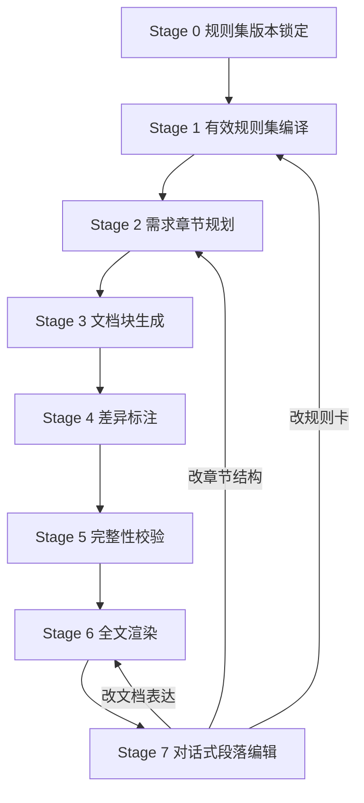

# 需求全文生成与变体差异标注（设计文档）

> 日期：2026-11-24
> 性质：`dev-docs/design/2026-11-24-RuleStudio需求文档.md` 的功能增补（第二个核心能力）。编号延续增补体系：不变量 `I-22` 起、功能需求 `FR-29` 起、架构决策 `AD-15` 起、验收 `AC-24` 起。
> 与上一个增补的关系：`dev-docs/design/2026-11-24-RuleStudio需求覆盖与补齐.md`（原子需求提取与覆盖）是**独立并行的另一条工作流**，不是本文的上游质量门；两条线只在 `requirement_refs` 上可选关联（见「一之二」）。
> 来源：用户 2026-11-24 对话中的方向说明；事实按仓库实测校正，见附录。

## 修订记录

| 版本 | 日期 | 变更 |
| --- | --- | --- |
| v1 | 2026-11-24 | 初稿：定位为「结构化规则 → 完整需求文档」生成引擎而非 Markdown 拼接；两种文档能力与五种差异标记；四个现有缺口；Stage 0-6 工作流与产物目录；三个正式产物；三阶段实施优先级 |
| v1.1 | 2026-11-24 | 并入「Document Block + 对话式段落编辑 + 增量重生成」：Stage 3 改为生成文档块、Stage 6 改为渲染、新增 Stage 7 对话式段落编辑与回流规则；新增文档块模型（片段级来源追踪）、四种编辑行为分流（表达 / 规则 / 补充 / 结构）、对话编辑三个必须解决的问题（修改范围、重生成不覆盖人工修改、多对多来源）；数据产物扩充 `editorial-overrides.yaml`、`proposals/`、`history/`；实施改为 P0 预留字段 / P1 变体与追溯 / P2 对话编辑；补三层产品定位与闭环原则（I-29 至 I-34、FR-38 至 FR-43、AD-21 至 AD-26、AC-32 至 AC-37） |
| v1.2 | 2026-11-24 | 按 `dev-docs/design/2026-11-24-需求全文生成与变体差异标注评审意见.md` 修订六项 P0：① 杭州与萧山共用同一套章节模板（`section_id` 跨变体一致，差异只作正文标记）② 实施阶段拆为 P0-A / P0-B / P1 / P2，与上游需求覆盖节奏对齐，AC-24 增设原子需求表达检查 ③ 差异标记拆成三维（lineage / decision_status / diff_status），移除「删除」标记（`changeTypes` 实测只有 inherited/modified/added）④ Document Block 引用拆四类并接入原子需求 ⑤ `block_id` 与章节解耦、增 `segment_id` 与 `logical_block_id`、`editable` 下沉到片段级 ⑥ 三个修改通道统一走提案与 `based_on_document_version` 版本校验；另补可复现性字段与「算例数值必须来自 `calculators/`」。编号扩至 FR-50、I-41、AD-33、AC-45 |
| v1.3 | 2026-11-24 | 按 `dev-docs/design/2026-11-24-需求全文生成边界收敛评审意见.md` **冻结与原子需求覆盖线的边界**：本文档线只负责「结构化规则 → 完整需求文档」，不以原子需求提取为前置。撤销 P0-A 的 2.3.3 需求登记表与 Stage 0 的需求表 Hash；`requirement_refs` 降为**可选预留字段**（I-39 改写、FR-46 改写、AC-40 改为规则/配置追溯）；Stage 5 改为规则卡与配置覆盖验证；AC-24 去掉「原子需求表达」检查；P0-A/P0-B 验收只要求规则卡与配置项落点。**其余 v1.3 清单项仍待执行**，本版本只应用本条边界 |
| v1.4 | 2026-11-24 | 清除边界收敛后残留的旧依赖表述：头部「上游质量门」定性改为并行独立线；10.2 改写为「本线不承担原始需求覆盖，由另一条线兜底」；**I-28 改写以消除与 I-42 的直接冲突**；第十一节标题与拆分理由去掉「与上游节奏对齐」；参考引用同步 |
| v1.5 | 2026-11-24 | D0 设计契约收敛：应用 v1.3 修订清单的剩余有效条目（A/B/C/D/G，C-4 永久移出本线）；修正旧 `remove`、`source_refs` / `provenance`、章节序号 `block_id`、Stage 4 五种标记、Document Block 片段引用、发布阻塞引用、ID 生命周期、五文件主从、文档提案契约与六态验收残留。原子需求覆盖保持独立，不作为本线前置或验收门禁 |
| v1.6 | 2026-11-24 | D0-Final：Proposal/Transaction 统一 `.rule-studio`；documents 六文件角色与主体权限矩阵；顶层 document_version 事实源与 Transaction 原子递增；requirement_refs 保持可选 |
| v1.7 | 2026-11-24 | D0-Final2：AC-52 让位为 AC-55（AC-52 永久空缺）；版本契约统一到 `baseRevision.documentVersion` + `baseRevision.files[]`，删除 `based_on_document_version`；I-51 改为引用主需求唯一权威并只保留文件级补充；目录补 `changes.json`（P1）与 `history/` 归属；Proposal 路径统一为 `<kb>/.rule-studio/proposals/`；明确 Stage 生成复用 Transaction Executor 但不经 Proposal 状态机 |

## 一、定位

**不是把 Markdown 卡片拼接起来**，而是建设一个「结构化规则 → 完整需求文档」的**生成引擎**。

要解决三个问题：

1. 把几十到上百张规则卡重新组织成一份完整、连贯、可交付的需求文档。
2. 切换麻将变体时自动生成对应完整需求，并保留基座继承关系。
3. 全文中明确标注：哪些沿用杭州、哪些被修改、哪些是新增，**具体改了什么**。

产品定位一句话：

> MahjongRuleKB 不应该只有一堆结构化规则卡，还应能根据任意一个麻将变体，自动生成一份完整、连贯、带差异溯源的游戏需求文档，成为后续游戏开发的需求入口。

### 产品最终形态：三层 + 一个闭环

| 层 | 内容 |
| --- | --- |
| 底层：结构化规则知识库 | 基础规则、地方变体、配置、来源、依赖 |
| 中层：需求文档生成引擎 | Stage Workflow、Document Block、全文差异、来源追踪 |
| 上层：AI 需求编辑器 | 选择段落、对话修改、补充需求、提案审核、增量重生成 |

闭环：结构化规则 → 自动生成完整需求 → 人工阅读 → 选中段落对话修改 → 生成提案 → 更新规则或文档表达 → 自动重新生成。

核心原则：**AI 可以通过对话修改需求，但不能绕过结构化规则知识库直接修改最终事实。**

因此本文不只是「生成器」设计，还包括 **Document Block 模型（第六节）、四种编辑行为分流（第七节）、对话编辑三个必须解决的问题（第八节）**。其中文档块与来源追踪属于 **P0 必须预留**，对话编辑 UI 属于 **P2 实现**（第十一节）。

## 一之二、与「原子需求覆盖」线的边界（v1.3 冻结）

本项目有两条从同一份原始资料出发、但产物与验证目标不同的工作流：

| 维度 | 本文档线：需求全文生成 | 另一条线：原子需求覆盖 |
| --- | --- | --- |
| 输入 | 已结构化规则、配置、未决项（`rulebook/specs/`） | 原始资料（`rulebook/sources/`） |
| 任务 | 按对局流程组织完整需求文档 | 独立提取原子需求并做六态覆盖判定 |
| 核心资产 | Document Template、Document Block、章节映射 | Requirement Registry |
| 验证目标 | 规则卡与配置项是否完整落入文档 | 原文需求是否被识别与覆盖 |
| 输出 | 完整需求文档 | 需求覆盖报告、缺口补齐清单 |
| 依赖关系 | **不依赖原子需求提取** | 需要规则结构化结果参与映射 |

规则：

1. 本文档线**不得**把原子需求提取作为前置或阻塞条件（I-42）。
2. 原子需求必须由 B 线直接读 `rulebook/sources/` 提取，不得从规则卡反推（对方文档 I-21 / AD-14 已定）。
3. Document Block **预留** `requirement_refs` 字段，供未来接入 B 线；P0-A / P0-B **不要求生成、不要求验证**它。
4. 「完整需求文档」指的是：当前 Rule KB 中已结构化的规则与配置完整转化为文档；它**不等于**「原始需求已被完整覆盖」。

## 二、现有基础（已具备大部分条件）

| 项 | 实测 |
| --- | --- |
| 杭州规则卡 | 61 张 |
| 萧山差异卡 | 47 张 |
| 杭州配置项 | 25 项（20 玩法 + 5 界面） |
| 萧山编译后规则 | 86 条（继承 4 / 替换 18 / 新增 25，另 39 条纯继承展开） |

编译器已经支持：杭州基础 + 萧山差异合并、`inherited` / `modified` / `added`、规则 ID 映射与引用重写、未决项与 `release_blocker` 状态传递、基础内容指纹 `content_hash` 与版本锁定校验。

**关键结论：文档生成不需要重新实现规则继承机制，直接复用 Compiler 的 `compileVariant` 结果即可。**不需要改编译器。

## 三、两种文档能力（不要只做一个 Markdown 导出）

### 3.1 完整需求文档生成：所有变体共用同一套章节模板

**这是全文变体切换成立的前提**：杭州与萧山必须共用同一个 Document Template，章节顺序与 `section_id` 完全一致，切换变体只改正文内容与标记，**不按规则来源重新组织章节**。

| 章节（`section_id`） | 杭州（基础版本） | 萧山（派生版本） |
| --- | --- | --- |
| 1 游戏规则概述（`overview`） | 杭州基础规则 | 基座沿用 |
| 2 基础名词与概念（`terms`） | 杭州名词表 | 基座沿用 / 默认继承 |
| 3 开局与发牌（`opening`） | 杭州开局流程 | 默认继承 + 局部修改 |
| 4 行牌规则（`gameplay`） | 杭州行牌 | 默认继承 + 萧山新增 |
| 5 三摊承包（`contract`） | 杭州承包 | 默认继承 / 修改 |
| 6 算分规则（`scoring`） | 杭州算分 | 修改（牢数递增、倍率翻倍） |
| 7 番型规则（`patterns`） | 杭州番型 | 默认继承 + 待裁决（十风倍数） |
| 8 结算流程（`settlement`） | 杭州结算 | 默认继承 + 修改 |
| 9 UI 交互及表现（`ui`） | 杭州 UI | 默认继承 + 萧山专属 |
| 10 不适用规则（`excluded`） | 杭州不适用清单 | 萧山不适用清单 |
| 11 待确认事项（`pending`） | 待确认清单 | 萧山待裁决清单 |

约束：

1. 模板由`文档模板版本`标识，随 Stage 0 一起锁定（见 I-41）。
2. 同一条规则在杭州与萧山落在**同一个** `section_id`；`section_id` 不因变体而不同。
3. 差异标记是正文的**展示属性**，不改变章节组织。
4. 变体专属配置与待裁决事项作为对应章节内容或附录，不另起章节体系。
5. 章节顺序沿用策划熟悉的结构（玩法选项 → 名词 → 开局 → 行牌 → 承包 → 算分 → 番型 → 结算 → 不适用 → 待确认），与 `rulebook/sources/hangzhou/hangzhou-core-flow.md` 对齐。

**错误的做法**（v1.1 的写法，已废弃）：萧山按「基座继承内容 / 修改规则 / 新增规则 / 专属配置」重新组织全文 —— 那样切换变体看到的是两份结构不同的文档，无法逐章对照。

### 3.2 全文差异标注：三个独立维度，不是五种互斥标签

来源关系与规则状态**不是互斥的**：一条萧山修改规则可以同时是「modified + disputed + release_blocker」。压成一个标签会丢信息。

| 维度 | 取值 | 来源 |
| --- | --- | --- |
| `lineage`（来源关系） | `explicit_inherited` / `default_inherited` / `modified` / `added` | `change_type` + 编译产物的继承展开 |
| `decision_status`（规则状态） | `confirmed` / `unresolved` / `disputed` | 卡与配置的 `status` |
| `diff_status`（差异审核） | `candidate` / `confirmed` | Allow Change Segments 的人工确认状态 |

展示时组合，例如：

```text
萧山修改 · 规则状态：待裁决 · 差异审核：待人工确认
```

颜色只绑定 `lineage`（蓝 / 橙 / 绿 / 灰），状态类标记用徽标叠加，不抢主色。

**「明确继承」与「默认继承」必须分开**：前者是萧山资料主动声明沿用，后者是因为没提及而按继承约定处理。两者在策划确认时的心智负担完全不同。

### 3.3 第一版不支持「删除」

`schemas/rule.ts` 的 `changeTypes` 实测只有 `inherited` / `modified` / `added`，`compiler/compile.ts` 也只处理这三类，**没有 `removed`**。

因此第一版：

- 差异对照模式只显示基座、修改、新增与变化摘要，**不显示删除标记**；
- `changes.json` 的 `type` 只有 `replace` / `add`；
- 规则废弃或排除机制单独设计（未来需求），不得让展示层宣称底层不支持的能力。

### 3.4 两种阅读模式

- **完整阅读模式**：只显示最终生效规则，适合交付。
- **差异对照模式**：显示基座内容、修改前后、新增与变化摘要，适合审核。

## 四、现有架构的四个缺口

### 缺口 1：规则卡没有文档章节顺序

现有目录按规则类型分类（`guize/`、`shixu/`、`zhuangtai/`、`gongshi/`、`biaoge/`、`jiesuan/`、`jiemian/`），完整需求文档要按实际对局流程组织。轮庄属于开局与下一局流程，摊数属于局内状态，承包属于特殊结算，庄闲倍率属于算分 —— 不能按目录直接拼接。

**需要新增一个文档章节映射层**（独立于规则卡）：

```yaml
sections:
  - id: opening
    title: 开局与发牌
    rules: [HJ-R-DINGZHUANG, HJ-R-LUNZHUANG, HJ-T-FAIPAI]
  - id: gameplay
    title: 行牌规则
    rules: [HJ-R-CHI, HJ-R-PENG, HJ-R-GANG-BUPAI]
  - id: settlement
    title: 结算规则
    rules: [HJ-P-ZIMO-RUZHANG, HJ-P-CHENGBAO-RUZHANG]
```

一张卡可被多个章节引用，但**正文只在主章节完整展开**，其他章节交叉引用，避免重复描述。

### 缺口 2：差异只到卡片级，到不了文字级（最重要的技术问题）

现有 Schema 能回答「哪张卡来自萧山、替换了哪张杭州卡」（`origin`、`change_type`、`base_rule_ref`、`compares_to`），但回答不了**具体哪句话变了**。

实测例子（萧山 `XS-R-ZHUANGJIA-02` 连庄与换庄，`change_type: modified`，`base_rule_ref: HJ-R-LUNZHUANG`）：

- 杭州 `HJ-R-LUNZHUANG`：胡牌者坐庄；流局由原庄连庄；连庄后仍是三牢、8 倍，三牢封顶。
- 萧山 `XS-R-ZHUANGJIA-02`：庄家自摸或流局时原庄继续坐庄；闲家自摸时赢家接庄；牢数 = 上局实际牢数 + 1；牢数无上限，每加一牢庄闲倍率翻倍。

整卡标橙色，读者仍不知道到底改了哪几条。因此需要新增一层：

**规则差异片段（Rule Change Segments）**

```yaml
# 结构示意，段内内容必须由规则卡对照产生并经人工确认，不得直接当成已裁决规则
- change_id: XS-CHANGE-001
  base_rule_ref: HJ-R-LUNZHUANG
  variant_rule_ref: XS-R-ZHUANGJIA-02
  changes:
    - type: replace
      subject: 连庄条件
      before: 胡牌者坐庄，流局原庄连庄
      after: 庄家自摸或流局时原庄继续坐庄
    - type: replace
      subject: 牢数
      before: 固定三牢、8 倍封顶
      after: 连庄前牢数 = 上局实际牢数 + 1，无上限
    - type: add
      subject: 牢数倍率
      after: 每增加一牢，庄闲倍率翻倍
```

**生成方式**：AI 生成语义差异**候选**，人工确认后才成为正式差异记录。不能把未经核验的文本 Diff 直接标成确定的业务变化 —— 措辞不同可能表达同一规则，措辞相近也可能条件已变。

### 缺口 3：配置项的差异来源在编译后丢失

实测（`compiler/compile.ts` 的 `compileVariant`）：

| 层 | 配置项 `XS-C-QIANGGANGHU` |
| --- | --- |
| 源 `rulebook/specs/variants/xiaoshan/config.yaml` | `origin: variant`、`change_type: modified`、`base_rule_ref: HJ-C-QIANGGANGHU`、`value: disabled` |
| 编译产物 `rulebook/compiled/xiaoshan/config.yaml` | `origin: base`、无 `change_type`、无 `base_rule_ref`、`value: disabled` |

即：**规则卡的变体元数据在编译后保留**（`rulebook/compiled/xiaoshan/guize/xs-r-zhuangjia-02.md` 仍有 `compiled_origin: variant`、`change_type`、`base_rule_ref`、`compares_to`），但**配置项的变体元数据被归一化掉了**。

因此文档生成不能只读 `rulebook/compiled/xiaoshan/config.yaml`，必须同时读：

1. 杭州原始配置 `rulebook/specs/base/hangzhou/config.yaml`（+ `config.ui.yaml`）
2. 萧山差异配置 `rulebook/specs/variants/xiaoshan/config.yaml`
3. 编译后的最终配置

三者比对才能判定某参数是继承、修改还是新增。

**这项处理放在文档生成层，不修改已冻结的编译器。**

### 缺口 4：不能把未决规则伪装成完整需求

萧山当前有 3 条 `release_blocker: true` 的未决项（`XS-U-001` 财神归属冲突、`XS-U-002` 飘财第 3 次及以上豪杠飘倍数缺失、`XS-U-003` 十风倍数未单列），另有 2 张卡（`XS-K-FANXING`、`XS-K-LIANGANG`）与 1 条配置（`XS-C-CAISHEN`）标了 `release_blocker`。

文档生成必须保留这些状态：可以生成完整草稿，但不能因生成成功就把萧山标成「规则完整、可发布」。

## 五、Stage 执行架构（0-7）

「Stage 流程」= **分阶段执行、保留中间产物**，而不是一次性让 Agent 读全部卡片生成全文。原六阶段保留，但 **Stage 3 改为生成文档块、Stage 6 改为渲染**，并新增 **Stage 7 对话式段落编辑**。



| Stage | 输入 | 动作 | 产物 |
| --- | --- | --- | --- |
| 0 | 规则集、基座版本、变体版本、生成任务 ID | 锁定版本与范围；记录可复现字段（基座/变体版本与 `content_hash`、文档模板版本、Prompt 版本、模型及版本、生成器版本） | `input-manifest.json` |
| 1 | 规则集 | 调既有 Compiler 得最终有效规则集；合并配置；取未决项与阻塞状态；建规则来源索引 | `effective-ruleset.json` |
| 2 | **共享文档模板** + 有效规则集 | 用所有变体共用的章节模板（3.1）建章节；按同一 `section_id` 分配卡与配置；检查未分配项。**变体不重组章节** | `document-outline.yaml` |
| 3 | 章节规划 | **生成 Document Block（不是直接生成 Markdown）**：每段建立稳定 ID 与片段级来源 | `document.json`（块） |
| 4 | 文档块 + 有效规则集 | **三维状态判定**（`lineage` / `decision_status` / `diff_status`）；段落级差异候选；变化摘要 | `provenance.json`、P1 的 `changes.json` |
| 5 | 全部上游产物 | **规则卡覆盖、配置项覆盖**、未决项标记、公式与数值正确性、来源追溯、章节映射完整性、差异正确性、三维标记合法性 | `validation-report.md` |
| 6 | 文档块 + 标注 | 渲染 Markdown（同一份块数据可渲染「纯净全文」与「差异对照」两种视图） | `需求全文.md` |
| 7 | 选中段落 + 对话 | 意图识别 → 分流四种编辑行为 → 生成提案 → Diff → 人工确认 → 应用 → 触发回流 | `<kb>/.rule-studio/proposals/DOC-P-*.json` |

### Stage 7 的回流机制

| 改动类型 | 回流起点 | 说明 |
| --- | --- | --- |
| 改规则卡 / 配置 | Stage 1 | 重新编译 → 重新规划 → 重新生成块；受影响的块标「需复核」 |
| 改文档表达 | Stage 6 | 只更新文档编辑层并重渲染相关章节；不重跑上游 |
| 改章节结构 | Stage 2 | 重跑 Stage 2 及下游 |

**不是每次编辑都重跑全部 Stage。**必须按 Stage 依赖图做增量执行（见 AD-26）。

### 产物目录（工作流产物，不进正式知识库结构）

```text
documents/<variant>/
  document.json            # 唯一结构与身份事实源（含顶层 document_version）
  editorial-overrides.yaml # 人工表达修改权威输入
  identity-map.json        # 可重建身份索引
  provenance.json          # 可重建来源索引
  需求全文.md               # Stage 渲染产物
  changes.json             # P1 才生成的差异索引
  history/                 # Stage / Transaction 各自的版本快照

<kb>/.rule-studio/
  proposals/               # 规则/文档共用唯一 Proposal 存储
  transactions/            # 规则/文档共用唯一 Transaction 存储
  workflow/<taskId>/       # Stage 中间产物

rulebook/changes/archive/<date>-<change-id>/ # P1 Verify 后归档（入库）
```

## 六、Document Block（文档块模型）

这是整个能力能否长期稳定运行的关键。**不要先生成一大段 Markdown 再回头识别段落，而是先生成结构化文档块，再渲染为 Markdown。**

```json
{
  "block_id": "DOC-XS-000123",
  "logical_block_id": "LBL-OPENING-ZHUANG-01",
  "section_id": "opening",
  "type": "paragraph",
  "document_version": 3,
  "content": [
    {
      "segment_id": "SEG-000456",
      "text": "庄家自摸或流局时，原庄继续坐庄。",
      "editable": true,
      "lineage": "modified",
      "decision_status": "confirmed",
      "diff_status": "confirmed",
      "requirement_refs": ["HZ-R-006", "HZ-R-007"],
      "rule_refs": ["XS-R-ZHUANGJIA-02"],
      "config_refs": [],
      "base_rule_ref": "HJ-R-LUNZHUANG"
    },
    {
      "segment_id": "SEG-000457",
      "text": "闲家自摸时，由赢家接庄。",
      "editable": true,
      "lineage": "added",
      "decision_status": "confirmed",
      "diff_status": "confirmed",
      "requirement_refs": ["HZ-R-008"],
      "rule_refs": ["XS-R-ZHUANGJIA-02"],
      "config_refs": []
    }
  ],
  "requirement_refs": ["HZ-R-006", "HZ-R-007", "HZ-R-008"],
  "rule_refs": ["XS-R-ZHUANGJIA-02", "XS-R-ZHUANGJIA-03", "XS-N-LAOSHU"],
  "config_refs": [],
  "source_evidence_refs": ["rulebook/sources/xiaoshan/xiaoshan-rules.md#R-BANK-02"]
}
```

### 6.1 ID 设计：三层身份，`block_id` 与章节解耦

| ID | 稳定性要求 | 说明 |
| --- | --- | --- |
| `block_id` | **永久稳定**，形如 `DOC-XS-000123` | 不随章节移动、不随文字修改变化；不得包含 `section_id`，也不得用文字 Hash |
| `section_id` | 可随结构调整变化 | 独立维护；块在章节间移动只改这里 |
| `segment_id` | 片段级稳定 | 句子 / 文本片段编辑的最小单位 |
| `logical_block_id` | 跨变体稳定 | 判断「杭州与萧山哪两段是同一逻辑段落」时使用 |

v1.1 用 `DOC-XS-OPENING-003`（章节 + 序号）作 ID，**已废弃**：把段落从开局移到结算时 ID 会变，人工修改记录与对话引用全部脱钩。

### 6.2 引用分四类，不合并成单一数组

| 引用 | 指向 | 用途 |
| --- | --- | --- |
| `requirement_refs` | 原子需求（`HZ-*` / `XS-*`） | 回答「原文这条要求写进了哪一段」，也是增量重生成的粗粒度触发器 |
| `rule_refs` | 规则卡 ID | 追溯规则事实；改卡后定位受影响段落 |
| `config_refs` | 配置项 ID | 同上，配置类事实 |
| `source_evidence_refs` | 原文位置（文件 + 章节 / 表格行） | 证据链，支撑差异审核 |

四类各司其职。合成一个数组会造成两种混乱：「需求改了不知道要重生成哪段」「卡改了却去查原文」。

**`requirement_refs` 是可选预留字段**：字段必须存在（可为空数组），但 P0-A / P0-B 不要求填值、也不作为验收条件。它用于未来接入「原子需求覆盖」线（见「一之二」与 I-42），届时由 B 线回填并校验。空值不视为缺陷，也无需在 Stage 5 报告解释（I-39 已改写）。

### 6.3 `document.json` 是事实源，`provenance.json` 是派生索引

两份文件都含来源关系，必须定主从：

| 文件 | 角色 | 可否单独修改 |
| --- | --- | --- |
| `document.json` | **唯一事实源**：块、片段、引用、状态、版本 | 只能由 Stage 3-4 或提案流程写 |
| `provenance.json` | **派生索引**：为查询与渲染优化的扁平表，可由 `document.json` 完全重建 | **禁止手改**；不一致时以 `document.json` 为准并重建 |

```text
document.json --(Stage 4)--> provenance.json（可随时重建）
document.json --(Stage 6)--> 需求全文.md
```

### 6.4 字段要求

| 字段 | 作用 | 要求 |
| --- | --- | --- |
| `block_id` | 段落永久身份 | 见 6.1；不得含章节、不得用内容 Hash |
| `logical_block_id` | 跨变体同一逻辑段落 | 变体间对照；缺失时按 `section_id` + 顺序回退匹配 |
| `section_id` | 所属需求章节 | 与共享模板一致（3.1） |
| `type` | 块类型 | paragraph / table / formula / list / callout |
| `content` | **片段数组** | 一段可能同时含基座与变体内容 |
| `editable`（片段级） | 是否允许对话修改 | **下沉到片段**：同一段落里文字说明可改、数值不可改（6.5） |
| `lineage` / `decision_status` / `diff_status` | 三维标记 | 见 3.2，可在片段级记录 |
| `document_version` | 块所属文档版本 | 支撑「重生成不覆盖人工修改」与编辑提案版本校验 |

### 6.5 `editable` 必须下沉到片段级

一个 paragraph 里常混着说明文字与规则数值（8 倍、16 倍、24 分）。块级 `editable: true` 等于允许 AI 改数字。

- 文字说明片段：`editable: true`
- 数值 / 公式片段：`editable: false`，由确定性模板或 `calculators/` 渲染（AD-19、AD-33）

### 6.6 为什么 `content` 必须是数组

一个段落常常是「杭州原有条件 + 萧山新增条件 + 萧山修改结果」的复合体。整段单来源就无法做文字级差异标注，也回答不了「这一句是基座还是萧山改的」。

有了片段级来源才能做到：

- 点段落 → 引用整段
- 选段落中的一句话 → 只改这句（`segment_id` 定位）
- 点萧山差异 → 跳到对应萧山卡
- 点基座继承内容 → 跳到杭州原卡

### 6.7 多对多（不能设计成一个段落一张卡）

```text
一个段落
  ├── 原子需求 A / B
  ├── 规则卡 C / D
  └── 配置项 E
```

实测已有这种情况：`XS-R-ZHUANGJIA-02` 依赖 `XS-R-ZHUANGJIA-03` 与 `XS-N-LAOSHU`，段落叙述「连庄牢数递增 + 倍率翻倍」时至少涉及两张卡。修改时必须识别全部相关来源，避免只改一张卡漏掉关联规则。

## 七、四种编辑行为（不能都直接写回 Markdown）

| 编辑类型 | 用户举例 | 最终修改位置 |
| --- | --- | --- |
| 表达调整 | 「这段话改得更容易理解」 | 文档表达层（`editorial-overrides.yaml`） |
| 规则修改 | 「庄家连庄条件改成另一种」 | 规则卡 / 配置（走既有提案） |
| 内容补充 | 「增加一个具体结算案例」 | 视语义：解释性 → 文档表达层；新规则条件 → 规则卡 |
| 结构调整 | 「把这段内容移动到结算章节」 | 文档章节映射层（Stage 2） |

### A. 只改文字表达

增加解释、改写措辞，**不新增任何规则条件** → 存文档表达层：

```yaml
# documents/<variant>/editorial-overrides.yaml
- block_id: DOC-HZ-GAMEPLAY-012
  mode: append            # append | replace-text | hide
  text: 直杠、补杠、暗杠的区别在于……
  author: 策划A
  at: 2026-11-24T10:00:00Z
  # 版本基线统一由 Proposal 的 baseRevision.documentVersion 承载；override 条目本身不带版本字段
```

它保存的是**文档表达修改，不是规则事实**。渲染时叠加在生成内容之上，不进规则库。

### B. 改规则本身

不是文字问题，规则变了 → 复用既有链路，**不另造写入系统**：

1. 定位对应规则卡
2. 生成规则卡修改提案
3. 展示原规则与新规则 Diff
4. 跑 Schema、引用、编译验证（门禁 G1-G4）
5. 人工确认后应用（事务）

### C. 补充新规则内容

必须先判三件事：

| 判断 | 处理 |
| --- | --- |
| 只是解释已有规则 | 写入文档表达层 |
| 需要新增规则条件 | 生成规则卡修改提案，`status` 按证据确定 |
| 原始资料没有依据 | 标记为推导或 `unresolved`，**不能写成 `confirmed`** |

否则 AI 很容易把自己补的解释当成正式玩法规则（I-31）。

### D. 调整文档结构

只改章节映射层，不碰规则卡；重跑 Stage 2 及下游。

## 八、对话编辑必须解决的三个问题

### 8.1 修改范围（杭州基座 or 萧山 or 仅文档）

打开萧山全文时，用户选中一段**杭州基座继承**的文字说「我想把这里改掉」—— 不能擅自动杭州基座规则。

| 修改范围 | 实际操作 |
| --- | --- |
| 仅萧山 | 为萧山新建 / 修改 `modified` 卡（`base_rule_ref` 指向杭州卡） |
| 所有继承杭州的变体 | 修改杭州基座 = 底座变更：必须升版本、重算 `content_hash`、做下游影响分析（变种锁定状态） |
| 仅文档说明 | 改萧山文档表达层 |

三种意图导致完全不同的结果，**用户没说明时必须先确认**（与既有「未决项不准 AI 自行补全」一致）。

### 8.2 重生成不能覆盖人工修改

今天通过对话改了 3.2 章节，明天改了另一张卡重新生成全文 —— 系统必须知道每段的状态：

| 段落状态 | 含义 | 重生成时的行为 |
| --- | --- | --- |
| 自动生成 | 无人工改动 | 按新规则重新生成 |
| 人工表达修改 | 只改文字（`editorial-overrides`） | 保留人工文字；若上游规则变化，标「需复核」 |
| 人工补充说明 | 追加解释 | 保留；来源仍指向原卡 |
| 因上游变化失效 | 引用的卡被改/被删 | 标「失效待处理」，不静默丢弃 |

必须有**文档版本、生成记录、修改记录**（`document_version`、`history/`）。这是 P0 就要预留 `document_version` 的原因。

### 8.3 三个修改通道统一走提案与版本校验

三个通道（规则 / 表达 / 结构）都必须**人工确认**，AI 不得直接写文件（I-35）：

| 通道 | 目标 | 提案形态 | 冲突校验 |
| --- | --- | --- | --- |
| 规则 | 规则卡 / 配置 | 复用主需求文档 10.2 的提案结构（`before`、`path`、Hash） | 复核目标文件 Hash（既有机制） |
| 表达 | `editorial-overrides.yaml` | 文档提案 `DOC-P-###` | 复核 `baseRevision.documentVersion` 与 `baseRevision.files[].sha256` |
| 结构 | 章节映射层 | 文档提案 `DOC-P-###` | 复核 `baseRevision.documentVersion` 与 `baseRevision.files[].sha256` |

**版本冲突必须拒绝应用**：用户打开 V3 发起修改，AI 生成提案期间文档已到 V4 —— 应用前校验

```text
proposal.baseRevision.documentVersion == document.json 顶层 document_version
```

不一致时拒绝，并提示重新审核或重新生成提案（I-36）。事务纪律复刻主需求文档 10.3：先取写入锁、再校验版本与 Hash、写入前逐文件复查。

### 8.4 段落与规则卡是多对多


见第六节。修改段落前，AI 必须分别列出 `requirement_refs`（可选预留）、`rule_refs`、`config_refs`、`source_evidence_refs`，供用户确认关联来源，禁止默认只改第一个规则来源。

## 九、产品形态

```text
需求文档
├── 变体选择：杭州麻将 | 萧山麻将
├── 差异标注：纯净全文 | 差异对照
├── 正文：按对局流程分章的完整需求
│     每段带标记（基座沿用 / 变体修改 / 变体新增 / 默认继承 / 待裁决）
│     段尾显示来源：XS-R-ZHUANGJIA-02 / 杭州基座：HJ-R-LUNZHUANG
└── 选中段落 → 「引用到对话」
      ├── 对话框显示：已引用段落 3.2 轮庄规则
      ├── 用户：帮我补充庄家连庄的具体计算示例，说明上局三牢时下一局怎么算
      └── AI 修改提案（区分「仅补充说明文字」与「改变原规则」）
            ├── 查看 Diff
            └── 接受 → 走对应通道（表达层 / 规则提案）
```

界面重点不是好看，而是：

1. 选杭州看到杭州完整需求，选萧山看到萧山完整需求
2. 打开差异标注能看清每段来源
3. 点某段能追溯到规则卡
4. 发现问题**回到规则卡或补齐任务修改，不直接改生成文档**
5. 对话修改必须**先声明它属于四种编辑行为中的哪一种**，再走对应通道

### 三层产品定位

| 层 | 内容 |
| --- | --- |
| 底层：结构化规则知识库 | 基础规则、地方变体、配置、来源、依赖 |
| 中层：需求文档生成引擎 | Stage Workflow、Document Block、全文差异、来源追踪 |
| 上层：AI 需求编辑器 | 选择段落、对话修改、补充需求、提案审核、增量重生成 |

### 闭环原则

**AI 可以通过对话修改需求，但不能绕过结构化规则知识库直接修改最终事实。**

闭环：结构化规则 → 自动生成完整需求 → 人工阅读 → 选中段落对话修改 → 生成提案 → 更新规则或文档表达 → 自动重新生成。

## 十、两个必须提前解决的范围问题

### 10.1 格式模板 ≠ 知识库现有范围

策划提供的《杭州麻将核心流程（核心策划补齐版）》包含 2/3/4 人、40/50/60 片、多个创房配置选项。而本仓库实测范围：

- `rulebook/specs/base/hangzhou/manifest.yaml` 的 `scope` 是 `{player_count: 4, room_type: friends}`
- 规则卡 front matter 的 `scope` 值是 `four_player_friend_room`
- 原始来源 `rulebook/sources/hangzhou/hangzhou-core-flow.md` 明确以四人好友房为本期范围

**结论：那份文档只作格式模板，不得把其中规则当作知识库已具备的事实。**要生成覆盖全部人数与玩法的杭州全文，必须先把这些范围纳入正式规则集。

### 10.2 本线不承担「原始需求是否完整覆盖」，该风险由另一条线兜底

若规则卡漏了一条原文要求，本文生成的全文会「很完整但依然遗漏」——这是**真实存在的风险**，但它**不是本文能解决的问题**：从规则卡无法判断原文有没有被漏提取（A 线看不出自己的遗漏）。

处理方式：

1. 本文只对「已结构化的规则与配置是否完整成文」负责（AC-24）。
2. 「原文是否被完整结构化」由并行的原子需求覆盖线负责（六态判定 + 缺口补齐）。
3. 本文**不得**以「原文需求已全部覆盖」措辞交付；只能说「当前知识库中的规则与配置已完整转化为文档」。
4. 两条线通过可选的 `requirement_refs` 关联，未来可做联合报告，但互不阻塞。

## 十一、实施优先级（单章节先行，不依赖另一条线）

P0 一次性要求「杭州完整全文」范围过大，先用单章节验证机制再扩展；**拆分的依据是生成链路的复杂度，不是另一条工作流的进度**：

| 阶段 | 任务 | 验收 |
| --- | --- | --- |
| **P0-A** | 以 `2.3.3 算分规则` 单章节跑通 Document Block 全流程（Stage 0-6） | 单章节生成；段落可追溯到规则卡与配置项；该章节规则/配置覆盖验证通过 |
| **P0-B** | 扩展杭州全部章节，生成杭州完整需求全文 | 61 张规则卡与 25 项配置全部有文档落点（AC-24）；公式与数值经计算器/模板校验 |
| **P1** | 萧山变体全文与差异标注 | 与杭州共用同一套 `section_id`；文字级差异可追溯 |
| **P2** | 对话式段落编辑 | 修改提案、版本校验、审核、增量重生成 |

**P0-A / P0-B 都必须预留的字段**（不能等 P2 回头改架构）：`block_id`、`logical_block_id`、`section_id`、`segment_id`、`rule_refs`、`config_refs`、`source_evidence_refs`、`requirement_refs`（**可选预留，不填值**）、`lineage`、`decision_status`、`diff_status`、`editable`（片段级）、`document_version`。

不做：完整文档编辑器（在线所见即所得）；修改 Compiler 以保留配置差异元数据；规则删除机制；让 AI 直接改 `需求全文.md` 或 `editorial-overrides.yaml`。

## 十二、数据产物

| 文件 / 目录 | 作用 | 谁写 | 事实角色 |
| --- | --- | --- | --- |
| `document.json`（顶层 `document_version`） | 文档块、片段、引用、身份历史与版本 | Stage Executor / approved Transaction | 生成结构唯一事实源 |
| `editorial-overrides.yaml` | 人工表达层修改 | approved 文档 Proposal → Transaction | 人工表达权威输入 |
| `identity-map.json` | 身份查询索引 | Stage Executor，从 `document.json` 重建 | 可重建索引 |
| `需求全文.md` | 最终完整需求（渲染结果） | Stage 6 Executor | 可重建产物 |
| `provenance.json` | 每段文字的来源与规则关联 | Stage Executor | 可重建索引，禁止手改 |
| `changes.json` | 杭州与萧山的段落级差异 | P1 Stage Executor | P1 可重建索引，P0 不生成 |
| `<kb>/.rule-studio/proposals/` | 对话产生的规则/文档提案 | Agent 草案 + UI/服务端状态推进 | 唯一 Proposal 存储 |
| `<kb>/.rule-studio/transactions/` | 文件写入、回滚、恢复 | Transaction Executor | 唯一 Transaction 存储 |
| `<kb>/.rule-studio/workflow/` | Stage 中间产物 | Stage Executor | 运行时，不入库 |
| `history/` | 文档生成与修改历史（含 `document_version`） | Stage / Transaction | 历史快照 |

这些数据不必在 P0 全部落地，**但数据模型必须提前定型**（见第十一节 P0 预留字段）。

**`需求全文.md` 是产出物，不是事实源**：发现问题回规则卡 / 配置 / 补齐任务修改后重渲染，不在渲染结果上手改（I-24）。

## 十三、硬约束

| # | 约束 |
| --- | --- |
| I-22 | 文档生成只读不写：不修改规则卡、配置、`rulebook/compiled/`，不修改 Compiler；生成产物存工作流目录 |
| I-23 | 派生变体的全文必须带五种标记之一，不允许出现「来源不明」的段落；每条标记必须有 `provenance.json` 证据 |
| I-24 | 需求全文是产出物，**不是事实源**。发现错误只能回到规则卡 / 配置 / 补齐任务修改后重新生成 |
| I-25 | 差异片段必须经人工确认才可用于交付文档；AI 生成的段落级差异属于**候选**，不得直接标成确定变化 |
| I-26 | 未决项与 `release_blocker` 必须原样进入文档（红色标记）；文档生成成功不得改变规则集的 `releasable` 状态 |
| I-27 | 配置项的继承/修改/新增判定必须三方比对（基座源、变体源、编译产物），不得只读编译产物 |
| I-28 | 本文的完整性验收只针对「已结构化的规则与配置是否完整成文」，**不得引用也不需要**原子需求覆盖结果；交付措辞不得声称「原始需求已全部覆盖」 |
| I-29 | 对话修改必须归类为四种编辑行为之一（表达 / 规则 / 补充 / 结构）后才执行；未归类前不得写入任何位置 |
| I-30 | 数值、倍数、公式块由模板渲染且默认不可自由改写；对话只能增删说明文字，不能改数字（与 AD-19 配套） |
| I-31 | 对话补充的内容若无原文依据，不得写成 `confirmed`：只能进文档表达层或 `unresolved`，必须与正式规则区分 |
| I-32 | 重生成不得静默覆盖人工修改：段落状态必须可枚举（自动生成 / 人工表达修改 / 人工补充说明 / 上游变化失效），失效项必须显式待处理 |
| I-33 | `block_id` 必须与文字内容解耦（不得用文字 Hash），否则人工修改记录会随文字改动失效 |
| I-34 | 改规则卡的对话修改必须走既有提案 + 门禁 + 事务（不得新建写入路径）；改表达只能写 `editorial-overrides.yaml` |
| I-35 | 三个修改通道（规则 / 表达 / 结构）都必须人工确认后才落盘；AI 不得直接写规则卡、`editorial-overrides.yaml`、章节映射层或 `需求全文.md` |
| I-36 | 文档类提案必须带 `baseRevision.documentVersion` 与 `baseRevision.files[].sha256`；应用前与 `document.json` 顶层 `document_version` 及每个目标文件当前 Hash 比对，任一不一致即 `stale` 拒绝并重新审核 |
| I-37 | 第一版不支持规则删除：`changeTypes` 只有 inherited / modified / added，展示层与 `changes.json` 不得出现「删除」 |
| I-38 | 差异信息必须按三维（`lineage` / `decision_status` / `diff_status`）同时记录，不得压成一维标签 |
| I-39 | `requirement_refs` 为可选预留字段：结构上必须存在（可为空数组），但**不要求在 P0-A / P0-B 填值**，也不作为完整性验收条件；填值时须指向真实原子需求 ID |
| I-40 | 算例、倍率、金额等数值只能由 `calculators/` 纯函数或确定性模板产生，AI 只组织解释文字，不得自行推算 |
| I-41 | `input-manifest.json` 必须记录基座与变体版本、`content_hash`、文档模板版本、Prompt 版本、模型及版本、生成器版本 |
| I-51 | **写入权限以主需求 I-51 为唯一权威规范**，本文档不重复定义，仅补充文件级说明：`documents/<variant>/` 下生成产物由 Stage Executor 写；`editorial-overrides.yaml` 与章节映射只由批准 Proposal 的 Transaction 写；`documents/<variant>/history/` 由 Stage 与 Transaction 分别写各自提交的快照 | 主需求矩阵已列全路径与主体；本文档只说明文档产物侧的落点，避免同一编号出现两套范围 |
| I-42 | **本文档线不依赖原子需求提取**：不得要求 Requirement Registry 先完成，也不得以「原子需求未覆盖」为由阻塞文档生成；两条线只通过可选的 `requirement_refs` 关联 |

## 十四、功能需求

| # | 需求 |
| --- | --- |
| FR-29 | 能为指定规则集生成完整需求文档，按对局流程分章，覆盖全部规则卡与配置项（无未分配项） |
| FR-30 | 章节映射层独立于规则卡：一张卡可被多章节引用，正文只在主章节展开，其余交叉引用 |
| FR-31 | 派生变体全文支持三维状态数据（`lineage` / `decision_status` / `diff_status`）与两种阅读模式；五类来源主标签 + 两类状态徽标由三维数据组合展示 |
| FR-32 | 支持段落级差异记录（`changes.json`）：`type`（**replace / add**；第一版不支持删除）、`subject`、`before`、`after`、证据与确认状态 |
| FR-33 | 每段可追溯到来源（`provenance.json`）：规则卡 ID、基座卡 ID、变体关系、原文出处 |
| FR-34 | 未决项与 `release_blocker` 在正文对应位置显示为「待裁决」，并汇总到文档末尾的待确认清单 |
| FR-35 | Stage 产物逐阶段落盘；支持从指定 Stage 增量重跑，复用上游产物 |
| FR-36 | 生成前后做一致性检查：卡是否全部进入、配置是否全部表达、规则是否矛盾、标记是否都有证据、未决项是否保留 |
| FR-37 | 输出输入 Hash 与版本，使同一输入可复现同一文档 |
| FR-38 | Stage 3 输出结构化 Document Block（不是直接输出 Markdown），每块有稳定 `block_id`、`logical_block_id`、`section_id`、`type`、`content[]`、`document_version`、四类引用聚合字段；片段有 `segment_id`、三维标记与四类引用 |
| FR-39 | 文档块支持片段级来源：一段内可混合基座与变体来源，可定位到句子 |
| FR-40 | 支持选中段落或句子后发起对话修改；工具回传块 ID、章节、来源卡，供渲染层画引用卡 |
| FR-41 | 对话修改先做意图分流：表达调整 / 规则修改 / 内容补充 / 结构调整；分流结果与目标位置在提案里显式可见 |
| FR-42 | 表达类修改存 `editorial-overrides.yaml` 并参与渲染；规则类修改走现有提案与门禁，不新建写入路径 |
| FR-43 | 重生成时按段落状态处理：自动生成 / 人工表达修改 / 人工补充说明 / 上游变化失效；失效项显式待处理，不静默丢弃 |
| FR-44 | 所有变体共用同一套文档模板，`section_id` 集合跨变体一致；变体切换只改内容与标记 |
| FR-45 | 支持三维标记的任意组合展示（来源关系 + 规则状态 + 差异审核），不以互斥单选方式呈现 |
| FR-46 | 文档块支持四类引用字段：`requirement_refs`（可选预留）/ `rule_refs` / `config_refs` / `source_evidence_refs`；P0 验收要求 `rule_refs` 与 `config_refs` 可追溯，`requirement_refs` 不作要求 |
| FR-47 | 选中句子发起对话时，工具入参必须包含 `block_id`、`segment_id`、`document_version`、`selected_text`、`rule_refs`、`config_refs`、`source_evidence_refs`；`requirement_refs` 可选 |
| FR-48 | 文档类提案应用前校验 `baseRevision.documentVersion` 与 `baseRevision.files[].sha256`（双校验），冲突时拒绝并给出重新审核指引 |
| FR-49 | `input-manifest.json` 记录可复现字段；读历史生成结果完全复现，重新生成时结构 / 规则事实 / 数值必须通过校验 |
| FR-50 | 生成计算案例时调用 `calculators/` 的确定性函数取数值，AI 仅补充解释文字 |

## 十五、架构决策

| # | 决策 | 理由 |
| --- | --- | --- |
| AD-15 | 章节映射层独立成文件（不进规则卡 front matter） | 一张卡可属多章节，映射会随文档结构调整；写进卡里会让卡承载展示逻辑 |
| AD-16 | 差异片段独立存为 `changes.json`，不改规则卡 Schema | Schema 已冻结；段落级差异是展示层数据，且需人工确认状态 |
| AD-17 | 配置差异在生成层三方比对解决，不改编译器 | 编译器产物已用于下游消费，改它会牵动 `rulebook/compiled/` 与既有测试；生成层多读两个文件成本更低 |
| AD-18 | Stage 产物落工作流目录（不进 `rulebook/compiled/`） | 中间产物会反复重生成，不适合放进随发布分发的产物目录 |
| AD-19 | 公式、倍数、配置值用确定性模板渲染，AI 只组织自然语言 | 数值由模板保证，避免模型改写数字；这是本项目最重要的一条生成纪律 |
| AD-20 | 增量重跑以 Stage 为单位，按受影响下游失效 | 变体规则长期演进，全量重生成成本不可接受 |
| AD-21 | 先生成 Document Block，再由块渲染 Markdown | 反过来做需从文本反推段落结构，段落身份不稳定，无法支撑人工修改与追溯 |
| AD-22 | ~~`block_id` 用「章节 + 序号」~~ **已废弃，由 AD-30 取代** | 段落会被移动章节；含章节的 ID 会随移动失效 |
| AD-23 | 文档表达修改存独立层 `editorial-overrides.yaml`，不进规则库 | 表达不等于事实；混在一起会让规则卡变成文案仓库 |
| AD-24 | 对话修改不新增写入通道：规则走既有提案/门禁/事务，表达走 override 层，结构走章节映射 | 两套写入路径必然分叉，且会绕过人工确认与审计 |
| AD-25 | 文档产物与规则库同级存放（`documents/<variant>/`），不放进 `rulebook/compiled/` | 文档有独立生命周期（版本、历史、人工修改）；`rulebook/compiled/` 是编译产物目录，可随时重建 |
| AD-26 | Stage 回流按依赖图最小重跑（规则→1、结构→2、表达→6） | 只改一句话就全量重生，会让长文档的每次校对都变成分钟级等待 |
| AD-27 | 所有变体共享同一 Document Template，`section_id` 跨变体一致 | 不共享就无法逐章对照；按规则来源重组章节等于每个变体一套结构，评审和更新成本翻倍 |
| AD-28 | 差异信息拆三维记录，展示时组合 | 来源关系与规则状态正交；压成一维必然丢信息（如 modified + disputed + blocker 同时成立） |
| AD-29 | 块引用拆四类（需求 / 规则 / 配置 / 原文证据） | 单一 `source_refs` 无法回答「需求改了要重生成哪段」，也无法区分事实与证据 |
| AD-30 | `block_id` 永久稳定并与 `section_id` 解耦；另设 `segment_id` 与 `logical_block_id` | 段落会被移动章节；ID 里带章节或文字 Hash 都会让历史修改与引用失效 |
| AD-31 | `document.json` 为唯一事实源，顶层 `document_version` 是文档版本事实源；`provenance.json` 为可重建派生索引 | **Stage 生成复用 Transaction Executor 做原子提交，但不经过 Proposal 审批状态机**（Proposal 状态机只服务人工修改）；人工 Proposal 应用成功同样在同一 Transaction 内递增版本；`document.json` 必须进入 `baseRevision.files[]`，使版本与文件内容双重校验闭合；Block 上的 `document_version` 只是生成时快照 |
| AD-32 | 文档编辑三通道统一走提案 + 版本校验 | 与规则修改共用一套审核/事务纪律，避免「聊天写文件」旁路 |
| AD-33 | 算例数值由 `calculators/` 的纯函数生成（实测已有 6 个导出函数） | 让模型算数迟早算错； calculators 已有 `calculateBaseSettlement`、`calculateContractSettlement` 等能力可直接复用 |
| AD-34 | ID 生命周期由持久化 `document.json` 事实源管理：`block_id` 解耦章节，split/merge 写 `segment_lineage`，无法匹配进入失效待处理；`identity-map.json` 为可重建索引 | 只定义确定性分配器不能解决跨次生成的旧新身份匹配 |
| AD-35 | 文档提案与规则提案共用 `.rule-studio/proposals/` 与 Transaction；不建立第二套提案生命周期 | 统一审批、Hash、事务和审计路径 |
| AD-36 | `document.json` 与 `editorial-overrides.yaml` 是两个不同事实源；`provenance.json`、`changes.json`、`identity-map.json` 是可重建索引或产物 | 人工表达不能被 Stage 重建覆盖；派生索引不能反过来成为事实源 |
| AD-37 | P0-A 不做差异引擎；基座 `diff_status` 使用 `not_applicable`；P1 才生成 `changes.json` | 避免为覆盖 Stage 列表提前实现没有验证意义的差异功能 |
| AD-38 | 文档 Proposal 使用 `baseRevision{documentVersion, files[{path, sha256}]}`，`documentVersion` 读自 `document.json` 顶层，`files[]` 必须含 `document.json` 自身；Agent 不传路径，落点由服务端推导 | 版本与逐文件 Hash 双校验；版本递增与文件写入在同一 Transaction，防止并发修改与只改版本绕过 |
| AD-39 | Proposal 与 Transaction 状态机分层；Proposal `draft/ready/approved/applied/rejected/stale/failed`，Transaction `preparing/prepared/writing/committed/rolled_back/recovery_failed` | 区分审批生命周期和文件写入生命周期 |

## 十六、验收标准

| # | 标准 |
| --- | --- |
| AC-24 | 杭州全文生成成功：61 张规则卡与 25 项配置全部出现在文档中、无未分配项；每条规则卡与配置项都能从文档追溯到（由 FR-36 检查报告证明）。**不含原子需求覆盖检查**（属另一条线） |
| AC-25 | 萧山全文生成成功：86 条有效规则全部出现，且每条都有 `lineage` 取值（`decision_status` / `diff_status` 按实际状态记录） |
| AC-26 | 差异抽查：随机抽 10 条 `modified` 卡，`changes.json` 的段落级差异与人工核对一致（含 `XS-R-ZHUANGJIA-02` 牢数变化这类多要点卡） |
| AC-27 | 每段都能从 `provenance.json` 追溯到规则卡；抽查 10 段全部命中 |
| AC-28 | 未决项：3 条 `release_blocker` 未决项（`XS-U-001/002/003`）、2 张阻塞卡（`XS-K-FANXING`、`XS-K-LIANGANG`）与 1 条阻塞配置（`XS-C-CAISHEN`）在全文中有红色标记，且 `manifest.releasable` 仍为 false |
| AC-29 | 配置判定：抽查 5 项萧山配置（含 `XS-C-QIANGGANGHU`），继承/修改/新增判定与三方比对结果一致 |
| AC-30 | 增量重跑：只改萧山连庄规则后重跑，未受影响的章节产物字节级不变 |
| AC-31 | 数值一致性：全文中的倍数与配置值全部来自模板渲染，`grep` 抽查与 `rulebook/compiled/` 一致，无模型改写的数值 |
| AC-32 | 文档块完整性：`document.json` 每块都有 `block_id` / `logical_block_id` / `section_id` / `type` / `content` / `document_version` 与四类聚合引用；每个 segment 四类引用字段存在（可为空数组）；缺任一结构字段即失败 |
| AC-33 | 片段级追溯：在萧山全文随机抽 10 个「含变体内容」的段落，可指出段内哪几句来自哪张卡（含 `XS-R-ZHUANGJIA-02` 这类基座+变体混合段） |
| AC-34 | 表达修改保留：对某个块做表达层修改后重跑 Stage 1-6，人工文字仍在；若其上游卡同时被改，该块被标「需复核」而非静默覆盖 |
| AC-35 | 规则修改不走旁门：对话要求「改规则」时，产生的是规则卡提案（过门禁），不产生 `editorial-overrides.yaml` 条目，也不产生对 `需求全文.md` 的修改 |
| AC-36 | 未归类不执行：对话请求无法归为四种编辑行为时，返回确认询问而不写任何文件 |
| AC-37 | 增量范围：只改文档表达时，Stage 1-5 产物字节级不变；只改章节结构时，Stage 1 产物字节级不变 |
| AC-38 | 章节模板一致：杭州与萧山的 `section_id` 集合完全相同，且同一规则在两份文档落在同一 `section_id` |
| AC-39 | 三维标记：存在一条「modified + disputed + release_blocker」的规则，正文同时显示来源、状态与审核三类标记，不丢信息 |
| AC-40 | 来源追溯：抽查 10 个段落，能从 `rule_refs` / `config_refs` 追到规则卡与配置项，并能从规则卡 `sources` 追到原文位置；不要求 `requirement_refs` |
| AC-41 | ID 稳定：把某段落从 `opening` 移到 `settlement`，`block_id` 不变、人工修改记录仍关联、对话引用仍有效 |
| AC-42 | 版本冲突：基于 V3 生成的文档提案在 V4 上应用被拒绝，且给出重新审核提示 |
| AC-43 | 复现性：读历史生成结果完全一致；重新调用模型生成时，`document.json` 的结构、规则事实与数值三项校验通过（文字不要求字节级一致） |
| AC-44 | 算例一致：对话补充「三牢连庄计算案例」后，案例数值与 `calculators/` 计算结果一致，AI 未自行推算 |
| AC-45 | 无删除能力：`changes.json` 的 `type` 不出现 `remove`，差异对照视图不显示删除标记 |
| AC-46 | 阻塞来源可追溯：抽查一条 blocker，能从 `release_blocker_refs` 追到 `unresolved.yaml` 具体条目 |
| AC-47 | ID 生命周期：普通重生成 / split / merge / 无法匹配四场景分别通过 |
| AC-48 | P0-A 基座产物 `lineage` 全为 `base`、`diff_status` 全为 `not_applicable`，不生成 `changes.json` |
| AC-49 | 文档提案与规则提案共用 Proposal/Transaction，documents 目标路径由服务端推导 |
| AC-50 | 每个 segment 四类引用字段存在，可为空数组；块级引用为片段聚合 |
| AC-51 | 文档提案版本冲突或任一目标文件 Hash 冲突均标记 `stale`，拒绝应用 |
| AC-55 | P0-A/P0-B 不要求 `requirement_refs` 填值或验证；规则与配置追溯通过（原编号 AC-52 保留空缺，不得复用） |
| AC-53 | 文档提案 `status` 只取 Proposal 状态，不出现 Transaction 状态 |
| AC-54 | Stage 生成、UI Apply/Transaction、Agent 无直写三主体边界验证通过 |

## 十七、类比理解

- **规则卡**像零件清单：螺丝、齿轮、电机各归各类，工程能查、能改。
- **需求全文生成**像把零件装成整机说明书：读者不看零件编号，只看「先装底座，再上电机」。
- **章节映射层**就是说明书的装配顺序表 —— 零件清单按类型排，说明书必须按装配顺序排。
- **差异片段**像两个版本的说明书对照：只标「这一章改过」（卡级）没用，要说清「这章第二段的条件从三牢封顶改成无上限递增」。
- **I-24（全文不是事实源）**像印刷品与源文件的关系：发现说明书印错，改源文件重印，不要在印刷品上手写涂改。
- **Document Block** 像说明书的活页：每页有固定页码，改内容不会换页；若用文字内容当页码，改一个字页码就变，之前贴的便签全掉了。
- **四种编辑行为分流**像医院的四个窗口：改指词去文案窗、改剂量去医生开方、加检查项目要开单、调章节顺序去找排版 —— 全挤在一个窗口就会直接把处方抄成说明书。
- **block_id 与章节解耦**像书架上的书用 ISBN 而不是「第 3 排第 2 格」编号：书挪了位置，编号仍然指得到它。
- **三个标记维度**像快递单上的「寄件地 / 状态 / 已签收」：这是三列信息，硬塞进一个下拉框就只能写一种。

## 十八、参考引用

- 主需求文档：`dev-docs/design/2026-11-24-RuleStudio需求文档.md`
- 并行独立工作流（非前置）：`dev-docs/design/2026-11-24-RuleStudio需求覆盖与补齐.md`
- 边界冻结依据：`dev-docs/design/2026-11-24-需求全文生成边界收敛评审意见.md`
- 规则命名规范与术语拼音表：`dev-docs/design/2026-11-24-规则命名规范与术语拼音表.md`
- 编译器：`compiler/compile.ts`（`compileVariant`、配置合并、阻塞传递）
- 实测差异样本：`rulebook/specs/base/hangzhou/guize/hj-r-lunzhuang.md`、`rulebook/specs/variants/xiaoshan/guize/xs-r-zhuangjia-02.md`
- 编译产物：`rulebook/compiled/xiaoshan/`
- 术语：`AGENTS.md`
- Mermaid 流程图语法：<https://mermaid.js.org/syntax/flowchart.html>

## 附录：与对话原文的实测校正

| 原文表述 | 实测 | 处理 |
| --- | --- | --- |
| 「杭州基座 `manifest.yaml` 锁定的是 `four_player_friend_room`」 | `rulebook/specs/base/hangzhou/manifest.yaml` 的 `scope` 是 `{player_count: 4, room_type: friends}`；`four_player_friend_room` 是规则卡 front matter 里 `scope` 字段的值 | 10.1 按实测分两层写 |
| 「配置项在 `modified` 和 `inherited` 合并时，部分变体元数据会被转换成最终配置值」 | 更明确：编译后配置项 `origin` 归一为 `base`，`change_type` 与 `base_rule_ref` **完全丢失**；而规则卡的这些字段在编译产物中**保留** | 缺口 3 用实测对照表写 |
| 「萧山仍有三个发布阻塞项」 | `manifest.blockers` 为 3 条（`XS-U-001/002/003`）；另有 2 张卡（`XS-K-FANXING`、`XS-K-LIANGANG`）与 1 条配置（`XS-C-CAISHEN`）也标了 `release_blocker: true` | 缺口 4 按实测补全；AC-28 覆盖两类 |
| 举例「萧山牢数递增一牢、倍率翻倍」 | `XS-R-ZHUANGJIA-02` 正文实测：牢数 = 上局实际牢数 + 1（含上局掷骰加的那牢），无上限，每加一牢庄闲倍率翻倍 | 举例按实测保留；`changes.json` 标注为结构示意，非已裁决规则 |
| 「86 萧山编译后规则」 | 编译输出 86 条（继承 4 / 替换 18 / 新增 25；其余为基座规则继承展开） | 一致 |
| 「61 / 47 / 25」 | 61 张杭州卡、47 张萧山卡、25 项杭州配置（20 玩法 + 5 界面） | 一致 |
| 举例「原文：玩家满足对应条件后可以执行杠牌」| 仓库对应卡为 `HJ-R-GANG-BUPAI`（杠牌通用逻辑与补牌），正文并非该句。该句属于对话中的示意，不是仓库原文 | 第七节 A 段的例子标注为示意，不当作真实卡内容 |
| `block_id` 示例 `DOC-XS-OPENING-003`、提案号 `DOC-P-001` | 仓库尚无文档块产物，属结构示意 | 第六节与数据产物章节均标注为结构示意 |
| 「一个段落可能依赖三张规则卡」 | 实测存在多卡依赖：`XS-R-ZHUANGJIA-02` 的 `depends_on` 为 `XS-R-ZHUANGJIA-03`、`XS-N-LAOSHU` | 第六节多对多引用该实测 |
| 评审提出的「差异对照模式支持删除」 | 属实不支持：`schemas/rule.ts` 的 `changeTypes` 只有 `inherited` / `modified` / `added`，`compiler/compile.ts` 只分支处理这三类，无 `removed` | 采纳：移除删除标记，新增 3.3 节与 I-37、AC-45 |
| 评审引用的「4 个计算纯函数」 | `calculators/` 4 个文件、共 **6 个导出函数**：`calculateBankerMultiplier`、`calculateBaseSettlement`、`calculateCapDistribution`、`calculateContractSettlement`、`calculateGenZhuangPayment`、`isGenZhuangEstablished` | AD-33 按实测写 6 个 |
| 评审建议 `requirement_refs` 连接原子需求 | 上游 `2026-11-24-RuleStudio需求覆盖与补齐.md` 已定义 `HZ-*` / `XS-*` 需求 ID 与六态，但**尚未有实际需求登记表产物**（该文档还处于单章节实验前的状态） | 6.2 与 I-39 按「依赖上游产出」写；P0-A 先建立 2.3.3 的需求登记表 |
| 既往把 `requirement_refs` 写成必填（I-39）并作为 AC-24 的一半 | 上游 `2026-11-24-RuleStudio需求覆盖与补齐.md` 尚未产出任何需求登记表；把 B 线产物当作 A 线交付的前置，会让本线阻塞在未开始的工作流上 | v1.3 已按 `2026-11-24-需求全文生成边界收敛评审意见.md` 改为可选预留字段，并新增 I-42 禁止该前置依赖 |
