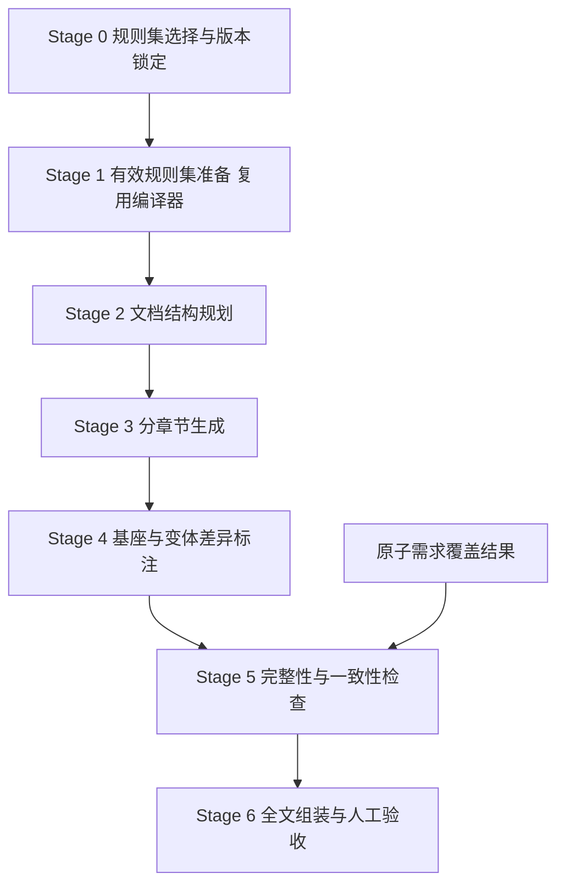

# 需求全文生成与变体差异标注（设计文档）

> 日期：2026-11-24
> 性质：`dev-docs/design/2026-11-24-RuleStudio需求文档.md` 的功能增补（第二个核心能力）。编号延续增补体系：不变量 `I-22` 起、功能需求 `FR-29` 起、架构决策 `AD-15` 起、验收 `AC-24` 起。
> 与上一个增补的关系：`dev-docs/design/2026-11-24-RuleStudio需求覆盖与补齐.md`（需求原子化）是本文的**上游质量门**，本文不得绕过它。
> 来源：用户 2026-11-24 对话中的方向说明；事实按仓库实测校正，见附录。

## 修订记录

| 版本 | 日期 | 变更 |
| --- | --- | --- |
| v1 | 2026-11-24 | 初稿：定位为「结构化规则 → 完整需求文档」生成引擎而非 Markdown 拼接；两种文档能力与五种差异标记；四个现有缺口；Stage 0-6 工作流与产物目录；三个正式产物；三阶段实施优先级 |

## 一、定位

**不是把 Markdown 卡片拼接起来**，而是建设一个「结构化规则 → 完整需求文档」的**生成引擎**。

要解决三个问题：

1. 把几十到上百张规则卡重新组织成一份完整、连贯、可交付的需求文档。
2. 切换麻将变体时自动生成对应完整需求，并保留基座继承关系。
3. 全文中明确标注：哪些沿用杭州、哪些被修改、哪些是新增，**具体改了什么**。

产品定位一句话：

> MahjongRuleKB 不应该只有一堆结构化规则卡，还应能根据任意一个麻将变体，自动生成一份完整、连贯、带差异溯源的游戏需求文档，成为后续游戏开发的需求入口。

## 二、现有基础（已具备大部分条件）

| 项 | 实测 |
| --- | --- |
| 杭州规则卡 | 61 张 |
| 萧山差异卡 | 47 张 |
| 杭州配置项 | 25 项（20 玩法 + 5 界面） |
| 萧山编译后规则 | 86 条（继承 4 / 替换 18 / 新增 25，另 39 条纯继承展开） |

编译器已经支持：杭州基础 + 萧山差异合并、`inherited` / `modified` / `added`、规则 ID 映射与引用重写、未决项与 `release_blocker` 状态传递、基础内容指纹 `content_hash` 与版本锁定校验。

**关键结论：文档生成不需要重新实现规则继承机制，直接复用 Compiler 的 `compileVariant` 结果即可。**不需要改编译器。

## 三、两种文档能力（不要只做一个 Markdown 导出）

### 3.1 完整需求文档生成

| 变体 | 章节组织（沿用策划熟悉的顺序） |
| --- | --- |
| 杭州（基础版本） | 游戏规则概述、基础名词与概念、开局与发牌、行牌规则、三摊承包、算分规则、番型规则、结算流程、UI 交互及表现、不适用规则、待确认事项 |
| 萧山（派生版本） | 杭州基座中仍生效的内容、萧山修改后的完整规则、萧山新增规则、萧山专属配置、待裁决规则 |

两者都是**完整文档**，不是规则卡列表，也不是差异清单。

组织方式沿用 `sources/hangzhou/hangzhou-core-flow.md` 这类策划熟悉的结构（玩法选项 → 名词 → 开局 → 行牌 → 承包 → 算分 → 番型 → 结算 → 不适用 → 待确认）。

### 3.2 全文差异标注

五种标记：

| 标记 | 含义 | 展示 |
| --- | --- | --- |
| 基座沿用 | 萧山资料主动声明沿用杭州规则（`change_type: inherited`） | 蓝色 |
| 变体修改 | 萧山替换杭州原规则（`modified`） | 橙色 |
| 变体新增 | 杭州没有，萧山新增（`added`） | 绿色 |
| 默认继承 | 萧山未点名，按继承约定生效（编译产物里 39 条继承展开中未被 variant 声明的部分） | 灰色 |
| 待裁决 | 尚未确认（`status: unresolved` / `disputed` 或 `release_blocker: true`） | 红色 |

**「明确继承」与「默认继承」必须分开**：前者是萧山资料主动声明沿用，后者是因为没提及而按继承约定处理。两者在策划确认时的心智负担完全不同。

两种阅读模式：

- **完整阅读模式**：只显示最终生效规则，适合交付。
- **差异对照模式**：显示基座、修改、新增、删除与变化摘要，适合审核。

## 四、现有架构的四个缺口

### 缺口 1：规则卡没有文档章节顺序

现有目录按规则类型分类（`guize/`、`shixu/`、`zhuangtai/`、`gongshi/`、`biaoge/`、`jiesuan/`、`jiemian/`），完整需求文档要按实际对局流程组织。轮庄属于开局与下一局流程，摊数属于局内状态，承包属于特殊结算，庄闲倍率属于算分 —— 不能按目录直接拼接。

**需要新增一个文档章节映射层**（独立于规则卡）：

```yaml
sections:
  - id: opening
    title: 开局与发牌
    rules: [HJ-R-DINGZHUANG, HJ-R-LUNZHUANG, HJ-T-FAIPAI]
  - id: gameplay
    title: 行牌规则
    rules: [HJ-R-CHI, HJ-R-PENG, HJ-R-GANG-BUPAI]
  - id: settlement
    title: 结算规则
    rules: [HJ-P-ZIMO-RUZHANG, HJ-P-CHENGBAO-RUZHANG]
```

一张卡可被多个章节引用，但**正文只在主章节完整展开**，其他章节交叉引用，避免重复描述。

### 缺口 2：差异只到卡片级，到不了文字级（最重要的技术问题）

现有 Schema 能回答「哪张卡来自萧山、替换了哪张杭州卡」（`origin`、`change_type`、`base_rule_ref`、`compares_to`），但回答不了**具体哪句话变了**。

实测例子（萧山 `XS-R-ZHUANGJIA-02` 连庄与换庄，`change_type: modified`，`base_rule_ref: HJ-R-LUNZHUANG`）：

- 杭州 `HJ-R-LUNZHUANG`：胡牌者坐庄；流局由原庄连庄；连庄后仍是三牢、8 倍，三牢封顶。
- 萧山 `XS-R-ZHUANGJIA-02`：庄家自摸或流局时原庄继续坐庄；闲家自摸时赢家接庄；牢数 = 上局实际牢数 + 1；牢数无上限，每加一牢庄闲倍率翻倍。

整卡标橙色，读者仍不知道到底改了哪几条。因此需要新增一层：

**规则差异片段（Rule Change Segments）**

```yaml
# 结构示意，段内内容必须由规则卡对照产生并经人工确认，不得直接当成已裁决规则
- change_id: XS-CHANGE-001
  base_rule_ref: HJ-R-LUNZHUANG
  variant_rule_ref: XS-R-ZHUANGJIA-02
  changes:
    - type: replace
      subject: 连庄条件
      before: 胡牌者坐庄，流局原庄连庄
      after: 庄家自摸或流局时原庄继续坐庄
    - type: replace
      subject: 牢数
      before: 固定三牢、8 倍封顶
      after: 连庄前牢数 = 上局实际牢数 + 1，无上限
    - type: add
      subject: 牢数倍率
      after: 每增加一牢，庄闲倍率翻倍
```

**生成方式**：AI 生成语义差异**候选**，人工确认后才成为正式差异记录。不能把未经核验的文本 Diff 直接标成确定的业务变化 —— 措辞不同可能表达同一规则，措辞相近也可能条件已变。

### 缺口 3：配置项的差异来源在编译后丢失

实测（`compiler/compile.ts` 的 `compileVariant`）：

| 层 | 配置项 `XS-C-QIANGGANGHU` |
| --- | --- |
| 源 `variants/xiaoshan/config.yaml` | `origin: variant`、`change_type: modified`、`base_rule_ref: HJ-C-QIANGGANGHU`、`value: disabled` |
| 编译产物 `compiled/xiaoshan/config.yaml` | `origin: base`、无 `change_type`、无 `base_rule_ref`、`value: disabled` |

即：**规则卡的变体元数据在编译后保留**（`compiled/xiaoshan/guize/xs-r-zhuangjia-02.md` 仍有 `compiled_origin: variant`、`change_type`、`base_rule_ref`、`compares_to`），但**配置项的变体元数据被归一化掉了**。

因此文档生成不能只读 `compiled/xiaoshan/config.yaml`，必须同时读：

1. 杭州原始配置 `rulesets/hangzhou/config.yaml`（+ `config.ui.yaml`）
2. 萧山差异配置 `variants/xiaoshan/config.yaml`
3. 编译后的最终配置

三者比对才能判定某参数是继承、修改还是新增。

**这项处理放在文档生成层，不修改已冻结的编译器。**

### 缺口 4：不能把未决规则伪装成完整需求

萧山当前有 3 条 `release_blocker: true` 的未决项（`XS-U-001` 财神归属冲突、`XS-U-002` 飘财第 3 次及以上豪杠飘倍数缺失、`XS-U-003` 十风倍数未单列），另有 2 张卡（`XS-K-FANXING`、`XS-K-LIANGANG`）与 1 条配置（`XS-C-CAISHEN`）标了 `release_blocker`。

文档生成必须保留这些状态：可以生成完整草稿，但不能因生成成功就把萧山标成「规则完整、可发布」。

## 五、Stage 执行架构

用户说的「Stage 流程」= **分阶段执行、保留中间产物**，而不是一次性让 Agent 读全部卡片生成全文。



| Stage | 输入 | 动作 | 产物 |
| --- | --- | --- | --- |
| 0 | 变体选择、版本 | 锁定基座与变体版本、适用人数与房间类型、记录输入 Hash | `input-manifest.json` |
| 1 | 规则集 | 调既有 Compiler 得最终规则集；合并配置；取未决项与阻塞状态；建立规则来源索引 | `effective-ruleset.json` |
| 2 | 模板 + 有效规则集 | 建游戏流程章节；把卡与配置分配到章节；检查有无未分配项 | `document-outline.yaml` |
| 3 | 章节规划 | 逐章节生成；公式与配置用确定性模板；AI 只负责自然语言组织与衔接 | `sections/*.md` |
| 4 | 有效规则集 + 章节稿 | 判定五种标记；找被替换的基座规则；生成段落级差异；生成人工审核用的变化摘要 | `provenance.json`、`changes.json` |
| 5 | 全部上游产物 + 需求覆盖结果 | 卡是否全部进文档、配置是否全部表达、规则是否互相矛盾、未决项是否保留、差异是否有证据、对照原子需求覆盖 | `validation-report.md` |
| 6 | 章节稿 + 标注 + 报告 | 组装完整 Markdown、差异报告、需求追踪索引、人工确认 | `需求全文.md` |

### 产物目录（工作流产物，不进正式知识库结构）

```text
document-workflow/<variant>/<version>/
  stage-0/input-manifest.json
  stage-1/effective-ruleset.json
  stage-2/document-outline.yaml
  stage-3/sections/{opening,gameplay,scoring,settlement}.md
  stage-4/{provenance.json,changes.json}
  stage-5/validation-report.md
  stage-6/需求全文.md
```

**增量重跑**：只改萧山连庄规则时，从受影响 Stage 重跑，复用上游产物，不重新整理全部规则。

## 六、产品形态

Rule Studio 增加独立的「需求文档」视图：

```text
需求文档
├── 变体选择：杭州麻将 | 萧山麻将
├── 差异标注：显示差异 | 纯净全文
├── 正文：按对局流程分章的完整需求
│     每段带标记（基座沿用 / 变体修改 / 变体新增 / 默认继承 / 待裁决）
└── 交互：点段落 → 追溯来源卡；发现问题 → 回到规则卡或补齐任务
```

界面重点不是好看，而是：

1. 选杭州看到杭州完整需求，选萧山看到萧山完整需求
2. 打开差异标注能看清每段来源
3. 点某段能追溯到规则卡
4. 发现问题**回到规则卡或补齐任务修改，不直接改生成文档**

## 七、两个必须提前解决的范围问题

### 7.1 格式模板 ≠ 知识库现有范围

策划提供的《杭州麻将核心流程（核心策划补齐版）》包含 2/3/4 人、40/50/60 片、多个创房配置选项。而本仓库实测范围：

- `rulesets/hangzhou/manifest.yaml` 的 `scope` 是 `{player_count: 4, room_type: friends}`
- 规则卡 front matter 的 `scope` 值是 `four_player_friend_room`
- 原始来源 `sources/hangzhou/hangzhou-core-flow.md` 明确以四人好友房为本期范围

**结论：那份文档只作格式模板，不得把其中规则当作知识库已具备的事实。**要生成覆盖全部人数与玩法的杭州全文，必须先把这些范围纳入正式规则集。

### 7.2 需求覆盖与补齐必须是本文的上游质量门

若规则卡漏了一条原文要求，文档生成器只读规则卡，最终全文会「很完整但依然遗漏」。

因此本文的验收必须挂在需求覆盖与补齐之上：原文要求全部被识别、每个有效需求有卡或配置映射、明确排除有记录、原文缺失与冲突有标记。**不要求所有规则已裁决，但不能有不明不白的遗漏。**

## 八、实施优先级

| 阶段 | 任务 | 交付 |
| --- | --- | --- |
| 第一阶段 | 杭州完整需求文档生成 | 一份完整杭州需求全文 |
| 第二阶段 | 萧山变体全文及差异标注 | 一份带基座沿用/修改/新增标记的萧山需求全文 |
| 第三阶段 | Rule Studio 文档视图 | 变体切换、差异显示、规则追溯 |

第一阶段先选一个代表性章节试点（建议「开局与轮庄」），验证「规则卡 → 完整叙述」的质量，再扩到全文。

不做：完整文档编辑器（在线编辑正文）；修改 Compiler 以保留配置差异元数据。

## 九、三个正式产物

| 产物 | 内容 | 关系 |
| --- | --- | --- |
| `需求全文.md` | 完整可读、可交付的需求文档 | 产物，不是事实源 |
| `provenance.json` | 每段文字对应的规则卡、基座来源、变体关系 | 支撑全文的追溯 |
| `changes.json` | 变体相对基座的具体变化记录（段落级） | 支撑差异标注 |

三者必须互相关联。**生成的需求全文不得反过来成为规则知识库的事实源**（见 I-24）。

## 十、硬约束

| # | 约束 |
| --- | --- |
| I-22 | 文档生成只读不写：不修改规则卡、配置、`compiled/`，不修改 Compiler；生成产物存工作流目录 |
| I-23 | 派生变体的全文必须带五种标记之一，不允许出现「来源不明」的段落；每条标记必须有 `provenance.json` 证据 |
| I-24 | 需求全文是产出物，**不是事实源**。发现错误只能回到规则卡 / 配置 / 补齐任务修改后重新生成 |
| I-25 | 差异片段必须经人工确认才可用于交付文档；AI 生成的段落级差异属于**候选**，不得直接标成确定变化 |
| I-26 | 未决项与 `release_blocker` 必须原样进入文档（红色标记）；文档生成成功不得改变规则集的 `releasable` 状态 |
| I-27 | 配置项的继承/修改/新增判定必须三方比对（基座源、变体源、编译产物），不得只读编译产物 |
| I-28 | 本文的完整性验收必须引用需求覆盖与补齐的结果；覆盖未完成的变体不得宣称「全文完整」 |

## 十一、功能需求

| # | 需求 |
| --- | --- |
| FR-29 | 能为指定规则集生成完整需求文档，按对局流程分章，覆盖全部规则卡与配置项（无未分配项） |
| FR-30 | 章节映射层独立于规则卡：一张卡可被多章节引用，正文只在主章节展开，其余交叉引用 |
| FR-31 | 派生变体全文支持五种标记与两种阅读模式（纯净全文 / 差异对照） |
| FR-32 | 支持段落级差异记录（`changes.json`）：`type`（replace / add / remove）、`subject`、`before`、`after`、证据与确认状态 |
| FR-33 | 每段可追溯到来源（`provenance.json`）：规则卡 ID、基座卡 ID、变体关系、原文出处 |
| FR-34 | 未决项与 `release_blocker` 在正文对应位置显示为「待裁决」，并汇总到文档末尾的待确认清单 |
| FR-35 | Stage 产物逐阶段落盘；支持从指定 Stage 增量重跑，复用上游产物 |
| FR-36 | 生成前后做一致性检查：卡是否全部进入、配置是否全部表达、规则是否矛盾、标记是否都有证据、未决项是否保留 |
| FR-37 | 输出输入 Hash 与版本，使同一输入可复现同一文档 |

## 十二、架构决策

| # | 决策 | 理由 |
| --- | --- | --- |
| AD-15 | 章节映射层独立成文件（不进规则卡 front matter） | 一张卡可属多章节，映射会随文档结构调整；写进卡里会让卡承载展示逻辑 |
| AD-16 | 差异片段独立存为 `changes.json`，不改规则卡 Schema | Schema 已冻结；段落级差异是展示层数据，且需人工确认状态 |
| AD-17 | 配置差异在生成层三方比对解决，不改编译器 | 编译器产物已用于下游消费，改它会牵动 `compiled/` 与既有测试；生成层多读两个文件成本更低 |
| AD-18 | Stage 产物落工作流目录（不进 `compiled/`） | 中间产物会反复重生成，不适合放进随发布分发的产物目录 |
| AD-19 | 公式、倍数、配置值用确定性模板渲染，AI 只组织自然语言 | 数值由模板保证，避免模型改写数字；这是本项目最重要的一条生成纪律 |
| AD-20 | 增量重跑以 Stage 为单位，按受影响下游失效 | 变体规则长期演进，全量重生成成本不可接受 |

## 十三、验收标准

| # | 标准 |
| --- | --- |
| AC-24 | 杭州全文生成成功：61 张卡与 25 项配置全部出现在文档中，无未分配项（由 FR-36 检查报告证明） |
| AC-25 | 萧山全文生成成功：86 条有效规则全部出现，且每条带五种标记之一 |
| AC-26 | 差异抽查：随机抽 10 条 `modified` 卡，`changes.json` 的段落级差异与人工核对一致（含 `XS-R-ZHUANGJIA-02` 牢数变化这类多要点卡） |
| AC-27 | 每段都能从 `provenance.json` 追溯到规则卡；抽查 10 段全部命中 |
| AC-28 | 未决项：3 条 `release_blocker` 未决项与 2 张阻塞卡在全文中有红色标记，且 `manifest.releasable` 仍为 false |
| AC-29 | 配置判定：抽查 5 项萧山配置（含 `XS-C-QIANGGANGHU`），继承/修改/新增判定与三方比对结果一致 |
| AC-30 | 增量重跑：只改萧山连庄规则后重跑，未受影响的章节产物字节级不变 |
| AC-31 | 数值一致性：全文中的倍数与配置值全部来自模板渲染，`grep` 抽查与 `compiled/` 一致，无模型改写的数值 |

## 十四、类比理解

- **规则卡**像零件清单：螺丝、齿轮、电机各归各类，工程能查、能改。
- **需求全文生成**像把零件装成整机说明书：读者不看零件编号，只看「先装底座，再上电机」。
- **章节映射层**就是说明书的装配顺序表 —— 零件清单按类型排，说明书必须按装配顺序排。
- **差异片段**像两个版本的说明书对照：只标「这一章改过」（卡级）没用，要说清「这章第二段的条件从三牢封顶改成无上限递增」。
- **I-24（全文不是事实源）**像印刷品与源文件的关系：发现说明书印错，改源文件重印，不要在印刷品上手写涂改。

## 十五、参考引用

- 主需求文档：`dev-docs/design/2026-11-24-RuleStudio需求文档.md`
- 上游质量门：`dev-docs/design/2026-11-24-RuleStudio需求覆盖与补齐.md`
- 规则命名规范与术语拼音表：`dev-docs/design/2026-11-24-规则命名规范与术语拼音表.md`
- 编译器：`compiler/compile.ts`（`compileVariant`、配置合并、阻塞传递）
- 实测差异样本：`rulesets/hangzhou/guize/hj-r-lunzhuang.md`、`variants/xiaoshan/guize/xs-r-zhuangjia-02.md`
- 编译产物：`compiled/xiaoshan/`
- 术语：`AGENTS.md`
- Mermaid 流程图语法：<https://mermaid.js.org/syntax/flowchart.html>

## 附录：与对话原文的实测校正

| 原文表述 | 实测 | 处理 |
| --- | --- | --- |
| 「杭州基座 `manifest.yaml` 锁定的是 `four_player_friend_room`」 | `rulesets/hangzhou/manifest.yaml` 的 `scope` 是 `{player_count: 4, room_type: friends}`；`four_player_friend_room` 是规则卡 front matter 里 `scope` 字段的值 | 7.1 按实测分两层写 |
| 「配置项在 `modified` 和 `inherited` 合并时，部分变体元数据会被转换成最终配置值」 | 更明确：编译后配置项 `origin` 归一为 `base`，`change_type` 与 `base_rule_ref` **完全丢失**；而规则卡的这些字段在编译产物中**保留** | 缺口 3 用实测对照表写 |
| 「萧山仍有三个发布阻塞项」 | `manifest.blockers` 为 3 条（`XS-U-001/002/003`）；另有 2 张卡（`XS-K-FANXING`、`XS-K-LIANGANG`）与 1 条配置（`XS-C-CAISHEN`）也标了 `release_blocker: true` | 缺口 4 按实测补全；AC-28 覆盖两类 |
| 举例「萧山牢数递增一牢、倍率翻倍」 | `XS-R-ZHUANGJIA-02` 正文实测：牢数 = 上局实际牢数 + 1（含上局掷骰加的那牢），无上限，每加一牢庄闲倍率翻倍 | 举例按实测保留；`changes.json` 标注为结构示意，非已裁决规则 |
| 「86 萧山编译后规则」 | 编译输出 86 条（继承 4 / 替换 18 / 新增 25；其余为基座规则继承展开） | 一致 |
| 「61 / 47 / 25」 | 61 张杭州卡、47 张萧山卡、25 项杭州配置（20 玩法 + 5 界面） | 一致 |
