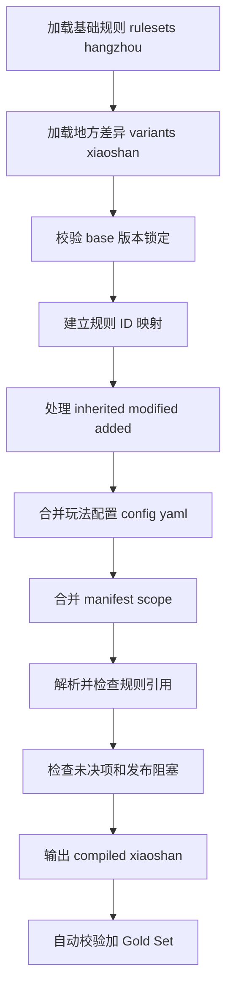
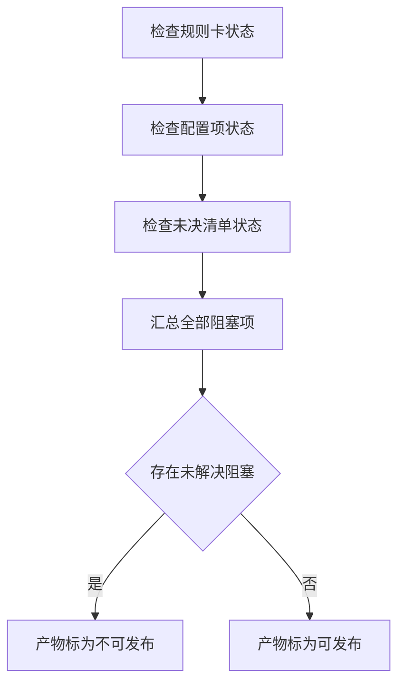

# 执行计划

> 依据：`dev-docs/design/需求分析.md`、`dev-docs/design/2025-11-24-执行计划评审意见.md`
> 日期：2025-11-24（v3.2，按 v3.1 评审意见修订，架构最终冻结版）
> 范围：Phase 0 - Phase 4

## 修订记录

| 版本 | 日期 | 变更 |
| --- | --- | --- |
| v1 | 2025-11-24 | 初版 |
| v2 | 2025-11-24 | 按评审意见修订：Phase 2 增加最小规则编译器与 `variants/`/`compiled/` 目录；规则卡加 YAML 元数据与 `base_rule_ref`；分类统一为 4 领域 11 类型；配置项进 `config.yaml`；Gold Set 结构化 + Vitest；规则状态与发布门槛。修正 v1 错误：「拖底相关 3 处未决」实为 1 处 |
| v3 | 2025-11-24 | 按 v2 评审意见修订（`dev-docs/design/2025-11-24-执行计划v2评审意见.md`）：基础卡用 `origin: base` 不用 `change_type`；删 `override_scope: slots`，`modified` 卡必须是完整有效规则；编译器加 config/manifest 合并；加有效规则 ID 映射与引用闭合检查；Gold Set 加 `ruleset_id` 与 Schema；加 `slot-definitions.ts`；编译阶段改用 `P2-C.*` 编号。修正 v2 错误：A-GZ 未决项 1 处实为 2 处（合计仍 16） |
| v3.1 | 2025-11-24 | 按 v3 评审意见修订（`dev-docs/design/2025-11-24-执行计划v3评审意见.md`）：ID 唯一性改为分数据集检查；引用分四类，`base_rule_ref` 和对照引用不重写；blocker 检查覆盖规则卡+配置+manifest+unresolved；Gold Set 拆 verification/automation 两个维度；新增 `calculators/` 目录与开发任务；配置示例加 `origin`，显式沿用项保留为 `inherited`；槽位校验按 base/inherited/modified/added 分策略。修正需求分析 R 类 12→13。**架构冻结，不再扩展基础设施** |
| v3.2 | 2025-11-24 | 按 v3.1 评审意见修订（`dev-docs/design/2025-11-24-执行计划v3.1评审意见.md`）：manifest scope 只留适用范围，玩法参数全部归 config，消除财神双事实源；unresolved 条目结构化为 YAML（id/card_ref/status/release_blocker/resolution）；引用闭合分两个验证范围（依赖引用编译后闭合，溯源引用指向原始规则集）；删 Gold Set 旧 status 定义；inherited 配置项不填 value；rule_aliases 加 inherited/modified 冲突检查；基础规则变更必须升 manifest 版本；coverage 验收扩到 3.2 和 6.1。**架构最终冻结，开始执行 Phase 1** |

## 总览


| 阶段 | 目标 | 预估 | 前置 | 交付物 |
| --- | --- | --- | --- | --- |
| Phase 0 | 固定原始资料 | 0.5 天 | 无 | `sources/` 目录、英文文件名、引用更新 |
| Phase 1 | 杭州规则结构化 | 3-5 天 | Phase 0 | `rulesets/hangzhou/` 规则卡、`config.yaml`、`manifest.yaml`、校验脚本、章节覆盖清单 |
| Phase 2 | 萧山差异结构化 | 2-3 天 | Phase 1 | `variants/xiaoshan/` 规则卡、`base_rule_ref`、未决清单 |
| Phase 2.6 | 最小规则编译器 | 1-2 天 | Phase 2 | `compiler/`、`compiled/xiaoshan/` |
| Phase 3 | 规则测试体系 | 2-3 天 | Phase 2.6 | 结构化 Gold Set、Vitest 测试 |
| Phase 4 | Agent 接入 | 按需 | Phase 3 | `AGENTS.md` |

**第一阶段真正的交付物**：能从杭州基础规则 + 萧山差异规则，稳定生成一份完整萧山规则集，并通过人工核对和 Gold Set 验证。

**架构冻结**：v3.1 后不再讨论数据库、MCP、LLM Wiki、Web 管理界面，不增加新基础设施。后续评审只接受实现层面的问题（编译错误、校验漏洞、规则内容错误），不再接受架构扩展建议。本仓库定位是「一个麻将规则基础知识库 + 多个地方麻将派生规则集」，服务 PrdGameSkill / Cocos Creator 生成策划文档、实现游戏规则、验证游戏行为；杭州和萧山只是第一组验证样本。

## 目录约定

| 目录 | 用途 | 可修改 |
| --- | --- | --- |
| `sources/` | 原始证据 | 否，只读 |
| `rulesets/` | 基础规则集（杭州） | 是 |
| `variants/` | 地方麻将差异（萧山） | 是 |
| `compiled/` | 编译产物，只由编译器生成 | 否 |
| `schemas/` | Zod 数据结构定义 | 是 |
| `compiler/` | 最小规则派生 | 是 |
| `tests/` | Gold Set 数据 + Vitest | 是 |

```
MahjongRuleKB/
├── sources/
│   ├── hangzhou/hangzhou-core-flow.md
│   └── xiaoshan/xiaoshan-rules.md
├── rulesets/hangzhou/
│   ├── manifest.yaml
│   ├── config.yaml              # 玩法参数
│   ├── config.ui.yaml           # 界面参数
│   ├── rules/                   # 判定
│   ├── timing/                  # 时序
│   ├── state/                   # 计数、记录
│   ├── formulas/                # 公式
│   ├── tables/                  # 查表
│   ├── settlement/              # 入账分配
│   └── ui/                      # 静态常显、交互、动效
├── variants/xiaoshan/
│   ├── manifest.yaml
│   ├── config.yaml
│   ├── rules/  timing/  state/  formulas/  tables/  settlement/  ui/
│   └── unresolved.yaml
├── compiled/
│   ├── hangzhou/
│   └── xiaoshan/
├── schemas/
│   ├── rule.ts
│   ├── config.ts
│   ├── manifest.ts
│   ├── slot-definitions.ts
│   └── gold-set.ts
├── compiler/
│   ├── loader.ts
│   ├── merger.ts
│   └── validator.ts
├── calculators/                # 确定性计算纯函数，Gold Set 验证对象
│   ├── banker-multiplier.ts
│   ├── contract.ts
│   ├── cap-distribution.ts
│   └── genzhuang.ts
├── tests/
│   ├── gold-set/
│   ├── compiler/
│   └── regression/
├── dev-docs/
├── dev-examples/
├── AGENTS.md
└── README.md
```

## 统一规范

### 规则分类：4 个一级领域 + 11 个二级类型

沿用萧山原始文档的分类，不另造：

| 一级领域 | 二级类型 | ID 前缀段 | 目录 |
| --- | --- | --- | --- |
| 规则 | 配置 | `C-` | 进 `config.yaml`，不建卡 |
| 规则 | 判定 | `R-` | `rules/` |
| 规则 | 时序 | `T-` | `timing/` |
| 状态 | 计数 | `N-` | `state/` |
| 状态 | 记录 | `M-` | `state/` |
| 算分 | 公式 | `F-` | `formulas/` |
| 算分 | 查表 | `K-` | `tables/` |
| 算分 | 入账分配 | `P-` | `settlement/` |
| 界面 | 静态常显 | `V-` | `ui/` |
| 界面 | 交互 | `I-` | `ui/` |
| 界面 | 动效 | `A-` | `ui/` |

杭州 ID 前缀 `HJ-`，萧山 `XS-`。例：`HJ-R-BANK-02`、`XS-R-BANK-02`。

### 规则卡格式

每张卡一个 Markdown 文件，文件名 = ID 小写（`hj-r-bank-02.md`）。YAML front matter 放机器可读元数据，正文沿用萧山的槽位写法给人读。

**基础卡（杭州）**：只有 `origin: base`，没有 `change_type` 和 `base_rule_ref`。

```markdown
---
id: HJ-R-BANK-02
origin: base
type: judgment
name: 连庄与换庄
scope: four_player_friend_room
status: confirmed
release_blocker: false
sources:
  - source: sources/hangzhou/hangzhou-core-flow.md
    section: 2.3.2.4
---

- **触发**：……
```

**差异卡（萧山）**：`origin: variant`，必须有 `change_type`。

```markdown
---
id: XS-R-BANK-02
origin: variant
type: judgment
name: 连庄与换庄
change_type: modified          # inherited | modified | added
base_rule_ref: HJ-R-BANK-02    # inherited/modified 必填，added 不允许
compares_to: [HJ-R-BANK-02]    # 「杭麻」槽里引用的对照规则，编译时不重写
depends_on: [HJ-N-BANK, XS-R-BANK-04]   # 真正的规则依赖，编译时按 rule_aliases 重写
scope: four_player_friend_room
status: confirmed              # confirmed | inferred | unresolved | disputed
release_blocker: false
sources:
  - source: sources/xiaoshan/xiaoshan-rules.md
    section: R-BANK-02
---

- **差异**：修改
- **杭麻**：胡牌者坐庄。流局由原庄连庄……（对照信息，仅供人读）
- **触发**：……（以下为萧山完整有效规则）
```

**引用分四类，编译时区别处理**：

| 引用类型 | 载体 | 编译处理 |
| --- | --- | --- |
| `base_rule_ref` | YAML 元数据 | 永远保留原始 ID，不重写。重写后会变成自引用，丢失继承关系 |
| `compares_to` | YAML 元数据，「杭麻」槽的对照规则 | 保留原始 ID |
| `depends_on` | YAML 元数据，真正的规则依赖 | 按 `rule_aliases` 重写为编译后有效 ID |
| 正文里的 ID 引用 | Markdown 正文 | 按 `rule_aliases` 重写。正文只写依赖类引用，对照类引用放 `compares_to`，不在正文重复 |

这样以后追溯「某条萧山规则从哪条杭州规则演化而来」，查 `base_rule_ref` 即可，不会因为编译重写而丢失。

**`change_type` 与 `base_rule_ref` 的约束**：

| change_type | base_rule_ref | 编译器处理 |
| --- | --- | --- |
| inherited | 必须有 | 取基础规则，记录 XS → HJ 对应关系，不生成新卡 |
| modified | 必须有 | 用 XS 卡整体替换 HJ 卡，记录 HJ → XS 映射 |
| added | 不允许有 | 作为新规则加入 |

**`modified` 卡必须是完整有效规则，不是差异说明。** 萧山原文「杭麻」槽只是对照信息，不代表卡已包含杭州规则的全部有效内容。整理 `modified` 卡时必须：

1. 保留杭州原行为作为「杭麻」对照槽
2. 把杭州未修改的必要条件补入萧山有效规则
3. 修改的条件用萧山规则
4. 最终卡不依赖杭州原文就能独立理解

MVP 只支持整卡替换，不提供槽位级继承。某张卡确实无法整理成完整规则时，单独讨论是否需要槽位级继承，不在 Schema 里预留。

**槽位校验按 `origin` / `change_type` 分策略**：

| 卡类型 | 槽位校验策略 |
| --- | --- |
| base | 该类型的全部基础槽位必填 |
| variant / inherited | 只校验 `change_type`、`base_rule_ref`、`sources`，**不要求填写正文槽位**（不复制基础规则全文） |
| variant / modified | 该类型的全部槽位必填，含「差异」「杭麻」对照槽 |
| variant / added | 该类型的全部槽位必填，含「差异」槽，「杭麻」槽写「无」 |

### 配置模型

配置项不建 Markdown 卡，统一放 `config.yaml`，每项有 ID。基础配置和差异配置用同样的 `origin` / `change_type` 结构：

```yaml
# rulesets/hangzhou/config.yaml —— 玩法参数
- id: HJ-C-PLAYER-COUNT
  origin: base
  name: 人数
  value: 4
  scope: four_player_friend_room
  source: 本期开发范围
- id: HJ-C-BASE-SCORE
  origin: base
  name: 底分
  value: 1
  source: 2.3.2.10
```

```yaml
# variants/xiaoshan/config.yaml —— 只写差异
- id: XS-C-BASE-SCORE
  origin: variant
  name: 底分
  change_type: inherited          # 萧山 1.1 配置表显式标「沿用」的，保留为显式继承，便于审计。不填 value，编译时取基础值
  base_rule_ref: HJ-C-BASE-SCORE
- id: XS-C-JOKER
  origin: variant
  name: 财神
  change_type: inherited
  base_rule_ref: HJ-C-JOKER
  status: disputed                # 配置表说沿用，术语表说翻财神，不能自动变成 confirmed
  release_blocker: true
  candidates:                     # 争议候选值，裁决后填 resolution
    - white_dragon
    - flipped_joker
- id: XS-C-CAP-LIMIT
  origin: variant
  name: 拖底额度
  value: 200
  change_type: added
```

**配置项的 `status` / `release_blocker` 字段和规则卡相同**，参与统一发布门槛检查。萧山配置表里显式写「沿用」的项保留为 `change_type: inherited`，未点名的项才走默认继承。

**`inherited` 配置项不填 `value`**，编译时取基础配置的值。有争议的值放 `candidates` 候选列表，裁决后写 `resolution`。`modified` 和 `added` 配置项必须填 `value`。

**配置合并规则**：

| 差异类型 | 编译处理 |
| --- | --- |
| inherited | 保留杭州配置值，把萧山卡的 `status` / `release_blocker` 带入产物 |
| modified | 用萧山配置替换 |
| added | 新增萧山配置 |
| 未提及 | 默认继承杭州配置 |

**配置产物不伪装状态**：萧山 `XS-C-JOKER` 标 `disputed` 时，`compiled/xiaoshan/config.yaml` 里这一项的值可以先按杭州 `white_dragon` 生成（临时产物），但 `status: disputed` 必须原样带入，不能因为继承了杭州的值就变成 `confirmed`。
界面参数（`turn_timer`、`long_press_ms`、动画时长等）单独放 `config.ui.yaml`，不和玩法参数混。第一阶段 `config.ui.yaml` **纯继承**，不允许地方玩法覆盖。

### manifest 与版本锁定

```yaml
# rulesets/hangzhou/manifest.yaml
ruleset_id: hangzhou-friends-4p
version: 1.0.0
scope:                            # 只放规则集适用范围，不放玩法参数
  player_count: 4
  room_type: friends
sources:
  - sources/hangzhou/hangzhou-core-flow.md
note: 杭州资料本身是四人好友房固定配置的核心流程，不是所有杭州麻将的完整定义
```

```yaml
# variants/xiaoshan/manifest.yaml
ruleset_id: xiaoshan-friends-4p
version: 0.1.0
base:
  ruleset_id: hangzhou-friends-4p
  version: 1.0.0
scope:
  player_count: 4
  room_type: friends
```

**manifest 和 config 的分工**：`manifest.scope` 只描述规则集适用范围（人数、房间类型），`config.yaml` 管所有玩法参数（底分、局数、财神、封顶、禁杠张数、拖底额度）。**同一玩法参数不在两处定义**，避免双事实源。萧山财神有争议，只在 `XS-C-JOKER` 的 `status: disputed` 上体现，manifest 不重复。

**版本锁定**：编译器按 `base.version` 锁定基础规则版本。**杭州 `rulesets/hangzhou/` 下任何卡或配置变更，必须升 `manifest.version`**（Patch 级改数字也升）。不升版本的基础规则变更，`compile` 测试报错。萧山 manifest 的 `base.version` 不自动跟随，需要时手动升级并重新验收。

**manifest scope 合并**：萧山只声明覆盖的字段，编译后未声明的字段从杭州继承。

### 规则状态与发布门槛

| status | 说明 |
| --- | --- |
| confirmed | 已确认 |
| inferred | 根据其他资料推导 |
| unresolved | 尚未确定 |
| disputed | 存在冲突 |

`release_blocker: true` 表示该规则未确定前，完整规则集不能标记为可发布。判定原则：

| 影响 | release_blocker |
| --- | --- |
| 影响玩法判定或算分（如翻财神归属） | true |
| 影响结算金额（如分配公式） | true |
| 只影响动效停留时长、过渡画面 | false |

已识别的 blocker：**翻财神归属**（`disputed`）。萧山配置表写「沿用白板财神」，术语表写「本局实际财神由翻财神确定」，不能让 AI 推断，必须规则方裁决。

### 技术依赖

Node 24 + TypeScript。依赖只加两个：`yaml`（解析）、`zod`（校验）。测试用 `vitest`。Node 标准库没有 YAML 解析器，不自己写。

### Schema 清单

| 文件 | 内容 |
| --- | --- |
| `schemas/rule.ts` | 规则卡 YAML 元数据。`origin: base` 和 `origin: variant` 是两个 Zod 对象，字段约束不同；variant 卡的 `base_rule_ref` / `compares_to` / `depends_on` 三个引用字段分开定义 |
| `schemas/config.ts` | 配置项结构，同样区分 base / variant，含 `status` / `release_blocker` |
| `schemas/manifest.ts` | manifest 结构与 `base` 锁定字段 |
| `schemas/slot-definitions.ts` | 11 种规则类型各自的必填槽位名 |
| `schemas/gold-set.ts` | Gold Set 用例的 `input` / `expected` 结构 |

**必填槽位校验**：`slot-definitions.ts` 定义每种类型正文里必须出现的槽位，校验脚本解析 Markdown 正文的 `- **槽位名**：` 行，按上文「槽位校验策略」表分 base / inherited / modified / added 四种策略检查。例：

```ts
export const slotDefinitions: Record<RuleType, string[]> = {
  judgment: ["差异", "杭麻", "触发", "条件", "否则", "结果", "验收"],
  timing: ["差异", "杭麻", "起点", "步骤", "中断", "结束"],
  // …其余 9 类按萧山原始文档的槽位表
};

// base 卡去掉对照槽
export const baseSlotDefinitions: Record<RuleType, string[]> = {
  judgment: ["触发", "条件", "否则", "结果", "验收"],
  // …
};
```

基础卡（杭州）的槽位名去掉「差异」「杭麻」两项——那两项是差异卡特有的对照信息。`inherited` 卡不检查正文槽位。

## Phase 0：固定原始资料

### 任务

| # | 任务 | 产出 | 状态 |
| --- | --- | --- | --- |
| 0.1 | 新建 `sources/hangzhou/`、`sources/xiaoshan/` | 目录 | 已完成 |
| 0.2 | 两份原始文档 `git mv` 进去，改英文文件名 | `hangzhou-core-flow.md`、`xiaoshan-rules.md` | 已完成 |
| 0.3 | 需求文档移入 `dev-docs/design/`，加日期前缀 | `2025-11-24-项目需求.md` | 已完成 |
| 0.4 | README、docs 引用更新 | 4 个文件 | 已完成 |
| 0.5 | 在 `sources/` 下放 README 说明「只读」 | `sources/README.md` | 已完成 |

### 验收

- `sources/` 下两份文档内容与移动前完全一致（`git log --follow` 可追溯）
- 全仓库 grep 不到旧文件名

## Phase 1：杭州基础规则结构化

### 目标

把 `sources/hangzhou/hangzhou-core-flow.md` 从 PRD 变成带 ID、带元数据、带来源追溯的规则卡集，作为萧山差异的锚点。

### 任务

| # | 任务 | 产出 |
| --- | --- | --- |
| 1.1 | 初始化 `package.json`，装 `yaml`、`zod`、`vitest`、`typescript` | `package.json` |
| 1.2 | 定 ID 规范（按上文「统一规范」） | 本文已定 |
| 1.3 | 抽玩法参数到 `config.yaml`，界面参数到 `config.ui.yaml` | 两个 YAML |
| 1.4 | 写 `manifest.yaml`，固定适用范围 | `rulesets/hangzhou/manifest.yaml` |
| 1.5 | 拆规则卡（按下表分 6 批） | 60-80 张 `.md` |
| 1.6 | 标注杭州文档里的「待确认」项 | 卡上 `status: unresolved` |
| 1.7 | 建 `schemas/rule.ts`、`schemas/config.ts`、`schemas/manifest.ts`，用 Zod 定义元数据结构 | `schemas/` |
| 1.8 | 建 `schemas/slot-definitions.ts`，按 11 种类型定义必填槽位 | `schemas/slot-definitions.ts` |
| 1.9 | 写校验脚本 `compiler/validator.ts`：校验 ID 唯一、引用闭合、YAML 元数据、**正文必填槽位**、config 可解析 | 校验脚本 |
| 1.10 | 建章节覆盖清单：杭州文档每个小节对应哪些卡 | `rulesets/hangzhou/coverage.md` |

### 1.5 拆卡批次

| 批次 | 内容 | 预估卡数 | 来源章节 |
| --- | --- | --- | --- |
| 1 | 操作优先级、吃、碰、杠（直杠/加杠/暗杠/杠开/杠爆/杠飘/抢杠胡） | 8-10 | 2.3.1 |
| 2 | 局数、人数、定庄、轮庄、财神、笃三老庄、庄闲放铳、三摊承包、吃碰禁手、底分 | 10-12 | 2.3.2 |
| 3 | 算分公式：原应赔分、自摸、点炮/抢杠、承包/反承包/链式、黄庄 | 5-6 | 2.3.3 |
| 4 | 番型查表：平胡、爆头、财飘、杠开、七对、清七对、杠爆、杠飘、飘杠、七客、十风、互斥优先级 | 12-14 | 2.3.4.2 |
| 5 | 对局流程时序：对局开始、定庄、定财神、发牌、行牌、结算 | 6-8 | 4.1-4.4、5.1 |
| 6 | 界面静态/交互/动效 | 20-30 | 3.2、4.5-4.8、6.1 |

杭州卡 `origin: base`，没有 `change_type` 和 `base_rule_ref`。

### 验收

- 杭州文档 2.3 节每个 `#####` 小节、3.2 节每个 `####` 小节、4.5-4.8 节每条行牌规则、6.1 节每个编号项，在 `coverage.md` 里都有对应卡
- 所有卡通过 Zod 校验，正文槽位完整
- `config.yaml` 每项有唯一 `HJ-C-*` ID
- 萧山文档中每张「修改/沿用」卡描述的「杭麻」行为，人工过一遍，都能在杭州卡里找到（正式对齐在 Phase 2）
- **杭州规则卡能够独立读取**（不依赖原始 PRD 的章节号上下文）

## Phase 2：萧山差异结构化

### 目标

萧山 47 张卡从 `sources/xiaoshan/xiaoshan-rules.md` 拆成独立文件，放进 `variants/xiaoshan/`，每张「修改/沿用」卡机器可识别地指向杭州卡。**不修改 `sources/` 下的原文。**

### 任务

| # | 任务 | 产出 |
| --- | --- | --- |
| 2.1 | 建 `variants/xiaoshan/` 目录结构与 `manifest.yaml` | 目录、manifest |
| 2.2 | 47 张卡拆成独立 `.md` 文件，加 `XS-` 前缀，卡内引用同步替换 | 47 个文件 |
| 2.3 | 萧山 1.1 配置表拆到 `variants/xiaoshan/config.yaml`，每项带 `change_type` 和 `base_rule_ref` | `config.yaml` |
| 2.4 | 每张卡写 YAML 元数据：`origin: variant`、`change_type`、`base_rule_ref`、`status`、`release_blocker`、`sources` | 元数据 |
| 2.5 | **`modified` 卡整理成完整有效规则**：补入杭州未修改的必要条件，使卡不依赖杭州原文就能独立理解。原文「杭麻」槽保留为对照信息 | 20 张 `modified` 卡重写 |
| 2.6 | 16 处「原文未写」汇总成 `variants/xiaoshan/unresolved.yaml`，结构化字段见下 | `unresolved.yaml` |
| 2.7 | 翻财神归属交规则方裁决，结论写回相关卡 | 决策记录 |
| 2.8 | 校验脚本扩展：检查 `XS-` 卡的 `base_rule_ref` 指向存在的 `HJ-` 卡；检查 `change_type` 与 `base_rule_ref` 的一致性约束；检查 `modified` 卡正文必填槽位完整 | 脚本更新 |

### 2.6 未决清单

用 YAML 不用 Markdown，让编译器能直接解析。每条：

```yaml
# variants/xiaoshan/unresolved.yaml
- id: XS-U-001
  card_ref: XS-C-JOKER
  description: 配置表写「翻财神沿用白板财神」，术语表写「本局实际财神由翻财神确定」，自相矛盾
  status: disputed
  release_blocker: true
  resolution: null                  # 裁决后填

- id: XS-U-002
  card_ref: XS-K-GANG
  description: 飘财第 3 次及以上的豪杠飘倍数原文未给
  status: unresolved
  release_blocker: true
  resolution: null
```

`card_ref` 必须指向存在的 `XS-` 卡或配置项。`status: confirmed` 且 `resolution` 非空才算已裁决。编译器按 `release_blocker: true && status != confirmed` 统一判断，与规则卡、配置项的门槛条件一致。

实测 16 处「原文未」，按卡分布：

| 卡 | 处数 | 内容 | release_blocker |
| --- | --- | --- | --- |
| A-HU | 3 | 胡牌番型字相对亮牌/对局结束/飘分的先后、停留时长 | false |
| I-HU | 2 | 被拦时其他操作是否保留、Toast 停留时间 | false |
| A-BANK | 2 | 「加庄」字停留时长、字退场后才发牌还是可重叠 | false |
| V-CAP | 1 | 局末原应付到大结实赔之间有没有过渡画面 | false |
| K-GANG | 1 | 飘财第 3 次及以上的豪杠飘倍数 | **true**（缺表档，算分不完整） |
| K-FAN | 1 | 十风倍数（原文未单列） | **true**（影响算分） |
| I-LOU-PENG | 1 | Toast 停留时间 | false |
| I-LOU-HU | 1 | Toast 停留时间 | false |
| I-CHI | 1 | 同次其余操作 | false |
| A-GZ | 2 | 字和骰子的停留时长；四家飘分是同时还是只飘首出者 | false |
| A-FLOAT | 1 | 萧山单独的停留时长 | false |

修正：v1 写「拖底相关 3 处」，实测拖底只有 V-CAP 这 1 处且是动效问题；拖底的分配公式（P-CAP）原文是完整的。v2 把 A-GZ 算成 1 处（按行数统计），实际一句话里两个独立问题，按处算 2。真正的 blocker 是 **K-GANG 飘财第 3 次档**和 **K-FAN 十风倍数**——这两处是算分查表缺档。

### 验收

- `sources/xiaoshan/xiaoshan-rules.md` 与 Phase 0 时内容完全一致
- 47 张卡全部通过 Zod 校验
- 所有 `inherited`/`modified` 卡都有有效的 `base_rule_ref`
- 20 张 `modified` 卡每张都不依赖杭州原文就能独立读懂（人工抽检）
- `unresolved.yaml` 覆盖全部 16 处，每条有 `id` / `card_ref` / `status` / `release_blocker`，blocker 项有裁决结论或明确标记为阻塞发布
- 翻财神归属有书面裁决

## Phase 2.6：最小规则编译器

### 目标

从杭州基础规则集 + 萧山差异规则集，确定性生成完整萧山规则集。**这是规则展开合并，不是能执行麻将玩法的规则引擎。编译器只做确定性的数据处理，不让 LLM 在编译过程中重新理解或决定规则。**

### 编译流程（固定顺序）



### 规则数量关系

杭州 N 条，萧山修改 a、新增 b、沿用 c，未提及的 N − a − c 条默认继承。完整萧山 = (N − a) + b。按当前 47 张卡：修改 20、新增 23、沿用 4，完整萧山 = N − 20 + 23。

### 有效规则 ID 映射

编译后杭州原规则被萧山规则替换，但其他杭州规则可能仍引用被替换的 `HJ-` ID。编译器必须建立映射表并重写**依赖类引用**：

| 萧山差异 | 编译后使用的规则 | 映射方向 |
| --- | --- | --- |
| 未提及 | HJ 原规则 | 无 |
| inherited | HJ 原规则 | XS → HJ（记录对应关系，不生成新卡） |
| modified | XS 修改后的规则 | HJ → XS |
| added | XS 新规则 | 无 |

映射表存 `compiled/xiaoshan/rule-index.json`：

```json
{
  "rule_aliases": {
    "HJ-R-BANK-02": "XS-R-BANK-02",
    "XS-R-BANK-01": "HJ-R-BANK-01"
  }
}
```

**引用重写规则**（只重写 `depends_on` 和正文里的依赖引用）：

| 引用 | 重写 | 验证范围 |
| --- | --- | --- |
| `base_rule_ref` | 否，保留原始 ID | 必须在原始基础规则集 `rulesets/hangzhou/` 中存在 |
| `compares_to` | 否，保留原始 ID | 必须在原始基础规则集 `rulesets/hangzhou/` 中存在 |
| `depends_on` | 是，按 `rule_aliases` 查表替换 | 必须在编译后规则集 `compiled/xiaoshan/` 中闭合 |
| 正文里的 ID | 是，按 `rule_aliases` 查表替换 | 必须在编译后规则集 `compiled/xiaoshan/` 中闭合 |

**依赖引用要求编译后闭合，溯源引用允许指向原始规则集。** `rule-index.json` 保留完整溯源关系（每条产物的 `base_rule_ref` 和 `compares_to`）。这样编译产物能独立使用，又不丢继承历史。

### 统一发布门槛

blocker 检查覆盖全部数据集，不只规则卡：



已识别的萧山 blocker：翻财神归属（配置项 `XS-C-JOKER`，`disputed`）、K-GANG 飘财第 3 次档、K-FAN 十风倍数（规则卡，`unresolved`）。

### 任务

| # | 任务 | 产出 |
| --- | --- | --- |
| P2-C.1 | `compiler/loader.ts`：读取 `rulesets/` 和 `variants/` 下全部卡与 config，Zod 校验 | loader |
| P2-C.2 | `compiler/merger.ts`：加载全部杭州规则 → 按 `base_rule_ref` 找到被 modified 的卡 → 整卡替换 → 加入 added 卡 → 校验 inherited 卡的 `base_rule_ref` 确实存在 | merger |
| P2-C.3 | 配置合并：按「配置合并规则」表处理 `config.yaml`；`config.ui.yaml` 纯继承 | merger |
| P2-C.4 | manifest scope 合并：萧山未声明的字段从杭州继承 | merger |
| P2-C.5 | 建立 `rule_aliases` 映射表；只重写 `depends_on` 和正文依赖引用，`base_rule_ref` / `compares_to` 原样保留；依赖引用在 `compiled/` 内闭合，溯源引用在 `rulesets/hangzhou/` 内存在 | merger |
| P2-C.6 | 映射冲突检查：同一张杭州卡被两张萧山卡 `modified` 报错；同一张杭州卡被一张 `inherited` 和一张 `modified` 同时指向报错；`rule_aliases` 不允许出现 A→B 且 B→A 的双向映射或循环 | merger |
| P2-C.7 | 统一发布门槛：扫描规则卡 + 配置项 + `unresolved.yaml`，汇总 `release_blocker: true` 且 `status != confirmed` 的条目写进编译报告；产物 manifest 标 `releasable: false`。配置项的 `disputed` 状态原样带入产物，不因继承杭州值而变 `confirmed` | merger |
| P2-C.8 | 输出到 `compiled/xiaoshan/`，保持和 `rulesets/` 同样的目录结构，每张卡带 `origin: base \| variant` 标记，写 `rule-index.json` | `compiled/xiaoshan/` |
| P2-C.9 | 生成 `compiled/xiaoshan/compile-report.md`：继承数、替换数、新增数、配置合并数、blocker 清单 | 报告 |
| P2-C.10 | `compiled/` 入库。理由：Agent 直接读，不需要先跑编译；编译产物有 diff 可审查 | 决策 |

### 验收

- `npm run compile` 从干净状态生成 `compiled/xiaoshan/`，无人工干预
- 编译报告的数字与规则数量关系公式一致
- **编译后所有规则引用闭合**（自动化测试检查）
- `compiled/xiaoshan/` 里的规则**可以脱离 `sources/hangzhou/` 和 `rulesets/hangzhou/` 独立读懂**
- `compiled/xiaoshan/config.yaml` 和 `manifest.yaml` 是完整合并后的结果
- `compiled/hangzhou/` 同样生成（纯 pass-through），让两个玩法在 `compiled/` 下对称

## Phase 3：规则测试体系

### 目标

三类测试：Gold Set 数据（人工可读、结构化）、结构测试（ID、引用、编译一致性）、计算测试（对已实现的确定性函数验证）。

### 3.1 Gold Set 数据

结构化 YAML，放 `tests/gold-set/`，一个文件一类。每条带 `ruleset_id` 标明验证的是哪个玩法：

```yaml
# tests/gold-set/banker-multiplier.yaml
- id: TC-F-BANK-001
  name: 杭州庄家三牢自摸平胡
  ruleset_id: hangzhou-friends-4p
  rule_refs: [HJ-F-BANK]
  input:
    banker: true
    win_type: self_draw
    fan_multiplier: 1
    banker_level: 3
    contract: none
  expected:
    winner_score: 24
    other_scores: [-8, -8, -8]
  verification:
    status: verified
    source: 杭州文档 2.3.3「自摸」
  automation:
    status: automated
    test_ref: tests/regression/calc-banker-multiplier.test.ts

- id: TC-F-BANK-002
  name: 萧山四牢庄家自摸平胡
  ruleset_id: xiaoshan-friends-4p
  rule_refs: [XS-F-BANK]
  input:
    banker: true
    win_type: self_draw
    fan_multiplier: 1
    banker_level: 4
    contract: none
  expected:
    winner_score: 48
    other_scores: [-16, -16, -16]
  verification:
    status: verified
    source: 萧山文档 F-BANK 例子
  automation:
    status: automated
    test_ref: tests/regression/calc-banker-multiplier.test.ts
```

**差异验证要求**：杭州庄闲倍率固定 8，萧山是 2^牢数。只测三牢两边都是 8 倍，证明不了差异规则生效。庄闲倍率类用例必须包含二牢（4 倍）、四牢（16 倍）、五牢（32 倍）等能体现萧山 `2^牢数` 的边界值。

`status` 拆成两个独立字段，一个用例可能同时人工核过且自动化测试通过：

```yaml
- id: TC-F-BANK-001
  name: 杭州庄家三牢自摸平胡
  ruleset_id: hangzhou-friends-4p
  rule_refs: [HJ-F-BANK]
  input: { ... }
  expected: { ... }
  verification:
    status: verified              # draft | verified
    by: 人工
    source: 杭州文档 2.3.3「自摸」
  automation:
    status: automated             # none | automated
    test_ref: tests/regression/calc-banker-multiplier.test.ts
```

**`rule_refs` 指向 `status: unresolved` 或 `disputed` 规则的用例，不允许 `verification.status` 为 `verified`。**

Gold Set 自身结构由 `schemas/gold-set.ts` 校验：`id` 唯一、`ruleset_id` 是已知的 manifest ID、`input` / `expected` 符合对应用例类型的结构、`automation.test_ref` 指向存在的测试文件。

### 3.2 用例范围（60 条）

| 优先级 | 文件 | 覆盖范围 | 条数 | 依据 |
| --- | --- | --- | --- | --- |
| P0 | `banker-multiplier.yaml` | 庄闲倍率（杭州固定 8；萧山 2^牢数） | 6 | HJ-F-BANK、XS-F-BANK |
| P0 | `contract.yaml` | 三摊承包/反承包/链式 | 9 | HJ-P-CHENBAO |
| P0 | `cap-distribution.yaml` | 拖底分配 | 6 | XS-P-CAP |
| P1 | `fan-stack.yaml` | 番型互斥与优先级 | 8 | HJ-K-STACK |
| P1 | `genzhuang.yaml` | 跟庄成立判定与赔付 | 6 | XS-R-GZ、XS-F-GZ |
| P1 | `gang-piao.yaml` | 杠飘/飘杠/杠爆 | 6 | HJ-K-GANGPIAO |
| P2 | `lou-peng-hu.yaml` | 漏碰/漏胡 | 4 | XS-M-LOU-PENG、XS-M-LOU-HU |
| P2 | `chi-jinshou.yaml` | 吃禁手（两玩法对比） | 4 | HJ-R-CHI、XS-R-CHI |
| P2 | `youcai.yaml` | 有财 2 番起胡 | 3 | XS-R-HU-03 |
| P2 | `piao-restriction.yaml` | 飘财限制下的可做操作 | 4 | HJ-R-PIAO、XS-R-PIAO |
| P2 | `wall-end.yaml` | 流局时机 | 4 | HJ-T-WALL、XS-T-WALL |

### 3.3 确定性计算函数

四个能写成纯函数的计算，实现放 `calculators/`，Gold Set 是它们的验证对象。**不是麻将引擎，只写能确定性计算的公式。**

| 文件 | 函数 | 依据规则 |
| --- | --- | --- |
| `calculators/banker-multiplier.ts` | `calculateBankerMultiplier(input)` | HJ-F-BANK、XS-F-BANK |
| `calculators/contract.ts` | `calculateContractSettlement(input)` | HJ-P-CHENBAO |
| `calculators/cap-distribution.ts` | `calculateCapDistribution(input)` | XS-P-CAP |
| `calculators/genzhuang.ts` | `calculateGenZhuangPayment(input)` | XS-F-GZ |

输入输出都是纯数据，不读文件、不依赖牌局状态。杭州和萧山倍率不同，`calculateBankerMultiplier` 按 `ruleset_id` 分支或由 input 传入倍率表。

### 3.4 自动化测试（Vitest）

`tests/compiler/`：

| 测试 | 检查内容 |
| --- | --- |
| `rule-ids.test.ts` | **分数据集**检查 ID 唯一：`rulesets/hangzhou/` 内部、`variants/xiaoshan/` 内部、`compiled/hangzhou/` 内部、`compiled/xiaoshan/` 内部。不跨原始数据集和编译产物检查（同一 HJ 卡会在三处出现，是副本不是冲突） |
| `rule-refs.test.ts` | 卡内引用的 `HJ-*`/`XS-*` ID 都存在；`base_rule_ref` 约束成立 |
| `config.test.ts` | `config.yaml` 可解析、ID 唯一、`base_rule_ref` 有效 |
| `compile.test.ts` | 编译结果数量符合公式；`compiled/` 与源一致（重新编译后无 diff）；config 和 manifest 是完整合并结果 |
| `compiled-refs.test.ts` | **编译后依赖引用闭合**：按 `rule_aliases` 重写 `depends_on` 和正文引用后，每条都能在 `compiled/` 里找到目标；`base_rule_ref` 和 `compares_to` 未被重写，且都能在 `rulesets/hangzhou/` 里找到目标 |
| `release-blocker.test.ts` | 规则卡、配置项、manifest、unresolved 任一处有未 resolved 的 blocker 时，编译产物 `manifest` 标记 `releasable: false`；配置项 `disputed` 状态原样带入产物 |
| `slots.test.ts` | 按 base / inherited / modified / added 四种策略检查正文槽位 |

`tests/regression/`：

| 测试 | 检查内容 |
| --- | --- |
| `gold-set-schema.test.ts` | Gold Set 全部通过 `schemas/gold-set.ts` 校验 |
| `gold-set-refs.test.ts` | Gold Set 每条 `rule_refs` 指向存在的 ID；`ruleset_id` 是已知 manifest ID；`verification.status: verified` 的用例 `rule_refs` 不含未决规则；`automation.test_ref` 指向存在的文件 |
| `calc-*.test.ts` | 读 Gold Set，调用 `calculators/` 里的纯函数，比对 `expected`。测的是真正的计算实现，不在测试里重写公式 |

**不要求**第一阶段开发完整麻将模拟器。只有能写成纯函数的计算才做 `calc-*` 测试；判定类规则（能否胡、能否碰）依赖完整局面，Phase 3 只做 Gold Set 数据，不做自动验证。

### 3.5 用例命名与门槛

- 称「Gold Set」的是 YAML 数据；称「自动化测试」的是 Vitest。Markdown 写的人工案例只能叫「人工验收案例」。
- Gold Set 一开始就是 YAML，不存在「超过 50 条再转」的门槛。

### 任务

| # | 任务 | 产出 |
| --- | --- | --- |
| 3.1 | 写 11 个 Gold Set YAML 文件（60 条），每条带 `ruleset_id` 和 `verification` | `tests/gold-set/*.yaml` |
| 3.2 | 建 `schemas/gold-set.ts` | Schema |
| 3.3 | 实现 4 个计算纯函数 | `calculators/*.ts` |
| 3.4 | 写 `tests/compiler/` 下 6 个结构测试 | 测试 |
| 3.5 | 写 `tests/regression/` 下 Gold Set 校验和 `calc-*` 测试 | 测试 |

### 验收

- 60 条 Gold Set 全部通过 Schema 校验，全部 `verification.status: verified`
- `npm test` 通过
- **所有 P0 Gold Set（庄闲倍率、承包赔付、拖底分配，共 21 条）都有 `calc-*` 自动化测试**，`automation.status: automated`
- 4 个计算函数都有对应测试；跟庄赔付覆盖全部 6 条跟庄 Gold Set（P1）
- 编译后依赖引用闭合（`compiled-refs.test.ts`）
- 编译产物重新编译无 diff

## Phase 4：Agent 接入

### 任务

| # | 任务 | 产出 |
| --- | --- | --- |
| 4.1 | 写 `AGENTS.md`：目录约定、ID 规范、如何查规则、如何读完整规则集、`compiled/` 不可手改 | `AGENTS.md` |
| 4.2 | 查规则差异：读 `compile-report.md` 的替换/新增清单 | 已有 |

| 能力 | 实现方式 |
| --- | --- |
| 按玩法拉完整规则集 | 读 `compiled/<玩法>/` |
| 按 ID 查规则 | `grep -r "HJ-R-xxx" rulesets/ variants/ compiled/` |
| 查依赖关系 | 解析卡内引用 |
| 查两玩法差异 | 读 `compiled/xiaoshan/compile-report.md` |

MCP、LLM Wiki：不做。

## 风险与依赖

| 风险 | 影响 | 应对 |
| --- | --- | --- |
| 杭州界面描述太细，拆卡工作量超预期 | Phase 1 延期 | 界面卡先粗粒度（一节一卡），判定/算分卡必须细 |
| 翻财神归属规则方不裁决 | 完整萧山规则集不能发布 | `release_blocker: true`，编译产物标 `releasable: false`，其余规则照常推进 |
| K-GANG 飘财第 3 次档、K-FAN 十风倍数缺失 | 萧山算分不完整 | 列入 `unresolved.yaml` blocker 项，交规则方 |
| `override_scope: slots` 语义复杂 | 编译器实现出错 | 已删，MVP 只支持整卡替换；`modified` 卡必须整理成完整规则。某张卡确实无法整理成完整规则时再讨论槽位级继承 |
| 萧山卡正文引用被替换的 `HJ-` ID | 编译后引用悬空 | `rule_aliases` 映射 + `compiled-refs.test.ts` 检查闭合 |
| `modified` 卡只写了差异，没补全杭州未改的条件 | 整卡替换后丢规则 | 任务 2.5 强制整理成完整有效规则；人工抽检 |
| 用例的「输入」需要完整局面状态 | 判定类 Gold Set 手写成本高 | 先写算分用例（输入是数字），判定用例只写数据不做自动验证 |

## 第一阶段最终验收

架构讨论到此为止，v3 后正式执行 Phase 0～3。第一阶段完成只看五件事：

| # | 验收项 | 对应阶段 |
| --- | --- | --- |
| 1 | 杭州规则卡完整，能独立读取 | Phase 1 |
| 2 | 萧山差异卡全部有明确的继承关系 | Phase 2 |
| 3 | 一条命令生成完整萧山规则集 | Phase 2.6 |
| 4 | 编译后的规则不依赖原始杭州文档，所有引用闭合 | Phase 2.6 + 3 |
| 5 | 核心 Gold Set 验证通过，未决问题不会被误认为已确认 | Phase 3 |

## 现在不做的

| 功能 | 决策 |
| --- | --- |
| SQLite、Neo4j、向量数据库 | 不做 |
| MCP Server | 不做 |
| Web 知识库管理界面 | 不做 |
| 通用麻将规则执行引擎 | 不做 |
| 自动生成游戏代码 | 不做 |
| LLM Wiki | 先不接 |
| 完整规则集编译 | 只做最小版本（本计划 Phase 2.6） |

## 参考引用

- 需求分析：`dev-docs/design/需求分析.md`
- 评审意见：`dev-docs/design/2025-11-24-执行计划评审意见.md`
- 萧山规则卡写法参考：`sources/xiaoshan/xiaoshan-rules.md`
- 杭州原始 PRD：`sources/hangzhou/hangzhou-core-flow.md`
