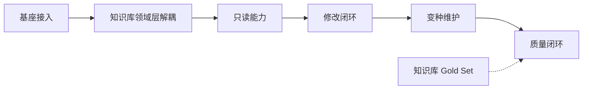

# Rule Studio 执行计划

> 依据：`dev-docs/design/2026-11-24-RuleStudio需求文档.md`（FR、I、AD、AC 编号沿用）、`dev-docs/planning/2025-11-24-执行计划.md`（KB v3.2 冻结架构）、PiBot 上游 `main` commit `152425f`
> 评审依据：`dev-docs/design/2026-11-24-RuleStudio执行计划评审意见.md`、`dev-docs/design/2026-11-24-RuleStudio执行计划评审意见-第2轮.md`
> 日期：2026-11-24
> 范围：Phase 0、A、B、C（第一阶段）；Phase D、E（第二阶段）
> 执行方式：按阶段推进，每阶段完成即更新 `dev-docs/progress/执行进度.md` 与 `dev-docs/progress-result/<阶段>-执行报告.md`，再提交

## 修订记录

| 版本 | 日期 | 变更 |
| --- | --- | --- |
| v1 | 2026-11-24 | 初稿 |
| v1.1 | 2026-11-24 | 任务 0.1 标记完成（合并提交 `ab76048`） |
| v2 | 2026-11-24 | 按 `dev-docs/design/2026-11-24-RuleStudio执行计划评审意见.md` 修订：Phase A 拆出纯内存 Parser，修复 Compiler 修改输入；Phase B 增加麻将 Bot 工具白名单与运行时断言、索引防过期、预览组件 Spike；Phase C 事务改为显式状态机并支持新建文件回滚；Phase E 的 Gold Set 执行改为默认关闭并需授权；环境要求写明 `engines` 与 `packageManager`；Zod 改为默认不迁移；同步 0.2、0.3、0.8 的完成状态与分支策略。逐项见下表 |
| v2.1 | 2026-11-24 | 合并 `main`（`b6e06d4`、`b78230f`）后同步：KB Phase 3、Phase 4 已完成，Phase E 不再被阻塞；`main` 新增 `content_hash`（基础内容指纹），底座变更规则扩展为「升版本并更新指纹」；编译器修改输入的问题已单独修复并加回归测试，A-4 与 AC-14 相应标注；KB 测试增至 85 个；同步目录必须类型检查零错误（新增 `typecheck` 脚本） |
| v2.2 | 2026-11-24 | 按第二轮评审意见修订（`dev-docs/design/2026-11-24-RuleStudio执行计划评审意见-第2轮.md`）：并入 `main` 的 `167b111`（测试基线 86；`typecheck` 脚本已由 main 加入并清零类型错误）；新增「进入 Phase A 的前置条件」核对表；事务改为先取写入锁再校验 Hash、写入前逐文件复查；提案更新必须显式指定 `proposalId`；事务恢复用例补全；ID 前缀统一为 2～4 位；Gold Set 授权后可选自动运行。评审中标为未解决的四项 P0 在 v2 已处理，逐条核对见下表 |
| v2.3 | 2026-11-24 | 任务 0.4 标记进行中：Node 26.11.1、pnpm 12.14.0 已装，fork 历史已补全；`pnpm install` 等磁盘空间；新增环境搭建指南与两篇经验文档（nvm 镜像 latest 滞后、失效 corepack 垫片） |
| v2.4 | 2026-11-24 | 合并 `main` 的 `decdf12`（第一阶段冻结，`962f488`）后同步：测试基线 88；KB Phase 3 口径改为「工程完成、Gold Set 27 verified / 33 draft」；写明版本递增由 Studio 门禁 G3 检查（KB 编译器不做这项检查，`AGENTS.md` 第 4 条）；Gold Set 门禁报告区分测试通过与人工核验；补充与第一阶段冻结的关系 |

### 第二轮评审逐条核对

第二轮评审读取的是 GitHub 远程分支（当时停在 `3f9136d`，文档 v1.1）；本地分支当时已是 v2.1（`402572e`），尚未推送。下表按本地实际逐条核对。

| 评审项 | 评审结论 | 核对结果 | 本轮处理 |
| --- | --- | --- | --- |
| P0 内存 Parser | 未解决 | v2 已写入 A-3（`parseRuleset({ kind, files })`）与 C-4 | 补上评审给的调用链图；设计不变 |
| P0 Compiler 输入不可变 | 未解决 | v2 已写入 A-4、A-9、AC-14；代码已修复（`fe38158`），评审引用的 `meta.depends_on = ...` 在当前代码中已不存在 | 无需再改 |
| P0 事务崩溃恢复 | 只有 `prepared` | v2 已改为显式状态机（C-5、需求文档 10.3） | 采纳新增的「先取写锁再校验 Hash、写入前复查」 |
| P0 Agent 工具白名单 | 部分解决 | v2 已有白名单常量与运行时断言（B-7、AC-6、需求文档 AD-13） | 无需再改 |
| P0 开发分支落后 main 三个提交 | 属实（针对远程分支） | 本地已并入前两个；第三个 `167b111` 本轮并入（`e4d92a4`） | 测试基线 86（main 80 + 本分支 6），typecheck 通过 |
| 测试数量 31 / 80、AGENTS.md 不存在 | 按 v1.1 与远程分支判断 | 本地已随 `b78230f` 并入 `AGENTS.md`，A-6 已标完成 | 基线数字同步为 86 |
| A-7 与 A-3 冲突（同步含 CLI 的 validator.ts） | 按 v1.1 判断 | v2 已拆为 `parser/`、`compiler/`、`cli/`，只同步前两者 | 保留 v2 的目录方案。评审建议的 `compiler/parser.ts` + `compiler/load.ts` + `compiler/cli/` 与它等价，差别只在磁盘 Loader 放在 `cli/` 还是 `compiler/` |
| `config.ui.yaml` 宽泛 catch | 属实 | v2 已列入 A-3 | 无需再改 |
| Hash 校验与写入锁顺序 | 新增 | 成立：先校验后取锁留有外部编辑的竞争窗口 | 采纳（C-5、需求文档 10.3） |
| C-3 同会话草稿自动更新 | 新增 | 成立：v2 写的「同会话草稿自动 update」会覆盖同会话的其他提案 | 采纳：更新必须指定 `proposalId` |
| C-11 恢复用例 | 新增细化 | v2 已有中断恢复、备份损坏、新建文件回滚 | 补全为评审列的五类 |
| A-1 与 AC-2 前缀长度不一致 | 新增 | 成立：A-1 允许 2～4 位，AC-2 写「任意两字母」 | 采纳：统一为 2～4 位，夹具覆盖 2 位与 4 位 |
| A-5 Zod 条件化 | 按 v1.1 判断 | v2 已改为默认不迁移 | 无需再改 |
| B-9 预览组件 Spike | 按 v1.1 判断 | v2 已有 S-10（评审编号 S-9） | 无需再改 |
| E-2 Gold Set 执行授权 | 按 v1.1 判断 | v2 已改为默认关闭、用户触发、首次确认、固定命令 | 补「授权后可开启应用后自动运行」 |

### v2 修订明细（按评审意见）

评审原文：`dev-docs/design/2026-11-24-RuleStudio执行计划评审意见.md`。评审引用的事实已逐条对照仓库与 PiBot 源码核对，凡与实测不一致处按实测写入，并在「实测校正」列注明。

| 评审项 | 处理 | 落点 | 实测校正 |
| --- | --- | --- | --- |
| P0-1 领域层内存加载 | 采纳：新增纯内存 `parseRuleset({ kind, files })`，拆成 Parser / Validator / Kernel / CLI | A-3、A-4、C-4、Phase A 关键约束 | 评审建议的 `parser/yaml.ts` 未单列：KB 没有独立的 YAML 处理逻辑，`parseYaml` 直接在 `parser/ruleset.ts` 里调用 |
| P0-2 Compiler 修改输入 | 采纳：kernel 不修改输入、输出独立、结果与编译次数和变种顺序无关；加对应测试。**已于合并 `main` 后单独修复**，回归测试在 `tests/compiler/compile-purity.test.ts` | A-4、A-9、AC-14 | 属实。补充两点：现有测试只经 `execSync` 跑 CLI，抓不到该问题；今天只有一个变种，`compiled/` 未受影响，但第二个变种与 Studio 复用内存索引都会触发 |
| P0-3 事务状态机 | 采纳：`preparing`、`prepared`、`writing`、`committed`、`rolled_back`、`recovery_failed`，新建文件回滚 | C-5、C-11、AC-15、需求文档 10.3 | 评审描述的「备份到一半崩溃」在原流程下不会丢数据：原流程是全部备份完成后才开始写，此时规则文件尚未改动。真正的缺口有两个：单一 `prepared` 状态无法从日志判断是否已开始写入，安全依赖代码顺序；新建文件没有回滚规则，而 `create_rule` 在 Phase C 就有，不止 Phase D |
| P0-4 Bot 工具权限 | 采纳：显式白名单、运行时断言、Spike S-9 | B-7、B-11、AC-6、需求文档 I-1、AD-13 | 属实。补充：PiBot 的命令执行、电脑操作、记忆、审查、浏览器、连接应用、Office 等工具组由内核提供（`packages/brain/src/runtime/tools/tool-catalog.ts`），不随 Capability 移除；运行中的 `tool_discover` 还能继续加载分组，白名单必须同时约束它 |
| P1 A-3 前缀校验范围 | 采纳：覆盖规则卡、config、config.ui、unresolved | A-3 | 无 |
| P1 A-3 解析异常被吞 | 部分采纳：只改 `config.ui.yaml` | A-3、A-9 | 评审写「config.ui.yaml、unresolved.yaml 使用宽泛 catch」。实测：`unresolved.yaml` 已在 `23e9dff`（已合并）修复为「文件存在但解析失败必须抛出」；`config.ui.yaml` 仍是宽泛 catch。另发现规则卡元数据在第一张坏卡处抛出，门禁一次只能看到一个错误，一并改为逐文件收集 |
| P1 B-4 索引过期 | 采纳：读时比对 mtime 与大小，加手动刷新；文件监听作为增强项 | B-4、B-5 | 无 |
| P1 B-9 预览组件 | 采纳：新增 Spike S-10，是否复用由结论决定 | B-9、Spike 清单 | 补充：预览经 RPC `preview.read` 读取并带 `expectedRevision`，路径授权范围待验证 |
| P1 E-2 Gold Set 授权 | 采纳：默认关闭、用户触发、首次确认、固定命令、超时与取消、输出记录 | E-2、需求文档 FR-19、I-14 | 无 |
| Phase 0 环境精确化 | 采纳：写明 `engines` 与 `packageManager` | 前置条件、0.4 | 评审建议的 `corepack enable && corepack prepare pnpm@12.14.0 --activate` 在 Node 26.11.1 上不可用：Node.js 从 25 起不再捆绑 Corepack（24 仍捆绑）。改用 `npm i -g pnpm@12.14.0` |
| Zod 迁移范围 | 采纳：默认不迁移，`mahjong-kb` 用 Zod 3 独立依赖 | A-5、S-7、需求文档 AD-5 | 无 |
| fork 与 submodule | 待决策 1 已定：`mickorz/PiBot`；`.gitmodules` 跟踪 `main` | 0.2、0.3、0.8、跨阶段规范、E-4 | 分支策略相应简化：直接在 fork 的 `main` 开发，不再另设开发分支 |

## 总览



| 阶段 | 目标 | 仓库 | 预估 | 前置 | 完成标志 |
| --- | --- | --- | --- | --- | --- |
| Phase 0 | fork 接入、环境打通、规范修订、功能裁剪 | KB + fork | 1 - 2 天 | fork 已创建 | AC-1 |
| Phase A | KB 领域层拆成不触碰文件系统、不修改输入的 Parser / Validator / Kernel；前缀可在 manifest 声明；纯领域目录整体同步进 fork | KB | 3 - 4 天 | Phase 0 | AC-2、AC-3、AC-14 |
| Phase B | 规则浏览、引用、只读问答 | fork | 4 - 6 天 | Phase A | AC-4、AC-5、AC-6 |
| Phase C | 提案、门禁、应用、事务 | fork + KB（.gitignore） | 5 - 7 天 | Phase B | AC-7、AC-8、AC-9、AC-15 |
| Phase D | 新建变种、影响分析、未决管理 | fork | 4 - 6 天 | Phase C | AC-10、AC-11、AC-12 |
| Phase E | Gold Set 门禁、审计历史、上游合并演练 | fork + KB | 2 - 3 天 | KB Phase 3（已完成） | AC-13 |

KB Phase 3 的工程部分与 Phase 4（`AGENTS.md`）已在 `main` 完成（`b78230f`、`167b111`）；Gold Set 验收状态为 27 verified / 33 draft（`decdf12`，第一阶段冻结），规则验证尚未全部完成。这不阻塞 Phase E 的工程接入，但 Studio 的 Gold Set 门禁报告要区分「测试通过」与「用例已人工核验」。

**第一阶段真正的交付物**：策划在 PiBot 桌面应用里，通过聊天修改一张杭州规则卡，看到 Diff 与门禁结果，点击应用后写入工作区；期间 `sources/` 不变、Agent 没有写盘能力、失败可回滚。

### 类比理解

- Phase 0 像**装修前先通水通电**：fork、Node、pnpm 跑不起来，后面都是纸上谈兵。
- Phase A 像**把编译器做成可搬动的工具箱**：去掉「必须放在 `variants/` 目录」「前缀必须是 HJ / XS」这些和位置绑定的假设，工具箱才能放进 Studio 的内存里。
- Phase A 还要求**工具箱用完原样放回**：编译不改动输入对象。否则 Studio 常驻内存的索引会被第一次编译悄悄改写，之后的门禁结果都不可信。
- Phase B 到 C 像**先给编辑器开只读模式，再开修订模式**：只读模式验证「AI 读得懂」，修订模式验证「AI 改得对、策划审得住」。

## 前置条件

| 项 | 要求 | 本机现状 | 处理 |
| --- | --- | --- | --- |
| Node | PiBot `.nvmrc` 指定 `26.11.1`；`engines.node` 为 `^22.12.0 \|\| ^24.0.0 \|\| >=26.0.0`；KB 要求 ≥ 24 | `24.18.0`（满足 engines，但与 `.nvmrc` 不同） | 正式开发用 26.11.1，与上游一致以减少环境差异；用 fnm 或 nvm-windows 安装后在 fork 目录切换；KB 用 24 或 26 均可 |
| pnpm | `packageManager` 固定 `pnpm@12.14.0`，`engines.pnpm` 为 `>=12.14.0 <13` | 未安装 | `npm i -g pnpm@12.14.0`。**不要用 `corepack`**：Node.js 从 25 起不再捆绑 Corepack（24 仍捆绑），在 26.11.1 上没有 `corepack` 命令，除非另行安装 |
| Git | 支持 submodule（标准） | 有 | 无 |
| GitHub | fork 权限 | `mickorz` 账号，`gh` 已登录 | 已定：fork 为 `mickorz/PiBot` |
| 模型 | 至少一个支持 Tool Calling 的 Provider | 由 PiBot 管理 | Phase 0 冒烟时配置 |

**工作目录约定**：KB 仓库根 = `$KB`；fork = `$KB/thirdparties/PiBot` = `$FORK`。fork 内的提交在 `$FORK` 里做，KB 仓库只记录 submodule 指针；两边的提交分开，先 fork 后 KB。fork 内已有两个远程：`origin`（fork）与 `upstream`（`w01fb0ss/PiBot`，gh 克隆时自动添加）。

## Phase 0：基座接入

### 目标

PiBot fork 以 submodule 进入 `thirdparties/`，本机能 `pnpm dev` 启动并完成一次对话；规范与登记同步修订；PiBot 无关功能裁剪到最小可运行集合。

### 任务

| # | 任务 | 操作要点 | 产出 |
| --- | --- | --- | --- |
| 0.1 | 合并 `main` | `git checkout mickorz/Mahjong-Rule-Studio && git merge main`（落后一个提交 `23e9dff`，发布门槛修复）。**已完成 2026-11-24，合并提交 `ab76048`** | 分支与 `main` 同步 |
| 0.2 | 创建 fork | GitHub fork `w01fb0ss/PiBot` → `mickorz/PiBot`。**已完成 2026-11-24**（`gh api repos/mickorz/PiBot` 确认 parent 为 `w01fb0ss/PiBot`，HEAD 与上游同为 `152425f`）。分支策略：开发直接在 fork 的 `main` 上，不另设开发分支；与上游的差异用 `upstream/main` 比较 | fork 仓库 |
| 0.3 | 添加 submodule | **已完成 2026-11-24**（提交 `3f9136d`）：`thirdparties/PiBot` → `https://github.com/mickorz/PiBot.git`，`.gitmodules` 跟踪分支 `main`，固定 commit `152425f`；gh 克隆自动添加了 `upstream` 远程。当前为浅克隆（depth 50），补全历史见 0.4 | `.gitmodules`、gitlink |
| 0.4 | 环境安装与冒烟 | **进行中（2026-11-24）**：Node 26.11.1、pnpm 12.14.0 已装，fork 历史已补全；`pnpm install` 等 C 盘腾出空间后再做（当时仅剩 5.2 GB）。步骤与环境指南见 `dev-docs/guides/2026-11-24-RuleStudio环境搭建.md`。原计划：建议先补全 fork 历史：`git -C thirdparties/PiBot fetch --unshallow origin`（合并上游、二分定位都需要完整历史）；安装 Node 26.11.1，`npm i -g pnpm@12.14.0`；`cd thirdparties/PiBot && pnpm install && pnpm dev`；设置 `PIBOT_DATA_DIR` 隔离开发数据；配置模型，完成一次对话；执行 `pnpm check` 记录基线结果 | 可运行的应用；`pnpm check` 基线 |
| 0.5 | 命名与许可 | fork 内：`apps/desktop/package.json` 的 `name` / `productName`、`appId`、窗口标题、关于页、i18n 应用名改为 Mahjong Rule Studio；`NOTICE` 追加「Derived from Pi Bot, Copyright 2026 The Pi Bot Authors, Apache-2.0」；README 顶部注明 fork 来源与用途；若 `pnpm lint` 校验应用名一致性，运行 `pnpm sync:agents` | 改名提交 |
| 0.6 | Spike S-2 功能裁剪 | 在 `packages/brain-app/src/index.ts` `capabilities()` 中逐个移除无关 Capability（computer-use、browser、routines、remote、external-agents、office、images、memory 按需），每移除一个跑 `pnpm dev` + `pnpm typecheck`；记录哪些是桌面启动硬依赖 | 最小 Capability 集合清单，写入 `$FORK` 的 README「Rule Studio 裁剪说明」 |
| 0.7 | 规范修订 | **须在首次修改 fork 内代码之前完成**（`REFERENCES.md` 已按「开发基座」登记，与现行「只读参考」条文暂时不一致）。本仓库 `CLAUDE.md` thirdparties 一节：新增「开发基座（fork）」类别，规则：指向我方 fork、在 fork 内修改、固定 commit、`REFERENCES.md` 标注复用策略为「开发基座」；保留「只读参考」类别的原有约束 | `CLAUDE.md` 修订 |
| 0.8 | 登记 | `thirdparties/REFERENCES.md` 新增 REF-001。**已完成 2026-11-24**（提交 `3f9136d`）：上游 `w01fb0ss/PiBot` 与 fork `mickorz/PiBot`、本地路径 `thirdparties/PiBot`、固定 commit `152425febf89487f6494e002122646fdd3bb041a`、License Apache-2.0（NOTICE 名称与 Logo 除外）、复用策略「开发基座」、研究目的 | 表格行 |
| 0.9 | 工作流指南 | `dev-docs/guides/2026-11-24-PiBot基座工作流.md`：目录约定、两仓库提交顺序、fork 分支策略（`main` 直接开发，`upstream/main` 为上游基线）、上游合并步骤、环境变量、`pnpm check` 前置 | 指南文档 |
| 0.10 | 经验沉淀 | 0.4 中遇到的每个坑（Node 版本、pnpm、Windows 原生模块、sandbox 补丁等）各写一篇 `dev-docs/experience/` | 经验文档 |
| 0.11 | 进度记录 | 更新 `dev-docs/progress/执行进度.md` 里程碑表（新增 Rule Studio 各阶段行）；新建 `dev-docs/progress-result/P0-RuleStudio-执行报告.md` | 进度文档 |

### 验收

- AC-1：`git submodule status` 显示 `thirdparties/PiBot` 指向 fork 的固定 commit；`pnpm dev` 在 Windows 上启动并完成一次对话
- `pnpm check` 在 fork 内通过（或记录与基线一致的既有失败项）
- 应用显示名不再出现 Pi Bot / PiBot（仓库描述中说明来源除外）
- `REFERENCES.md`、`CLAUDE.md`、指南文档已提交

## Phase A：知识库领域层解耦

### 目标

KB 的领域层拆成不触碰文件系统、不修改输入的纯函数：Parser（内存中的文件内容 → 规则集结构）、Validator（结构校验）、Kernel（编译）；磁盘读写与命令行留在 `cli/`。不再依赖目录名与硬编码前缀，能在内存中解析、校验、编译任意规则集。纯领域目录（`schemas/`、`parser/`、`compiler/`）一键整体同步进 fork，并有漂移检查与纯度检查。**全部在 KB 仓库内完成，KB 现有 88 个测试必须持续通过。**

### 目标目录结构

```text
KB 根目录
├── schemas/                 Zod Schema（同步）
├── parser/                  纯函数（同步）
│   ├── markdown.ts          splitFrontMatter / extractSlots / extractBodyRefs
│   └── ruleset.ts           parseRuleset({ kind, files })
├── compiler/                纯函数（同步）
│   ├── validator.ts         validateRuleset(rs, base?, registry)
│   └── kernel.ts            compileBase / compileVariant / rulesetContentHash / dirFor / rewriteBody
└── cli/                     磁盘读写与命令行（不同步）
    ├── loader.ts            读目录为 files 映射；从目录位置推断 kind
    ├── validate.ts          node cli/validate.ts [dir] [--json]
    └── compile.ts           node cli/compile.ts [--out <dir>]
```

「同步」= `npm run sync:studio` 整体复制进 fork 的目录；`cli/` 不进 fork。门禁（C-4）的用法：把提案变更叠加到索引保存的 `files` 映射上，交给 `parseRuleset`，全程不落盘。

磁盘加载与内存加载共用同一套解析逻辑：

```text
规则集目录 ── cli/loader.ts（读目录为 files）──┐
                                             ├──> parseRuleset({ kind, files }) ──> validateRuleset ──> kernel.compileBase / compileVariant
提案变更（内存中的 files 映射）──────────────┘
```

### 任务

| # | 任务 | 文件 | 产出 |
| --- | --- | --- | --- |
| A-1 | manifest 增加 `id_prefix` | `schemas/manifest.ts`：base 与 variant manifest 均加 `id_prefix: z.string().regex(/^[A-Z]{2,4}$/)`（必填）；`rulesets/hangzhou/manifest.yaml` 加 `id_prefix: HJ`；`variants/xiaoshan/manifest.yaml` 加 `id_prefix: XS` | Schema 与数据 |
| A-2 | ID 格式通用化 | `schemas/rule.ts`、`schemas/config.ts`、`schemas/unresolved.ts`：正则改为 `/^[A-Z]{2,4}-.../`；删除 `startsWith("HJ-")` / `startsWith("XS-")` 的 Zod 检查（前缀归属由校验器按注册表核对，Zod 只管结构） | Schema |
| A-3 | 拆分 Parser / Validator / Loader / CLI | 新建 `parser/markdown.ts`（`splitFrontMatter`、`extractSlots`、`extractBodyRefs`，自 `validator.ts` 迁出）与 `parser/ruleset.ts`：`parseRuleset({ kind, files })`，输入「相对路径（统一 `/` 分隔）→ 文件内容」映射，输出不含磁盘路径的规则集对象（`kind`、`files`、manifest、config、configUi、rules、unresolved、`errors`）；**逐文件收集解析错误**（`{ file, message }`），不在第一张坏卡处中止。`compiler/validator.ts` 只剩纯校验 `validateRuleset(rs, base?, registry)`（`registry = { baseIdPrefix, variantIdPrefix }`，取自两边 manifest 的 `id_prefix`）：新增 `type RuleSetKind = "base" \| "variant"`，核对**规则卡、`config.yaml`、`config.ui.yaml`、`unresolved.yaml`** 的 ID 前缀（base = 底座前缀；variant = 变种前缀），`base_rule_ref` / `compares_to` 目标带底座前缀；删除 `rs.dir.startsWith("variants")`。新建 `cli/loader.ts`（读目录为 `files` 映射；从目录位置推断 kind）、`cli/validate.ts`（`node cli/validate.ts [dir] [--json]`）。可选文件只忽略「不存在」：`config.ui.yaml` 改为与 `unresolved.yaml` 一致（后者已在 `23e9dff` 修复），存在但解析失败必须报错 | Parser、校验器、CLI |
| A-4 | 编译器纯函数化与不可变 | 新建 `compiler/kernel.ts`：迁移 `compileBase`、`compileVariant`、`rulesetContentHash`、`dirFor`、`rewriteBody` 与依赖闭合检查，输入为 `parseRuleset` 的输出，输出为结果对象，**不触碰文件系统**；`rewriteBody` 与闭合正则用注册表前缀构造。**不修改输入**：`compile.ts` 浅拷贝后就地改写共享 `meta.depends_on` 的问题已于 2026-11-24 单独修复（回归测试 `tests/compiler/compile-purity.test.ts`），迁移时连同该测试的约束一起保留。kernel 的三条硬性要求：不修改任何输入对象；输出拥有独立的嵌套元数据（`structuredClone`）；同一输入编译任意次、多个变种按任意顺序编译，结果一致。`compiler/compile.ts` 迁为 `cli/compile.ts`：加载 → 校验 → 调 kernel → `writeOutput`；增加 `--out <dir>`（默认 `compiled/`） | kernel + CLI |
| A-5 | Zod 版本策略 | **默认不迁移**：KB 与 `@pibot/mahjong-kb` 继续用 Zod 3（独立依赖），PiBot 的 RPC 契约用 Zod 4；两者只交换普通对象与类型，不互相嵌入 Schema 实例。本任务改为验证双主版本在 fork 内可共存：`pnpm install`、`pnpm typecheck`、`pnpm lint`（含 `tools/dev/domain-boundaries.ts`）、`mahjong-kb` 测试。仅当边界检查禁止双 Zod 主版本，或确有共享 Schema 实例的需要时，才回到「KB 迁移 Zod 4」方案（S-7 时间盒，出现行为差异即停） | 验证结论 |
| A-6 | KB `AGENTS.md` | **已由 `main` 完成（`b78230f`），无需再做。**原计划：执行 KB Phase 4.1：目录约定、ID 规范、四种引用、如何查规则、如何读完整规则集、`compiled/` 不可手改、`modified` 卡必须完整、底座升版规则、未决项规则。**该文件是 Studio Skill 的唯一内容来源** | `AGENTS.md` |
| A-7 | 同步脚本 | 新建 `scripts/sync-studio-kb.mjs`：**只整体复制三个纯领域目录** `schemas/`、`parser/`、`compiler/` 到 `$FORK/packages/mahjong-kb/src/kb/`（相对结构与导入路径不改）；`cli/`、`tests/`、`dev-examples/` 不同步。在目标目录生成 `GENERATED.md` 说明来源与禁止手改；写 `SYNC.lock.json`（每个文件的 sha256）；`--check` 模式逐文件比对，不一致、缺失或多出文件即非零退出。`package.json` 加 `"sync:studio"`、`"sync:check"` | 脚本 + 锁文件 |
| A-8 | fork 侧包定义 | `$FORK/packages/mahjong-kb/package.json`（`@pibot/mahjong-kb`，`"pibot": { "layer": "L2" }`，exports `./kb`，依赖 `zod`（与 KB 同主版本）、`yaml`）、`tsconfig.json`、`src/index.ts`（re-export）；`src/kb.test.ts` 校验 vendored 文件哈希与 `SYNC.lock.json` 一致 | 可被 fork 引用的包 |
| A-9 | 测试 | 清单见下表；更新 `rule-ids` / `variant-refs` / `compile` 测试以适配新模块路径与签名。现有测试只经 `execSync` 跑 CLI，抓不到输入被修改的问题，所以不可变性与顺序测试必须直接调用 kernel | 测试 |
| A-10 | 文档与脚本入口 | `package.json`：`validate` → `node cli/validate.ts`，`compile` → `node cli/compile.ts`，新增 `typecheck` 已由 `main` 的 `167b111` 加入（`tsc --noEmit`）并清零既有类型错误，合并后通过；fork 的 `pnpm typecheck` 是 strict，同步目录须持续保持零类型错误；`tsconfig.json` 的 `include` 加 `parser`、`cli`；`docs/development.md`（中英）补新目录与 `sync:studio` / `sync:check`；`README.md` 目录结构补 `parser/`、`cli/`、`scripts/`；进度文档与 `progress-result/PA-执行报告.md` | 文档 |

#### A-9 测试清单

夹具变种放 `tests/fixtures/variants/tonglu-fake/`（前缀 `TL`，锁定杭州 1.0.0），放在 `variants/` 之外，避免被 `cli/compile.ts` 扫进真实产物。

| 测试 | 文件 | 验收目标 |
| --- | --- | --- |
| 新前缀不改 Schema | `tests/compiler/id-prefix.test.ts` | 夹具覆盖 2 位与 4 位前缀（A-1 允许 2～4 位大写字母），不改 Schema 即可解析、校验、编译；规则卡、config、config.ui、unresolved 的前缀错误都被报出；1 位与 5 位前缀被 Schema 拒绝 |
| 纯度 | `tests/compiler/purity.test.ts` | `schemas/`、`parser/`、`compiler/` 下任何文件不 `import "node:*"`、不读写 `process` |
| 输入不可变 | `tests/compiler/kernel.test.ts` | 深冻结输入后编译不抛错；编译前后输入 `structuredClone` 深比较一致 |
| 重复编译 | 同上 | 同一输入连续编译两次，结果深比较一致 |
| 多变种顺序 | 同上 | 先萧山再夹具变种，与反过来，两个结果各自一致 |
| kernel 与 CLI 一致 | 同上 | 内存编译结果与 `cli/compile.ts` 落盘产物内容一致 |
| 产物不变 | `tests/compiler/compile.test.ts` | 修复前后 `npm run compile` 的 `compiled/` 无 diff |
| 解析错误收集 | `tests/compiler/parser.test.ts` | 两张坏卡的两个错误都报出；`config.ui.yaml` 存在但格式错误时报错，不存在时通过 |

其中「输入不可变」「重复编译」「多变种顺序」三项以及「输出不与输入共享引用」已由 `tests/compiler/compile-purity.test.ts`（2026-11-24）覆盖，迁移到 `kernel.test.ts` 时保留；本表新增的是纯度、新前缀、解析错误收集三项。

### 关键约束

- 纯度：`schemas/`、`parser/`、`compiler/` 不得 `import "node:*"`、不得读写 `process`；文件读写只在 `cli/`。由 `purity.test.ts` 强制。
- 不可变：`kernel` 不修改输入，输出的嵌套元数据与输入不共享引用。由 `kernel.test.ts` 强制。
- `kind` 与前缀由调用方传入（Studio），或由 `cli/` 从目录位置与 manifest 推断（命令行）；领域层不对目录名做任何假设。
- 同步只复制 `schemas/`、`parser/`、`compiler/` 三个目录整体；`cli/`、`tests/`、`dev-examples/` 不同步。
- 解析错误逐文件收集，门禁一次列出全部问题，便于 Agent 一次改对。
- Zod 以双主版本共存为默认；若改为迁移且发现行为差异，**停止并在需求文档待决策表登记**，不带病推进。

### 验收

- AC-2：新增 `variants/<x>/`（2～4 位大写字母前缀，与 A-1 一致）不改 Schema 即可通过校验与编译
- AC-3：`npm run sync:check` 通过；`$FORK` 内 `pnpm typecheck`、`pnpm lint` 对 `@pibot/mahjong-kb` 通过
- `npm test` 全绿（现有 88 个 + 新增）
- AC-14：编译器不修改输入；同一输入重复编译、多个变种按不同顺序编译，结果一致（`kernel.test.ts`）
- `npm run typecheck` 通过

### 进入 Phase A 的前置条件

第二轮评审给出的四个前置条件，当前状态：

| # | 条件 | 状态 |
| --- | --- | --- |
| 1 | 同步 `main` | 已完成：`b6e06d4`、`b78230f`、`167b111`（`e4d92a4`）、`decdf12`（`962f488`）均已并入 |
| 2 | 确定纯内存 Parser 接口 | 已确定：A-3 的 `parseRuleset({ kind, files })` |
| 3 | 明确领域代码同步边界 | 已确定：只同步 `schemas/`、`parser/`、`compiler/`，`cli/` 不同步 |
| 4 | Compiler 不可变性纳入验收 | 已确定：A-4 约束、A-9 测试、AC-14；代码已修复（`fe38158`） |

与第一阶段冻结的关系（`dev-docs/design/2025-11-24-第一阶段冻结评审意见.md`）：冻结的是 KB 第一阶段的范围，不再新增版本基线机制、不扩展编译器能力、不新增基础设施。Phase A 不改变编译语义，只做结构拆分、manifest 的 `id_prefix` 字段与显式 `kind`；Studio 的基础设施都在 fork 内，不进 KB 仓库。
- `npm run compile` 产物与迁移前一致（`git diff compiled/` 为空）

## Phase B：Mahjong Capability 只读

### 目标

在 fork 内新增 Mahjong Capability，提供知识库工作区、规则集与规则浏览、原始资料阅读、只读 Agent 工具；UI 增加右侧「规则」页签与「引用到对话」。**麻将 Bot 在本阶段没有任何写盘能力：下发给模型的工具集合等于显式白名单（B-7），而不是「没给它注册写工具」。**

### 前置 Spike（进入本阶段前完成，结论写进 `$FORK` 的 `packages/mahjong/README.md`）

| Spike | 问题 | 产出 |
| --- | --- | --- |
| S-3 | Capability 工具规格如何声明策略规则（allow / ask / deny）、必须声明哪些工具属性（`pnpm lint` 含 `tools/dev/tool-attributes.ts` 检查）；工具结果 `details` 如何到达渲染层以渲染自定义卡片（参考 `UserQuestionCard`、`GroupWorkflowDecisionCard` 的数据流） | 结论 + 示例代码位置 |
| S-4 | 内置 Skill 如何打包并默认挂到某个 Bot（`teamsCapability({ builtinDir })`、`skillsCapability`、`.pibot` 模板） | 结论 + 放置路径 |
| S-5 | Capability 可用的审计 API；持久化少量设置（知识库路径）的 API（`ctx.local`、`@pibot/storage`、settings） | 结论 |
| S-6 | 聊天输入框是否支持程序化插入文本（「引用到对话」） | 结论或替代方案 |
| S-8 | `SidePaneTab` 扩展方式；`@pibot/workspaces/ui` 的 Diff 组件能否用于「未落盘的虚拟差异」 | 结论 |
| S-9 | 麻将 Bot 的工具集合如何收窄到白名单：PiBot 内核自带的工具组（命令执行、电脑操作、记忆、审查、浏览器、连接应用、Office 等，见 `packages/brain/src/runtime/tools/tool-catalog.ts`）不随 Capability 移除而消失；找到按 Bot 或按运行过滤工具目录的注入点，并确认运行中的 `tool_discover` 无法加载白名单外的分组 | 结论 + 注入点 + 测试断言方式 |
| S-10 | 「预览」页签能否打开知识库目录（PiBot 工作区之外）的文件：`use-preview-file.ts` 经 RPC `preview.read` 读取并带 `expectedRevision`，需确认其路径授权范围；候选方案是把知识库根目录登记为话题的只读参考文件夹 | 结论；不可行则在「规则」页签内自建 Markdown 只读视图 |

### 任务

| # | 任务 | 文件（相对 `$FORK`） | 产出 |
| --- | --- | --- | --- |
| B-1 | 契约包 | `packages/mahjong-contract/package.json`、`tsconfig.json`、`src/index.ts`：导出 `MahjongMethods`（RPC 方法表）、`MahjongEvents`（事件表）、`mahjongTools`（工具规格）、`mahjongToolGroup`、共享 zod Schema（`RuleRef`、`RuleSummary`、`RulesetDescriptor`、`GateReport` 等）。方法前缀 `mahjong.`，工具前缀 `mahjong_` | 契约 |
| B-2 | Capability 骨架 | `packages/mahjong/package.json`（`@pibot/mahjong`，L2，依赖 `brain`、`mahjong-contract`、`mahjong-kb`、`observability`、`storage`、`zod`、`yaml`）、`src/brain/index.ts`、`src/brain/capability.ts`（`mahjongCapability()`：`register` 中注册 RPC 与工具执行器，`start` 中加载索引） | 骨架 |
| B-3 | 工作区 | `src/brain/workspace.ts`：KB 根目录的读取、校验（存在 `rulesets/`、`schemas/`、`package.json`）、持久化（Spike S-5 结论）、变更后重建索引；路径白名单工具函数（拒绝 `..`、符号链接逃逸） | 工作区模块 |
| B-4 | 注册表与仓库 | `src/brain/registry.ts`：扫描 `rulesets/*`、`variants/*` 的 manifest，构建 `{ rulesetId, dirName, kind, version, basePin, idPrefix, rootPath }`；`src/brain/repository.ts`：读目录为 `files` 映射后交给 `@pibot/mahjong-kb` 的 `parseRuleset`，内存索引保存**原始 `files` 映射**（供 Phase C 门禁叠加）、每个文件的 mtime 与大小、规则摘要、三类关系、反向依赖、未决清单、配置项；提供 `list` / `get` / `search`（ID 精确 → 名称 → 正文关键词） / `dependentsOf` / `refresh`。**防索引过期**：`get` 与 `mahjong_read_rule` 读前比对 mtime 与大小，变化即重读该文件；「规则」页签提供手动刷新（RPC `mahjong.index.refresh`）；`fs.watch` 递归监听作为增强项（防抖，平台不支持时回退为手动刷新并在界面说明）。事务应用（C-5）始终从磁盘读取，不经索引。`src/brain/source-reader.ts`：只读 `sources/`，支持按章节标题定位 | 索引层 |
| B-5 | RPC | `src/brain/rpc.ts`：`mahjong.workspace.get` / `set`、`mahjong.rulesets.list`、`mahjong.rules.list`、`mahjong.rules.get`、`mahjong.rules.search`、`mahjong.rules.dependents`、`mahjong.sources.read`、`mahjong.index.refresh`；事件 `mahjong.workspace.changed`、`mahjong.index.changed` | RPC |
| B-6 | 协议聚合 | `packages/protocol/src/aggregate/api.ts`：import 并 spread `MahjongMethods` / `MahjongEvents`，`EventEnvelopeSchema` 加入两个事件；`tools.ts`：spread `mahjongTools`，组加入 `mahjongToolGroup`；`packages/brain-app/src/index.ts`：`capabilities()` 加入 `mahjongCapability()` | 聚合改动（最小 diff） |
| B-7 | 只读工具与 Bot 工具白名单 | `src/brain/tools.ts`：`mahjong_list_rulesets`、`mahjong_search_rules`、`mahjong_read_rule`（返回全文、元数据、三类关系、来源、状态与 blocker）、`mahjong_read_source`、`mahjong_compare_rules`（两张卡并排 + 元数据差异）、`mahjong_find_dependents`；工具返回里 `base_rule_ref` / `compares_to` / `depends_on` 分开列出；策略规则按 Spike S-3 设为 allow。**工具白名单**：`packages/mahjong-contract` 导出 `MAHJONG_BOT_TOOL_ALLOWLIST`，按阶段启用：B 阶段为上述 6 个只读工具；C 阶段加 `mahjong_propose_change`、`mahjong_proposal_read`、`mahjong_proposal_validate`、`mahjong_proposal_update`。按 Spike S-9 找到的注入点，把麻将 Bot 下发给模型的工具集合收窄为该白名单（外加 S-9 确认的、运行循环必需的内核工具，逐个列名登记）。**禁止**：通用文件写入、补丁、Shell / 命令执行、通用工作区修改工具；运行中的 `tool_discover` 只能加载白名单所在分组。`mahjong_propose_change` 写的是 `.rule-studio/` 下的提案 JSON，不属于对规则文件的写权限 | 工具 + 白名单 |
| B-8 | Skill | 按 Spike S-4 放置 `SKILL.md`，内容改写自 KB `AGENTS.md`（A-6），外加工具用法与「引用 ID 时先读卡再回答」的硬性要求 | Skill |
| B-9 | UI 页签 | `apps/desktop/src/renderer/features/mahjong/`：`RuleStudioPane.tsx`（浏览 / 提案 / 验证三子视图的容器，B 阶段只实现浏览）、`RulesetPicker.tsx`、`RuleBrowser.tsx`（筛选、搜索、列表）、`RuleReferenceButton.tsx`（引用到对话）；`features/side-pane/use-side-pane.ts` 的 `SidePaneTab` 加 `"rules"`；点击规则在「预览」页签打开 `.md`（按 Spike S-10 结论：可复用 FilePreviewPane 则复用，否则在页签内自建 Markdown 只读视图）；i18n 中英同改；颜色只用主题 token | 页签 |
| B-10 | 设置 | `features/settings/general.tsx` 加「知识库目录」行，复用 `host.pickFolder`；未设置时「规则」页签显示引导空状态 | 设置 |
| B-11 | 测试 | `packages/mahjong/src/brain/*.test.ts`：夹具 KB 放 `tests/fixtures/mahjong-kb/`（从真实 KB 裁剪：杭州 5 张、萧山 3 张、一份 sources）；覆盖注册表、索引、搜索、路径白名单、索引过期（mtime 变化后重读）、RPC 校验；`tests/integration` 用 fake-llm 跑一次「读规则」工具链路，并**断言实际下发给模型的工具定义集合等于 `MAHJONG_BOT_TOOL_ALLOWLIST`**、运行中工具发现加载不到其他分组（AC-6） | 测试 |
| B-12 | 文档与进度 | `$FORK/packages/mahjong/README.md`（模块说明 + Spike 结论）；KB `docs/getting-started.md`（中英）加 Studio 启动方式；进度文档与 `PB-执行报告.md` | 文档 |

### 关键约束

- 本阶段 `mahjong_*` 工具全部只读；麻将 Bot 的工具集合以白名单为准（B-7）。**移除 Capability 不等于收回内核工具**：命令执行、文件写入等由 PiBot 内核提供（见 `tool-catalog.ts`），必须单独限制（AC-6）。
- Capability 内不得 `import "electron"`、不得 `child_process`、不得读 `process.env`（PiBot 硬约束）。
- 所有 RPC 经 `ctx.rpc.handle` 包装；错误返回明确错误码（如 `mahjong_workspace_unset`、`mahjong_rule_not_found`、`mahjong_path_forbidden`），不吞错。
- UI 文案不得硬编码；中英同时提交。

### 验收

- AC-4、AC-5、AC-6
- `$FORK` 内 `pnpm check` 通过
- 规则页签切换规则集、筛选、搜索、预览、引用均可用；未设置工作区时有明确引导

## Phase C：规则修改闭环

### 目标

Agent 可生成结构化提案，策划在 UI 审阅 Diff、证据、影响与门禁结果后应用；应用走 Hash 校验与事务，失败回滚，崩溃可恢复。底座变更强制升版。

### 任务

| # | 任务 | 文件（相对 `$FORK`，另注明者除外） | 产出 |
| --- | --- | --- | --- |
| C-1 | 提案 Schema 与存储 | `packages/mahjong-contract/src/proposal.ts`：`Proposal`、`ProposalChange`、`ProposalStatus`、`GateReport`、`ImpactAnalysis` 的 zod Schema（字段见需求文档 10.2）；`packages/mahjong/src/store/proposal-repository.ts`：读写 `<kb>/.rule-studio/proposals/<id>.json`，原子写（临时文件 + rename），单写入锁 | 存储层 |
| C-2 | 路径推导 | `src/brain/paths.ts`：按规则集注册表与规则 ID 推导目标文件路径（复用 `dirFor` 与前缀），config / manifest / unresolved 的路径固定；Agent 传入的任何路径字段一律拒绝 | 路径规则 |
| C-3 | 提案工具 | `src/brain/tools.ts` 扩展：`mahjong_propose_change`（输入：`summary`、`rationale`、`evidence[]`、`changes[]`，每项 `{ ruleset, ruleId, op, content }`；服务端补 `before`、`path`、Hash；不带 `proposalId` 时一律新建提案，带 `proposalId` 时只更新该提案，不按会话自动合并，避免覆盖同会话的其他提案）、`mahjong_proposal_read`、`mahjong_proposal_validate`、`mahjong_proposal_update`；工具 `details` 带 `proposalId` 供渲染层画卡片 | 工具 |
| C-4 | 质量门禁 | `src/brain/gate/run.ts`：不落盘的叠加——`files = { ...索引中该规则集的原始 files, ...提案变更的路径与内容 }`，交给 `@pibot/mahjong-kb` 的 `parseRuleset` 得到候选规则集；G1 解析错误（`parseRuleset` 的 `errors`）加 `validateRuleset(rs, base?, registry)`；G2 `kernel.compileBase / compileVariant`（纯函数，A-4，不污染索引）；G3 版本规则；G4 下游锁定状态（逐变种：锁定匹配则试编译，失配标「待升级」并列出 `base_rule_ref` / `depends_on` / `compares_to` 命中的卡）；所有错误一次性列入 `GateReport` | 门禁 |
| C-5 | 应用 RPC 与事务 | `src/brain/mutation/apply.ts`：`mahjong.proposals.apply`；状态机与启动恢复表见需求文档 10.3（`preparing` → `prepared` → `writing` → `committed` / `rolled_back`，异常为 `recovery_failed`）；每次状态迁移原子写 `manifest.json`（临时文件 + rename）。**先取写入锁，再做 Hash 校验与备份**（顺序反过来会留出外部编辑的竞争窗口）。事务清单逐文件记录 `path`、`existedBefore`、原始 Hash（新建文件为 null）与新 sha256；**备份全部完成并核对 Hash 之后，才进入允许写入的状态**；进入 `writing` 后每个文件写入前再比对一次原始 Hash，有变化即中止并回滚，提案标记过期。回滚规则：`existedBefore: true` 恢复 `originals/` 并核对 Hash；`existedBefore: false`（`create_rule` 等新建文件，Phase C 即有）删除本次新建的文件并清理因此产生的空目录。`src/brain/mutation/recovery.ts`：`start()` 时按状态恢复（见需求文档 10.3 表）；`mahjong.proposals.reject`；审计写入（Spike S-5 结论）；事件 `mahjong.proposals.changed` | 写入层 |
| C-6 | Diff 计算 | `src/brain/proposals/diff.ts`：逐文件生成行级 Diff（新增 / 修改 / 删除行），供 UI 展示；若 Spike S-8 结论允许复用 `@pibot/workspaces/ui` 的 Diff 组件则直接复用 | Diff |
| C-7 | UI：卡片 | `features/mahjong/ProposalCard.tsx`：在聊天中按工具名与 `details.proposalId` 渲染：状态、文件数、门禁摘要、按钮「查看详情」「应用」「拒绝」；应用前若 `status !== ready` 或门禁未过则禁用并说明 | 卡片 |
| C-8 | UI：详情与验证 | `features/mahjong/ProposalDetail.tsx`（理由、证据链接、逐文件 Diff、影响分析、门禁报告、事务步骤记录）、`features/mahjong/GateReportView.tsx`（「验证」子视图）；大型 JSON 可折叠 | 详情 |
| C-9 | 版本规则落地 | G3：目标为底座且变更含 `rulesets/hangzhou/**` 但无 manifest `version` 升级 → 失败，错误文案指向「需在同一提案升 manifest.version」。底座变更提案还必须携带新的 `content_hash`（`main` 的 `b6e06d4` 引入的基础内容指纹）：由服务端在生成提案时用 `rulesetContentHash` 按提案应用后的内容计算，写进 `update_manifest`，Agent 不提供；未携带或算错时 G2 编译因指纹不符失败。KB 编译器本身不检查「更新了 `content_hash` 但没有升 `version`」（`AGENTS.md` 第 4 条）；这项发布流程约束由 G3 在提案门禁里检查。Skill 增加该规则与 `update_manifest` 用法 | 规则 |
| C-10 | 运行时目录 | KB `.gitignore` 加 `.rule-studio/`；`<kb>/.rule-studio/README.md`（由 Capability 首次创建时写入）说明该目录是运行时数据 | 忽略规则 |
| C-11 | 测试 | 门禁各层正反用例（缺槽位、引用悬空、未升版、下游失配）；事务：正常提交、门禁失败回滚、Hash 不一致过期；备份过程中崩溃（`preparing`）、备份完成未写入时崩溃（`prepared`）、写入过程中崩溃（`writing`）三种中断后的启动恢复（规则文件与事务前一致）；新建文件回滚（`create_rule` 的文件被删除、空目录被清理）；恢复时原始文件备份缺失或 Hash 不符 → `recovery_failed` 并保留现场；回滚失败进入 `recovery_failed` 后不自动重试；取锁后校验 Hash 发现外部修改 → 提案过期、不写入；并发第二次 apply 被锁拒绝；fake-llm 跑「引用 → 提案 → 应用」链路 | 测试 |
| C-12 | 文档与进度 | `$FORK/packages/mahjong/README.md` 补提案与事务；KB `docs/how-to-guides.md`（中英）加「通过对话修改规则」；进度文档与 `PC-执行报告.md` | 文档 |

### 关键约束

- `apply` 只能由 RPC 触发；Agent 工具表中不存在任何能写盘的工具（I-1、I-2）。
- 事务写入后必须对**真实文件系统**复跑门禁，不能只信内存叠加结果。
- 回滚或恢复失败（例如 originals 缺失、恢复后 Hash 不符）不得静默：事务标记 `recovery_failed`，UI 醒目提示，保留现场，不自动重试。持久性以文件系统为准，不追求断电级保证（与 Git 同级，知识库本身受 Git 管理）。
- 应用后不执行任何 git 命令（I-10）。

### 验收

- AC-7、AC-8、AC-9、AC-15
- `$FORK` 内 `pnpm check` 通过；KB 目录 `npm run compile` 在应用后通过

## Phase D：变种维护

### 目标

通过对话新建地方变种、修改继承规则、管理未决项；底座变更给出下游影响分析；支持升级变种锁定。

### 任务

| # | 任务 | 要点 | 产出 |
| --- | --- | --- | --- |
| D-1 | 新建变种 | `mahjong_propose_change` 新增 op `create_variant { dirName, rulesetId, idPrefix, baseVersion }`：生成 `variants/<dirName>/manifest.yaml`（含 `id_prefix`、`base` 锁定）、`config.yaml`（空列表）、`unresolved.yaml`（空列表）；随后以 `create_rule` 逐张加卡；门禁：新变种可加载、可编译 | 能力 |
| D-2 | 比较工具 | `mahjong_compare_rulesets { a, b }`：复用 kernel 的映射结果输出 modified / added / inherited 清单与配置差异；`mahjong_compare_rules` 扩展为支持跨规则集同 ID 后缀对照；新工具同时加入 `MAHJONG_BOT_TOOL_ALLOWLIST` | 工具 |
| D-3 | 影响分析 | `GateReport.impact`（目标为底座时）：逐变种列出锁定状态、命中的 inherited / modified / `depends_on` / `compares_to` 卡；`update_manifest` 支持变种 manifest 的 `base.version` 升级（升级锁定提案） | 分析 |
| D-4 | 未决项 | op `create_unresolved { ruleset, cardRef, description, status, releaseBlocker, candidates? }`、`resolve_unresolved { id, resolution }`；门禁检查：裁决后关联卡 / 配置项的 `status` 与 `candidates` 一致（例如 `XS-C-JOKER` 裁决后不得仍带 `candidates` 且 `status: confirmed`），不一致时失败并指出 | 能力 |
| D-5 | 修改继承规则 | Skill 明确「沿用但加限制」的写法；门禁按槽位策略校验 `modified` 卡（I-6，KB 已有逻辑） | Skill |
| D-6 | 原始资料选区引用 | 「预览」页签打开 `sources/` 文件时支持选中段落 →「引用到对话」（文件、章节、行范围、文本）；工具 `mahjong_read_source` 支持按行范围读取 | UI + 工具 |
| D-7 | UI | 提案详情新增「影响分析」区；规则浏览增加变种创建入口（跳转到对话并预填提示词）；差异报告视图 | UI |
| D-8 | 测试与文档 | 新建变种全链路；影响分析命中与未命中；未决裁决一致性；进度文档与 `PD-执行报告.md` | 测试、文档 |

### 验收

- AC-10、AC-11、AC-12
- `$FORK` 内 `pnpm check` 通过

## Phase E：质量闭环

### 目标

Gold Set 接入门禁；审计与提案历史完整；上游合并流程演练一次。

### 任务

| # | 任务 | 要点 | 产出 |
| --- | --- | --- | --- |
| E-1 | KB Phase 3 | **工程部分已完成（`main` 提交 `b78230f`、`167b111`）**：60 条 Gold Set、4 个计算纯函数、回归测试。验收状态 27 verified / 33 draft（`decdf12`）：33 条判定类用例待结合游戏实现人工核验，不阻塞本阶段的工程接入 | KB 测试体系 |
| E-2 | G5 宿主端口与授权 | 运行知识库目录里的 `npm test` 等于执行该目录的代码（`package.json` 脚本与依赖），按外部代码对待：**默认关闭**；只能由用户在界面主动触发；每个知识库目录首次执行前弹确认，显示执行目录、固定命令与超时；授权后用户可自行开启「应用后自动运行」（开关默认关，按知识库目录记忆）；命令固定为 `npm test -- --reporter=json`，不接受 Agent 或用户拼接；有超时、取消、输出记录（截断保存）并写入审计；不向 Agent 提供任何可触发它的工具，也不授予通用 Shell 权限。`packages/mahjong-contract` 定义 `KbTestPort`（输入 KB 根目录，输出解析后的 Vitest JSON 报告）；`apps/desktop/src/main/` 实现端口（`node:child_process`，带超时与 `AbortSignal`）；brain 侧端口缺失时返回显式「不支持」；门禁报告增加 G5 区块，并同时给出每条用例的人工核验状态（verified / draft），不以「测试通过」代替「规则已核验」（第一阶段冻结评审的口径） | 门禁扩展 |
| E-3 | 审计与历史 | `mahjong.proposals.list` 支持全部状态；「提案」子视图增加历史筛选；应用 / 拒绝 / 回滚均入审计（Spike S-5） | 历史 |
| E-4 | 上游合并演练 | 在 fork 中执行一次「`git fetch upstream` → 合并 `upstream/main` 到 fork 的 `main` → `pnpm check` → 推送 fork → 更新 submodule 指针与 `REFERENCES.md`」，记录耗时与冲突点，更新工作流指南 | 演练记录 |
| E-5 | 进度 | `PE-执行报告.md`；更新 `REFERENCES.md` 固定 commit | 文档 |

### 验收

- AC-13
- 工作流指南中的上游合并步骤可被他人照做

## 跨阶段规范

| 项 | 规范 |
| --- | --- |
| 两仓库提交顺序 | 先在 `$FORK` 提交并推送到 fork（直接在 `main` 上开发；上游基线是 `upstream/main` 远程，由 gh 克隆自动添加）；再在 `$KB` 执行 `git add thirdparties/PiBot && git commit`。KB 侧不得直接修改 submodule 工作区而不提交 fork |
| fork 内工程 | 遵守 PiBot `AGENTS.md`：strict、ESM、pnpm；UI 文案走 i18n 中英同改；颜色只用主题 token；RPC 用 zod；工具经策略；合并前 `pnpm check`；提交信息说明改了什么、为什么 |
| KB 内工程 | 遵守本仓库 `CLAUDE.md`；代码不加 Emoji；注释与日志中文；新增脚本 UTF-8 |
| 文档 | 每阶段完成：更新 `dev-docs/progress/执行进度.md`，新建 `dev-docs/progress-result/<阶段>-执行报告.md`（不向其他阶段报告追加）；踩坑写 `dev-docs/experience/` |
| 测试 | fork 内测试不用真实网络、真实密钥、真实用户目录；用 `tools/fake-llm`；KB 内测试不经网络 |
| 防御性代码 | 禁止用 null 检查或 try/catch 隐藏错误；错误要指向根因（I-8、I-9 的失败都要显式上报） |
| 阶段门禁 | 上一阶段 AC 未全部通过，不进入下一阶段；例外需在进度文档登记原因 |

## Spike 清单

| Spike | 问题 | 所属阶段 | 时间盒 | 失败时的替代方案 |
| --- | --- | --- | --- | --- |
| S-1 | PiBot 在本机 Windows 能否安装、构建、运行 | Phase 0 | 1 天 | 回到需求文档重新评估自建方案；记录经验 |
| S-2 | 最小 Capability 集合 | Phase 0 | 0.5 天 | 保留全部 Capability，只在 UI 层隐藏入口 |
| S-3 | 工具策略规则声明；工具 `details` 到渲染层的数据流 | Phase B 前置 | 0.5 天 | 自定义事件传递提案 ID |
| S-4 | 内置 Skill 打包与默认挂载 | Phase B 前置 | 0.5 天 | 把规范写进 Bot 的系统提示（`bots.update` 的 norms 字段） |
| S-5 | 审计 API；设置持久化 API | Phase B 前置 | 0.5 天 | 自建 JSON 文件于 `dataDir` |
| S-6 | 输入框程序化插入 | Phase B 前置 | 0.25 天 | 「复制引用」按钮 + 用户粘贴 |
| S-7 | 双 Zod 主版本能否在 fork 内共存（`mahjong-kb` 用 Zod 3，契约用 Zod 4） | Phase A | 0.5 天 | KB 迁移 Zod 4（出现行为差异即停并登记待决策） |
| S-8 | Side Pane 页签扩展；虚拟 Diff 组件 | Phase B 前置 | 0.5 天 | 自写最小行级 Diff 组件 |
| S-9 | 麻将 Bot 工具白名单的注入点与运行时断言方式 | Phase B 前置 | 0.5 天 | 在 fork 内新增 Bot 级工具白名单字段（内核小改）并补测试 |
| S-10 | 预览组件能否打开知识库目录文件 | Phase B 前置 | 0.5 天 | 「规则」页签内自建 Markdown 只读视图 |

## 验收矩阵

| AC | 内容 | 阶段 | 验证方式 |
| --- | --- | --- | --- |
| AC-1 | submodule 与桌面应用可运行 | 0 | 手动：`git submodule status`、`pnpm dev`、完成一次对话 |
| AC-2 | 新前缀（2～4 位）不改 Schema | A | 自动：`tests/compiler/id-prefix.test.ts`（2 位与 4 位夹具） |
| AC-3 | 同步无漂移、领域层纯净、fork 包通过检查 | A | 自动：`npm run sync:check`、`purity.test.ts`、`pnpm typecheck`、`pnpm lint` |
| AC-4 | 财神差异问答正确 | B | 手动：对照 `XS-C-JOKER` 元数据核对回答 |
| AC-5 | 引用后读取全文 | B | 手动 |
| AC-6 | 麻将 Bot 无写盘能力 | B、C | 自动：启动真实 brain 加 fake-llm，断言**实际下发给模型的工具定义集合**等于白名单，且工具发现加载不到其他分组；手动：对话中要求 AI 直接改文件，应被拒绝并转为提案 |
| AC-7 | 修改杭州卡全链路 | C | 手动 + `npm run compile` |
| AC-8 | 外部修改后提案过期 | C | 自动：`apply.test.ts` |
| AC-9 | 门禁失败回滚 | C | 自动：`apply.test.ts` |
| AC-10 | 影响分析与升级锁定 | D | 自动 + 手动 |
| AC-11 | 新建桐庐变种 | D | 手动 |
| AC-12 | 裁决未决减少 blocker | D | 自动：门禁报告 blocker 数 |
| AC-13 | Gold Set 门禁 | E | 手动（有 / 无 Node 两种机器） |
| AC-14 | 编译器不修改输入，结果与编译次数、变种顺序无关（已由 `compile-purity.test.ts` 提前覆盖，Phase A 迁移后保留） | A | 自动：`kernel.test.ts`、`compile-purity.test.ts` |
| AC-15 | 事务在任一阶段中断后可恢复；新建文件可回滚 | C | 自动：`apply.test.ts`、`recovery.test.ts` |

## 风险与应对

见需求文档第十三节。执行层面补充：

| 风险 | 应对 |
| --- | --- |
| Phase 0 环境问题吞掉时间 | S-1 时间盒一天，到期未通即停下来汇报，不带病推进 |
| fork 内 `pnpm check` 既有失败项与我们的改动混在一起 | Phase 0 记录基线；之后只对「基线之外的新失败」负责 |
| 聚合文件合并冲突 | `api.ts` / `tools.ts` 只做 spread，每处改动一行；冲突时按上游结构重排我们的 spread |
| 同步漂移 | `sync:check` 失败时 fork 内 `mahjong-kb` 测试失败，阻断 `pnpm check` |
| LLM 生成的卡质量 | 门禁错误原文回传工具结果；Skill 给出一张完整卡示例；提案可多轮修订 |
| 内核工具越权（移除 Capability 后命令执行、文件写入仍可用） | 白名单在运行时测试中断言（AC-6）；S-9 找不到注入点时在 fork 内加 Bot 级白名单 |
| 浅克隆导致上游合并或二分定位受限 | 0.4 先 `git fetch --unshallow origin` |

## 待决策

见需求文档第十四节。待决策 1（fork 仓库名）已定：`mickorz/PiBot`。待决策 2（是否裁剪）在 S-2 后定；其余可在对应阶段开始时定。

## 现在不做的

| 功能 | 决策 | 何时重新评估 |
| --- | --- | --- |
| 多人协作、权限 | 不做 | 出现第二个策划 |
| 向量检索 | 不做 | 规则卡超过约 2000 张或关键词搜索明显不准 |
| 提案存 SQLite | 不做 | 需要跨提案查询或历史检索 |
| 删除规则卡 | 不做 | 出现真实的废弃需求 |
| 槽位级继承 | 不做 | 某张卡确实无法整理成完整规则 |
| 自动 commit | 不做 | 策划明确要求 |
| 上游自动同步 | 不做 | 上游发布节奏稳定且合并无冲突 |

## 参考引用

- 需求文档：`dev-docs/design/2026-11-24-RuleStudio需求文档.md`
- KB 执行计划 v3.2：`dev-docs/planning/2025-11-24-执行计划.md`
- 评审意见：`dev-docs/design/2026-11-24-RuleStudio执行计划评审意见.md`
- fork 仓库：<https://github.com/mickorz/PiBot>
- PiBot 上游：<https://github.com/w01fb0ss/PiBot>
- PiBot 工程规范：<https://github.com/w01fb0ss/PiBot/blob/main/AGENTS.md>
- PiBot Capability 接口：<https://github.com/w01fb0ss/PiBot/blob/main/packages/brain/src/core/capability.ts>
- PiBot 组合根：<https://github.com/w01fb0ss/PiBot/blob/main/packages/brain-app/src/index.ts>
- PiBot 内核工具目录（Capability 之外的内建工具组）：<https://github.com/w01fb0ss/PiBot/blob/main/packages/brain/src/runtime/tools/tool-catalog.ts>
- PiBot 协议聚合：<https://github.com/w01fb0ss/PiBot/blob/main/packages/protocol/src/aggregate/api.ts>、<https://github.com/w01fb0ss/PiBot/blob/main/packages/protocol/src/aggregate/tools.ts>
- PiBot Side Pane：<https://github.com/w01fb0ss/PiBot/blob/main/apps/desktop/src/renderer/features/side-pane/SidePane.tsx>
- PiBot 构建要求（Node、pnpm）：<https://github.com/w01fb0ss/PiBot/blob/main/README.md>
- PiBot `package.json`（`engines` 与 `packageManager`）：<https://github.com/w01fb0ss/PiBot/blob/main/package.json>
- Corepack 随 Node.js 分发的版本范围（14.19.0 起，不含 25.0.0）：<https://www.npmjs.com/package/corepack>
- Git Submodules 文档：<https://git-scm.com/book/en/v2/Git-Tools-Submodules>
- Zod 4 迁移指南：<https://zod.dev/v4/changelog>
- Apache License 2.0：<https://www.apache.org/licenses/LICENSE-2.0>
