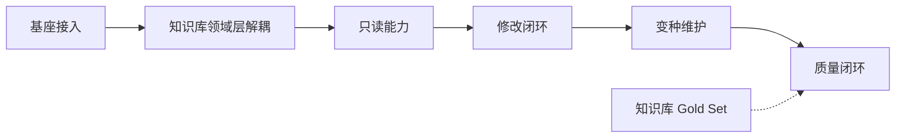

# Rule Studio 执行计划

> 依据：`dev-docs/design/2026-11-24-RuleStudio需求文档.md`（FR、I、AD、AC 编号沿用）、`dev-docs/planning/2025-11-24-执行计划.md`（KB v3.2 冻结架构）、PiBot 上游 `main` commit `152425f`
> 日期：2026-11-24
> 范围：Phase 0、A、B、C（第一阶段）；Phase D、E（第二阶段）
> 执行方式：按阶段推进，每阶段完成即更新 `dev-docs/progress/执行进度.md` 与 `dev-docs/progress-result/<阶段>-执行报告.md`，再提交

## 修订记录

| 版本 | 日期 | 变更 |
| --- | --- | --- |
| v1 | 2026-11-24 | 初稿 |

## 总览

| 阶段 | 目标 | 仓库 | 预估 | 前置 | 完成标志 |
| --- | --- | --- | --- | --- | --- |
| Phase 0 | fork 接入、环境打通、规范修订、功能裁剪 | KB + fork | 1 - 2 天 | fork 已创建 | AC-1 |
| Phase A | KB 领域层可在任意目录、任意前缀、内存中运行；同步进 fork | KB | 2 - 3 天 | Phase 0 | AC-2、AC-3 |
| Phase B | 规则浏览、引用、只读问答 | fork | 4 - 6 天 | Phase A | AC-4、AC-5、AC-6 |
| Phase C | 提案、门禁、应用、事务 | fork + KB（.gitignore） | 5 - 7 天 | Phase B | AC-7、AC-8、AC-9 |
| Phase D | 新建变种、影响分析、未决管理 | fork | 4 - 6 天 | Phase C | AC-10、AC-11、AC-12 |
| Phase E | Gold Set 门禁、审计历史、上游合并演练 | fork + KB | 2 - 3 天 | KB Phase 3 | AC-13 |

KB Phase 3（Gold Set）按 KB 自身计划独立推进，只阻塞 Phase E，不阻塞 B、C、D。

**第一阶段真正的交付物**：策划在 PiBot 桌面应用里，通过聊天修改一张杭州规则卡，看到 Diff 与门禁结果，点击应用后写入工作区；期间 `sources/` 不变、Agent 没有写盘能力、失败可回滚。

### 类比理解

- Phase 0 像**装修前先通水通电**：fork、Node、pnpm 跑不起来，后面都是纸上谈兵。
- Phase A 像**把编译器做成可搬动的工具箱**：去掉「必须放在 `variants/` 目录」「前缀必须是 HJ / XS」这些和位置绑定的假设，工具箱才能放进 Studio 的内存里。
- Phase B 到 C 像**先给编辑器开只读模式，再开修订模式**：只读模式验证「AI 读得懂」，修订模式验证「AI 改得对、策划审得住」。

## 前置条件

| 项 | 要求 | 本机现状 | 处理 |
| --- | --- | --- | --- |
| Node | PiBot 要求 `26.11.1`（`.nvmrc`）；KB 要求 ≥ 24 | `24.18.0` | 用 fnm 或 nvm-windows 安装 26.11.1；在 fork 目录 `fnm use` / `nvm use`；KB 继续用 24 或 26 均可 |
| pnpm | 12 | 未安装 | `npm i -g pnpm@12` 或 `corepack enable && corepack prepare pnpm@12 --activate` |
| Git | 支持 submodule（标准） | 有 | 无 |
| GitHub | fork 权限 | `mickorz` 账号 | 待决策 1 确定仓库名 |
| 模型 | 至少一个支持 Tool Calling 的 Provider | 由 PiBot 管理 | Phase 0 冒烟时配置 |

**工作目录约定**：KB 仓库根 = `$KB`；fork = `$KB/thirdparties/PiBot` = `$FORK`。fork 内的提交在 `$FORK` 里做，KB 仓库只记录 submodule 指针；两边的提交分开，先 fork 后 KB。

## Phase 0：基座接入

### 目标

PiBot fork 以 submodule 进入 `thirdparties/`，本机能 `pnpm dev` 启动并完成一次对话；规范与登记同步修订；PiBot 无关功能裁剪到最小可运行集合。

### 任务

| # | 任务 | 操作要点 | 产出 |
| --- | --- | --- | --- |
| 0.1 | 合并 `main` | `git checkout mickorz/Mahjong-Rule-Studio && git merge main`（落后一个提交 `23e9dff`，发布门槛修复） | 分支与 `main` 同步 |
| 0.2 | 创建 fork | GitHub fork `w01fb0ss/PiBot` → `mickorz/PiBot`（待决策 1）；fork 内建分支 `rule-studio`，`main` 只做上游镜像 | fork 仓库 |
| 0.3 | 添加 submodule | `git submodule add <fork-url> thirdparties/PiBot`；`git -C thirdparties/PiBot checkout rule-studio`；确认 `git submodule status` 指向 `152425f`（fork 尚无改动时与上游一致） | `.gitmodules`、gitlink |
| 0.4 | 环境安装与冒烟 | 安装 Node 26.11.1 与 pnpm 12；`cd thirdparties/PiBot && pnpm install && pnpm dev`；设置 `PIBOT_DATA_DIR` 隔离开发数据；配置模型，完成一次对话；执行 `pnpm check` 记录基线结果 | 可运行的应用；`pnpm check` 基线 |
| 0.5 | 命名与许可 | fork 内：`apps/desktop/package.json` 的 `name` / `productName`、`appId`、窗口标题、关于页、i18n 应用名改为 Mahjong Rule Studio；`NOTICE` 追加「Derived from Pi Bot, Copyright 2026 The Pi Bot Authors, Apache-2.0」；README 顶部注明 fork 来源与用途；若 `pnpm lint` 校验应用名一致性，运行 `pnpm sync:agents` | 改名提交 |
| 0.6 | Spike S-2 功能裁剪 | 在 `packages/brain-app/src/index.ts` `capabilities()` 中逐个移除无关 Capability（computer-use、browser、routines、remote、external-agents、office、images、memory 按需），每移除一个跑 `pnpm dev` + `pnpm typecheck`；记录哪些是桌面启动硬依赖 | 最小 Capability 集合清单，写入 `$FORK` 的 README「Rule Studio 裁剪说明」 |
| 0.7 | 规范修订 | 本仓库 `CLAUDE.md` thirdparties 一节：新增「开发基座（fork）」类别，规则：指向我方 fork、在 fork 内修改、固定 commit、`REFERENCES.md` 标注复用策略为「开发基座」；保留「只读参考」类别的原有约束 | `CLAUDE.md` 修订 |
| 0.8 | 登记 | `thirdparties/REFERENCES.md` 新增 REF-001：仓库 `w01fb0ss/PiBot`（上游）与 fork 地址、本地路径 `thirdparties/PiBot`、固定 commit `152425febf89487f6494e002122646fdd3bb041a`（初始）、License Apache-2.0（NOTICE 名称与 Logo 除外）、复用策略「开发基座」、研究目的 | 表格行 |
| 0.9 | 工作流指南 | `dev-docs/guides/2026-11-24-PiBot基座工作流.md`：目录约定、两仓库提交顺序、fork 分支策略（`main` 镜像 / `rule-studio` 开发）、上游合并步骤、环境变量、`pnpm check` 前置 | 指南文档 |
| 0.10 | 经验沉淀 | 0.4 中遇到的每个坑（Node 版本、pnpm、Windows 原生模块、sandbox 补丁等）各写一篇 `dev-docs/experience/` | 经验文档 |
| 0.11 | 进度记录 | 更新 `dev-docs/progress/执行进度.md` 里程碑表（新增 Rule Studio 各阶段行）；新建 `dev-docs/progress-result/P0-RuleStudio-执行报告.md` | 进度文档 |

### 验收

- AC-1：`git submodule status` 显示 `thirdparties/PiBot` 指向 fork 的固定 commit；`pnpm dev` 在 Windows 上启动并完成一次对话
- `pnpm check` 在 fork 内通过（或记录与基线一致的既有失败项）
- 应用显示名不再出现 Pi Bot / PiBot（仓库描述中说明来源除外）
- `REFERENCES.md`、`CLAUDE.md`、指南文档已提交

## Phase A：知识库领域层解耦

### 目标

KB 的 schemas 与 compiler 不再依赖目录名与硬编码前缀，能以纯函数形式在内存中加载、校验、编译任意规则集；领域代码可一键同步进 fork，并有漂移检查。**全部在 KB 仓库内完成，KB 现有 31 个测试必须持续通过。**

### 任务

| # | 任务 | 文件 | 产出 |
| --- | --- | --- | --- |
| A-1 | manifest 增加 `id_prefix` | `schemas/manifest.ts`：base 与 variant manifest 均加 `id_prefix: z.string().regex(/^[A-Z]{2,4}$/)`（必填）；`rulesets/hangzhou/manifest.yaml` 加 `id_prefix: HJ`；`variants/xiaoshan/manifest.yaml` 加 `id_prefix: XS` | Schema 与数据 |
| A-2 | ID 格式通用化 | `schemas/rule.ts`、`schemas/config.ts`、`schemas/unresolved.ts`：正则改为 `/^[A-Z]{2,4}-.../`；删除 `startsWith("HJ-")` / `startsWith("XS-")` 的 Zod 检查（前缀归属由校验器按注册表核对，Zod 只管结构） | Schema |
| A-3 | validator 显式 kind | `compiler/validator.ts`：新增 `type RuleSetKind = "base" \| "variant"`；`loadRuleset(dir, kind)`；`validateRuleset(rs, base?, registry)`，其中 `registry = { base: { idPrefix }, variant: { idPrefix } }`，核对：base 卡前缀 = 底座前缀、variant 卡前缀 = 变种前缀、`base_rule_ref` / `compares_to` 目标带底座前缀、未决 ID 前缀与规则集一致；`extractBodyRefs(body, prefixes)`；删除 `rs.dir.startsWith("variants")`；CLI 部分保留在文件底部，增加 `--json` 输出结构化错误 | 校验器 |
| A-4 | 编译器拆分 | 新建 `compiler/kernel.ts`：迁移 `compileBase`、`compileVariant`、`dirFor`、`rewriteBody` 与依赖闭合检查，输入为已加载的规则集与注册表，输出为结果对象，**不触碰文件系统**；`rewriteBody` 与闭合正则用注册表前缀构造；`compiler/compile.ts` 变为 CLI：加载 → 校验 → 调 kernel → `writeOutput`；增加 `--out <dir>`（默认 `compiled/`） | kernel + CLI |
| A-5 | Zod 4 迁移 | `package.json` `zod` 改 `^4`；`npm install`；运行 `npm test`、`npm run validate`、`npm run compile`；逐项修正差异（`.default()` 语义、错误 `issues` 路径等）；有坑则写 `dev-docs/experience/` | 迁移完成，测试通过 |
| A-6 | KB `AGENTS.md` | 执行 KB Phase 4.1：目录约定、ID 规范、四种引用、如何查规则、如何读完整规则集、`compiled/` 不可手改、`modified` 卡必须完整、底座升版规则、未决项规则。**该文件是 Studio Skill 的唯一内容来源** | `AGENTS.md` |
| A-7 | 同步脚本 | 新建 `scripts/sync-studio-kb.mjs`：把 `schemas/*.ts`、`compiler/kernel.ts`、`compiler/validator.ts` 复制到 `$FORK/packages/mahjong-kb/src/kb/`（保持 `schemas/`、`compiler/` 相对结构，导入路径不改）；在目标目录顶部生成 `GENERATED.md` 说明来源与禁止手改；写 `SYNC.lock.json`（每个文件的 sha256）；`--check` 模式逐文件比对，不一致或缺失即非零退出。`package.json` 加 `"sync:studio"`、`"sync:check"` | 脚本 + 锁文件 |
| A-8 | fork 侧包定义 | `$FORK/packages/mahjong-kb/package.json`（`@pibot/mahjong-kb`，`"pibot": { "layer": "L2" }`，exports `./kb`，依赖 `zod`、`yaml`）、`tsconfig.json`、`src/index.ts`（re-export）；`src/kb.test.ts` 校验 vendored 文件哈希与 `SYNC.lock.json` 一致 | 可被 fork 引用的包 |
| A-9 | 测试 | 新增 `tests/compiler/id-prefix.test.ts`：用夹具 `tests/fixtures/rulesets/tl-fake/`（前缀 `TL`）验证不改 Schema 即可校验与编译；新增 `tests/compiler/kernel.test.ts`：内存编译 API 与 `compile.ts` CLI 输出一致；更新 `rule-ids` / `variant-refs` / `compile` 测试以适配新签名 | 测试 |
| A-10 | 文档 | `docs/development.md`（中英）补 `sync:studio` / `sync:check`；`README.md` 目录结构补 `scripts/`；进度文档与 `progress-result/PA-执行报告.md` | 文档 |

### 关键约束

- `compiler/kernel.ts` 不得 `import "node:fs"`；文件读写只留在 CLI 层。
- `loadRuleset` 的 `kind` 由调用方传入；CLI 层从目录位置推断（`rulesets/` → base，`variants/` → variant），但这是 CLI 层的便利，不是校验器的假设。
- 同步只复制 KB 的 `schemas/` 与 `compiler/` 纯函数部分；`compile.ts` CLI、`tests/`、`dev-examples/` 不同步。
- Zod 4 迁移若发现 KB 行为变化且无法等价迁移，**停止并在需求文档待决策表登记**，不带病推进。

### 验收

- AC-2：新增 `variants/<x>/`（任意前缀）不改 Schema 即可通过校验与编译
- AC-3：`npm run sync:check` 通过；`$FORK` 内 `pnpm typecheck`、`pnpm lint` 对 `@pibot/mahjong-kb` 通过
- `npm test` 全绿（原 31 个 + 新增）
- `npm run compile` 产物与迁移前一致（`git diff compiled/` 为空）

## Phase B：Mahjong Capability 只读

### 目标

在 fork 内新增 Mahjong Capability，提供知识库工作区、规则集与规则浏览、原始资料阅读、只读 Agent 工具；UI 增加右侧「规则」页签与「引用到对话」。**麻将 Bot 在本阶段没有任何写盘能力。**

### 前置 Spike（进入本阶段前完成，结论写进 `$FORK` 的 `packages/mahjong/README.md`）

| Spike | 问题 | 产出 |
| --- | --- | --- |
| S-3 | Capability 工具规格如何声明策略规则（allow / ask / deny）；工具结果 `details` 如何到达渲染层以渲染自定义卡片（参考 `UserQuestionCard`、`GroupWorkflowDecisionCard` 的数据流） | 结论 + 示例代码位置 |
| S-4 | 内置 Skill 如何打包并默认挂到某个 Bot（`teamsCapability({ builtinDir })`、`skillsCapability`、`.pibot` 模板） | 结论 + 放置路径 |
| S-5 | Capability 可用的审计 API；持久化少量设置（知识库路径）的 API（`ctx.local`、`@pibot/storage`、settings） | 结论 |
| S-6 | 聊天输入框是否支持程序化插入文本（「引用到对话」） | 结论或替代方案 |
| S-8 | `SidePaneTab` 扩展方式；`@pibot/workspaces/ui` 的 Diff 组件能否用于「未落盘的虚拟差异」 | 结论 |

### 任务

| # | 任务 | 文件（相对 `$FORK`） | 产出 |
| --- | --- | --- | --- |
| B-1 | 契约包 | `packages/mahjong-contract/package.json`、`tsconfig.json`、`src/index.ts`：导出 `MahjongMethods`（RPC 方法表）、`MahjongEvents`（事件表）、`mahjongTools`（工具规格）、`mahjongToolGroup`、共享 zod Schema（`RuleRef`、`RuleSummary`、`RulesetDescriptor`、`GateReport` 等）。方法前缀 `mahjong.`，工具前缀 `mahjong_` | 契约 |
| B-2 | Capability 骨架 | `packages/mahjong/package.json`（`@pibot/mahjong`，L2，依赖 `brain`、`mahjong-contract`、`mahjong-kb`、`observability`、`storage`、`zod`、`yaml`）、`src/brain/index.ts`、`src/brain/capability.ts`（`mahjongCapability()`：`register` 中注册 RPC 与工具执行器，`start` 中加载索引） | 骨架 |
| B-3 | 工作区 | `src/brain/workspace.ts`：KB 根目录的读取、校验（存在 `rulesets/`、`compiler/`、`package.json`）、持久化（Spike S-5 结论）、变更后重建索引；路径白名单工具函数（拒绝 `..`、符号链接逃逸） | 工作区模块 |
| B-4 | 注册表与仓库 | `src/brain/registry.ts`：扫描 `rulesets/*`、`variants/*` 的 manifest，构建 `{ rulesetId, dirName, kind, version, basePin, idPrefix, rootPath }`；`src/brain/repository.ts`：基于 `@pibot/mahjong-kb` 的 `loadRuleset` 构建内存索引（规则摘要、全文、三类关系、反向依赖、未决清单、配置项），提供 `list` / `get` / `search`（ID 精确 → 名称 → 正文关键词） / `dependentsOf`；`src/brain/source-reader.ts`：只读 `sources/`，支持按章节标题定位 | 索引层 |
| B-5 | RPC | `src/brain/rpc.ts`：`mahjong.workspace.get` / `set`、`mahjong.rulesets.list`、`mahjong.rules.list`、`mahjong.rules.get`、`mahjong.rules.search`、`mahjong.rules.dependents`、`mahjong.sources.read`；事件 `mahjong.workspace.changed`、`mahjong.index.changed` | RPC |
| B-6 | 协议聚合 | `packages/protocol/src/aggregate/api.ts`：import 并 spread `MahjongMethods` / `MahjongEvents`，`EventEnvelopeSchema` 加入两个事件；`tools.ts`：spread `mahjongTools`，组加入 `mahjongToolGroup`；`packages/brain-app/src/index.ts`：`capabilities()` 加入 `mahjongCapability()` | 聚合改动（最小 diff） |
| B-7 | 只读工具 | `src/brain/tools.ts`：`mahjong_list_rulesets`、`mahjong_search_rules`、`mahjong_read_rule`（返回全文、元数据、三类关系、来源、状态与 blocker）、`mahjong_read_source`、`mahjong_compare_rules`（两张卡并排 + 元数据差异）、`mahjong_find_dependents`；工具返回里 `base_rule_ref` / `compares_to` / `depends_on` 分开列出；策略规则按 Spike S-3 设为 allow | 工具 |
| B-8 | Skill | 按 Spike S-4 放置 `SKILL.md`，内容改写自 KB `AGENTS.md`（A-6），外加工具用法与「引用 ID 时先读卡再回答」的硬性要求 | Skill |
| B-9 | UI 页签 | `apps/desktop/src/renderer/features/mahjong/`：`RuleStudioPane.tsx`（浏览 / 提案 / 验证三子视图的容器，B 阶段只实现浏览）、`RulesetPicker.tsx`、`RuleBrowser.tsx`（筛选、搜索、列表）、`RuleReferenceButton.tsx`（引用到对话）；`features/side-pane/use-side-pane.ts` 的 `SidePaneTab` 加 `"rules"`；点击规则在「预览」页签打开 `.md`（复用 FilePreviewPane）；i18n 中英同改；颜色只用主题 token | 页签 |
| B-10 | 设置 | `features/settings/general.tsx` 加「知识库目录」行，复用 `host.pickFolder`；未设置时「规则」页签显示引导空状态 | 设置 |
| B-11 | 测试 | `packages/mahjong/src/brain/*.test.ts`：夹具 KB 放 `tests/fixtures/mahjong-kb/`（从真实 KB 裁剪：杭州 5 张、萧山 3 张、一份 sources）；覆盖注册表、索引、搜索、白名单、RPC 校验；`tests/integration` 用 fake-llm 跑一次「读规则」工具链路 | 测试 |
| B-12 | 文档与进度 | `$FORK/packages/mahjong/README.md`（模块说明 + Spike 结论）；KB `docs/getting-started.md`（中英）加 Studio 启动方式；进度文档与 `PB-执行报告.md` | 文档 |

### 关键约束

- 本阶段 `mahjong_*` 工具全部只读；`capabilities()` 中不得注册任何含写文件、补丁、Shell 的工具给麻将 Bot（AC-6）。
- Capability 内不得 `import "electron"`、不得 `child_process`、不得读 `process.env`（PiBot 硬约束）。
- 所有 RPC 经 `ctx.rpc.handle` 包装；错误返回明确错误码（如 `mahjong_workspace_unset`、`mahjong_rule_not_found`、`mahjong_path_forbidden`），不吞错。
- UI 文案不得硬编码；中英同时提交。

### 验收

- AC-4、AC-5、AC-6
- `$FORK` 内 `pnpm check` 通过
- 规则页签切换规则集、筛选、搜索、预览、引用均可用；未设置工作区时有明确引导

## Phase C：规则修改闭环

### 目标

Agent 可生成结构化提案，策划在 UI 审阅 Diff、证据、影响与门禁结果后应用；应用走 Hash 校验与事务，失败回滚，崩溃可恢复。底座变更强制升版。

### 任务

| # | 任务 | 文件（相对 `$FORK`，另注明者除外） | 产出 |
| --- | --- | --- | --- |
| C-1 | 提案 Schema 与存储 | `packages/mahjong-contract/src/proposal.ts`：`Proposal`、`ProposalChange`、`ProposalStatus`、`GateReport`、`ImpactAnalysis` 的 zod Schema（字段见需求文档 10.2）；`packages/mahjong/src/store/proposal-repository.ts`：读写 `<kb>/.rule-studio/proposals/<id>.json`，原子写（临时文件 + rename），单写入锁 | 存储层 |
| C-2 | 路径推导 | `src/brain/paths.ts`：按规则集注册表与规则 ID 推导目标文件路径（复用 `dirFor` 与前缀），config / manifest / unresolved 的路径固定；Agent 传入的任何路径字段一律拒绝 | 路径规则 |
| C-3 | 提案工具 | `src/brain/tools.ts` 扩展：`mahjong_propose_change`（输入：`summary`、`rationale`、`evidence[]`、`changes[]`，每项 `{ ruleset, ruleId, op, content }`；服务端补 `before`、`path`、Hash；已有同会话草稿则 `update`）、`mahjong_proposal_read`、`mahjong_proposal_validate`、`mahjong_proposal_update`；工具 `details` 带 `proposalId` 供渲染层画卡片 | 工具 |
| C-4 | 质量门禁 | `src/brain/gate/run.ts`：把变更集叠加到内存（`@pibot/mahjong-kb` 需要支持从「路径 → 内容」映射加载，A-4 的 kernel 接受 `LoadedRuleset` 即可满足：叠加后重新 `loadRuleset` 的内存版本）；G1 `validateRuleset(kind, registry)`；G2 `kernel.compileBase / compileVariant`（内存）；G3 版本规则；G4 下游锁定状态（逐变种：锁定匹配则试编译，失配标「待升级」并列出 `base_rule_ref` / `depends_on` / `compares_to` 命中的卡）；输出 `GateReport` | 门禁 |
| C-5 | 应用 RPC 与事务 | `src/brain/mutation/apply.ts`：`mahjong.proposals.apply`；流程见需求文档 10.3；事务目录 `<kb>/.rule-studio/transactions/<tx-id>/`（`manifest.json` + `originals/`）；`src/brain/mutation/recovery.ts`：`start()` 时扫描 `prepared` 事务并回滚；`mahjong.proposals.reject`；审计写入（Spike S-5 结论）；事件 `mahjong.proposals.changed` | 写入层 |
| C-6 | Diff 计算 | `src/brain/proposals/diff.ts`：逐文件生成行级 Diff（新增 / 修改 / 删除行），供 UI 展示；若 Spike S-8 结论允许复用 `@pibot/workspaces/ui` 的 Diff 组件则直接复用 | Diff |
| C-7 | UI：卡片 | `features/mahjong/ProposalCard.tsx`：在聊天中按工具名与 `details.proposalId` 渲染：状态、文件数、门禁摘要、按钮「查看详情」「应用」「拒绝」；应用前若 `status !== ready` 或门禁未过则禁用并说明 | 卡片 |
| C-8 | UI：详情与验证 | `features/mahjong/ProposalDetail.tsx`（理由、证据链接、逐文件 Diff、影响分析、门禁报告、事务步骤记录）、`features/mahjong/GateReportView.tsx`（「验证」子视图）；大型 JSON 可折叠 | 详情 |
| C-9 | 版本规则落地 | G3：目标为底座且变更含 `rulesets/hangzhou/**` 但无 manifest `version` 升级 → 失败，错误文案指向「需在同一提案升 manifest.version」；Skill 增加该规则与 `update_manifest` 用法 | 规则 |
| C-10 | 运行时目录 | KB `.gitignore` 加 `.rule-studio/`；`<kb>/.rule-studio/README.md`（由 Capability 首次创建时写入）说明该目录是运行时数据 | 忽略规则 |
| C-11 | 测试 | 门禁各层正反用例（缺槽位、引用悬空、未升版、下游失配）；事务：正常提交、门禁失败回滚、Hash 不一致过期、`prepared` 事务启动恢复；并发第二次 apply 被锁拒绝；fake-llm 跑「引用 → 提案 → 应用」链路 | 测试 |
| C-12 | 文档与进度 | `$FORK/packages/mahjong/README.md` 补提案与事务；KB `docs/how-to-guides.md`（中英）加「通过对话修改规则」；进度文档与 `PC-执行报告.md` | 文档 |

### 关键约束

- `apply` 只能由 RPC 触发；Agent 工具表中不存在任何能写盘的工具（I-1、I-2）。
- 事务写入后必须对**真实文件系统**复跑门禁，不能只信内存叠加结果。
- 回滚失败（例如 originals 缺失）不得静默：事务标记 `recovery_failed`，UI 醒目提示，并保留现场。
- 应用后不执行任何 git 命令（I-10）。

### 验收

- AC-7、AC-8、AC-9
- `$FORK` 内 `pnpm check` 通过；KB 目录 `npm run compile` 在应用后通过

## Phase D：变种维护

### 目标

通过对话新建地方变种、修改继承规则、管理未决项；底座变更给出下游影响分析；支持升级变种锁定。

### 任务

| # | 任务 | 要点 | 产出 |
| --- | --- | --- | --- |
| D-1 | 新建变种 | `mahjong_propose_change` 新增 op `create_variant { dirName, rulesetId, idPrefix, baseVersion }`：生成 `variants/<dirName>/manifest.yaml`（含 `id_prefix`、`base` 锁定）、`config.yaml`（空列表）、`unresolved.yaml`（空列表）；随后以 `create_rule` 逐张加卡；门禁：新变种可加载、可编译 | 能力 |
| D-2 | 比较工具 | `mahjong_compare_rulesets { a, b }`：复用 kernel 的映射结果输出 modified / added / inherited 清单与配置差异；`mahjong_compare_rules` 扩展为支持跨规则集同 ID 后缀对照 | 工具 |
| D-3 | 影响分析 | `GateReport.impact`（目标为底座时）：逐变种列出锁定状态、命中的 inherited / modified / `depends_on` / `compares_to` 卡；`update_manifest` 支持变种 manifest 的 `base.version` 升级（升级锁定提案） | 分析 |
| D-4 | 未决项 | op `create_unresolved { ruleset, cardRef, description, status, releaseBlocker, candidates? }`、`resolve_unresolved { id, resolution }`；门禁检查：裁决后关联卡 / 配置项的 `status` 与 `candidates` 一致（例如 `XS-C-JOKER` 裁决后不得仍带 `candidates` 且 `status: confirmed`），不一致时失败并指出 | 能力 |
| D-5 | 修改继承规则 | Skill 明确「沿用但加限制」的写法；门禁按槽位策略校验 `modified` 卡（I-6，KB 已有逻辑） | Skill |
| D-6 | 原始资料选区引用 | 「预览」页签打开 `sources/` 文件时支持选中段落 →「引用到对话」（文件、章节、行范围、文本）；工具 `mahjong_read_source` 支持按行范围读取 | UI + 工具 |
| D-7 | UI | 提案详情新增「影响分析」区；规则浏览增加变种创建入口（跳转到对话并预填提示词）；差异报告视图 | UI |
| D-8 | 测试与文档 | 新建变种全链路；影响分析命中与未命中；未决裁决一致性；进度文档与 `PD-执行报告.md` | 测试、文档 |

### 验收

- AC-10、AC-11、AC-12
- `$FORK` 内 `pnpm check` 通过

## Phase E：质量闭环

### 目标

Gold Set 接入门禁；审计与提案历史完整；上游合并流程演练一次。

### 任务

| # | 任务 | 要点 | 产出 |
| --- | --- | --- | --- |
| E-1 | KB Phase 3 | 按 KB 执行计划完成 Gold Set、calculators、Vitest（独立文档，本计划不展开） | KB 测试体系 |
| E-2 | G5 宿主端口 | `packages/mahjong-contract` 定义 `KbTestPort`（输入 KB 根目录，输出解析后的 Vitest JSON 报告）；`apps/desktop/src/main/` 实现端口（`node:child_process` 运行 `npm test -- --reporter=json`，带超时与 `AbortSignal`）；brain 侧端口缺失时返回显式「不支持」；门禁报告增加 G5 区块；设置项「应用后运行 Gold Set」默认开 | 门禁扩展 |
| E-3 | 审计与历史 | `mahjong.proposals.list` 支持全部状态；「提案」子视图增加历史筛选；应用 / 拒绝 / 回滚均入审计（Spike S-5） | 历史 |
| E-4 | 上游合并演练 | 在 fork 中执行一次「`main` 拉取上游 → 合并到 `rule-studio` → `pnpm check` → 更新 submodule 指针与 `REFERENCES.md`」，记录耗时与冲突点，更新工作流指南 | 演练记录 |
| E-5 | 进度 | `PE-执行报告.md`；更新 `REFERENCES.md` 固定 commit | 文档 |

### 验收

- AC-13
- 工作流指南中的上游合并步骤可被他人照做

## 跨阶段规范

| 项 | 规范 |
| --- | --- |
| 两仓库提交顺序 | 先在 `$FORK` 提交并推送到 fork；再在 `$KB` 执行 `git add thirdparties/PiBot && git commit`。KB 侧不得直接修改 submodule 工作区而不提交 fork |
| fork 内工程 | 遵守 PiBot `AGENTS.md`：strict、ESM、pnpm；UI 文案走 i18n 中英同改；颜色只用主题 token；RPC 用 zod；工具经策略；合并前 `pnpm check`；提交信息说明改了什么、为什么 |
| KB 内工程 | 遵守本仓库 `CLAUDE.md`；代码不加 Emoji；注释与日志中文；新增脚本 UTF-8 |
| 文档 | 每阶段完成：更新 `dev-docs/progress/执行进度.md`，新建 `dev-docs/progress-result/<阶段>-执行报告.md`（不向其他阶段报告追加）；踩坑写 `dev-docs/experience/` |
| 测试 | fork 内测试不用真实网络、真实密钥、真实用户目录；用 `tools/fake-llm`；KB 内测试不经网络 |
| 防御性代码 | 禁止用 null 检查或 try/catch 隐藏错误；错误要指向根因（I-8、I-9 的失败都要显式上报） |
| 阶段门禁 | 上一阶段 AC 未全部通过，不进入下一阶段；例外需在进度文档登记原因 |

## Spike 清单

| Spike | 问题 | 所属阶段 | 时间盒 | 失败时的替代方案 |
| --- | --- | --- | --- | --- |
| S-1 | PiBot 在本机 Windows 能否安装、构建、运行 | Phase 0 | 1 天 | 回到需求文档重新评估自建方案；记录经验 |
| S-2 | 最小 Capability 集合 | Phase 0 | 0.5 天 | 保留全部 Capability，只在 UI 层隐藏入口 |
| S-3 | 工具策略规则声明；工具 `details` 到渲染层的数据流 | Phase B 前置 | 0.5 天 | 自定义事件传递提案 ID |
| S-4 | 内置 Skill 打包与默认挂载 | Phase B 前置 | 0.5 天 | 把规范写进 Bot 的系统提示（`bots.update` 的 norms 字段） |
| S-5 | 审计 API；设置持久化 API | Phase B 前置 | 0.5 天 | 自建 JSON 文件于 `dataDir` |
| S-6 | 输入框程序化插入 | Phase B 前置 | 0.25 天 | 「复制引用」按钮 + 用户粘贴 |
| S-7 | KB schemas 在 Zod 4 下的行为 | Phase A | 0.5 天 | 不迁移；fork 内 `mahjong-kb` 用 Zod 3 独立依赖（pnpm 允许多版本） |
| S-8 | Side Pane 页签扩展；虚拟 Diff 组件 | Phase B 前置 | 0.5 天 | 自写最小行级 Diff 组件 |

## 验收矩阵

| AC | 内容 | 阶段 | 验证方式 |
| --- | --- | --- | --- |
| AC-1 | submodule 与桌面应用可运行 | 0 | 手动：`git submodule status`、`pnpm dev`、完成一次对话 |
| AC-2 | 新前缀不改 Schema | A | 自动：`tests/compiler/id-prefix.test.ts` |
| AC-3 | 同步无漂移、fork 包通过检查 | A | 自动：`npm run sync:check`、`pnpm typecheck`、`pnpm lint` |
| AC-4 | 财神差异问答正确 | B | 手动：对照 `XS-C-JOKER` 元数据核对回答 |
| AC-5 | 引用后读取全文 | B | 手动 |
| AC-6 | 无写盘工具 | B、C | 自动：测试断言注册的工具名集合；手动：对话中要求 AI 直接改文件，应被拒绝并转为提案 |
| AC-7 | 修改杭州卡全链路 | C | 手动 + `npm run compile` |
| AC-8 | 外部修改后提案过期 | C | 自动：`apply.test.ts` |
| AC-9 | 门禁失败回滚 | C | 自动：`apply.test.ts` |
| AC-10 | 影响分析与升级锁定 | D | 自动 + 手动 |
| AC-11 | 新建桐庐变种 | D | 手动 |
| AC-12 | 裁决未决减少 blocker | D | 自动：门禁报告 blocker 数 |
| AC-13 | Gold Set 门禁 | E | 手动（有 / 无 Node 两种机器） |

## 风险与应对

见需求文档第十三节。执行层面补充：

| 风险 | 应对 |
| --- | --- |
| Phase 0 环境问题吞掉时间 | S-1 时间盒一天，到期未通即停下来汇报，不带病推进 |
| fork 内 `pnpm check` 既有失败项与我们的改动混在一起 | Phase 0 记录基线；之后只对「基线之外的新失败」负责 |
| 聚合文件合并冲突 | `api.ts` / `tools.ts` 只做 spread，每处改动一行；冲突时按上游结构重排我们的 spread |
| 同步漂移 | `sync:check` 失败时 fork 内 `mahjong-kb` 测试失败，阻断 `pnpm check` |
| LLM 生成的卡质量 | 门禁错误原文回传工具结果；Skill 给出一张完整卡示例；提案可多轮修订 |

## 待决策

见需求文档第十四节。执行前必须确定：待决策 1（fork 仓库名）阻塞 0.2、0.3；待决策 2（是否裁剪）在 S-2 后定；其余可在对应阶段开始时定。

## 现在不做的

| 功能 | 决策 | 何时重新评估 |
| --- | --- | --- |
| 多人协作、权限 | 不做 | 出现第二个策划 |
| 向量检索 | 不做 | 规则卡超过约 2000 张或关键词搜索明显不准 |
| 提案存 SQLite | 不做 | 需要跨提案查询或历史检索 |
| 删除规则卡 | 不做 | 出现真实的废弃需求 |
| 槽位级继承 | 不做 | 某张卡确实无法整理成完整规则 |
| 自动 commit | 不做 | 策划明确要求 |
| 上游自动同步 | 不做 | 上游发布节奏稳定且合并无冲突 |

## 参考引用

- 需求文档：`dev-docs/design/2026-11-24-RuleStudio需求文档.md`
- KB 执行计划 v3.2：`dev-docs/planning/2025-11-24-执行计划.md`
- PiBot 上游：<https://github.com/w01fb0ss/PiBot>
- PiBot 工程规范：<https://github.com/w01fb0ss/PiBot/blob/main/AGENTS.md>
- PiBot Capability 接口：<https://github.com/w01fb0ss/PiBot/blob/main/packages/brain/src/core/capability.ts>
- PiBot 组合根：<https://github.com/w01fb0ss/PiBot/blob/main/packages/brain-app/src/index.ts>
- PiBot 协议聚合：<https://github.com/w01fb0ss/PiBot/blob/main/packages/protocol/src/aggregate/api.ts>、<https://github.com/w01fb0ss/PiBot/blob/main/packages/protocol/src/aggregate/tools.ts>
- PiBot Side Pane：<https://github.com/w01fb0ss/PiBot/blob/main/apps/desktop/src/renderer/features/side-pane/SidePane.tsx>
- PiBot 构建要求（Node、pnpm）：<https://github.com/w01fb0ss/PiBot/blob/main/README.md>
- Git Submodules 文档：<https://git-scm.com/book/en/v2/Git-Tools-Submodules>
- Zod 4 迁移指南：<https://zod.dev/v4/changelog>
- Apache License 2.0：<https://www.apache.org/licenses/LICENSE-2.0>
