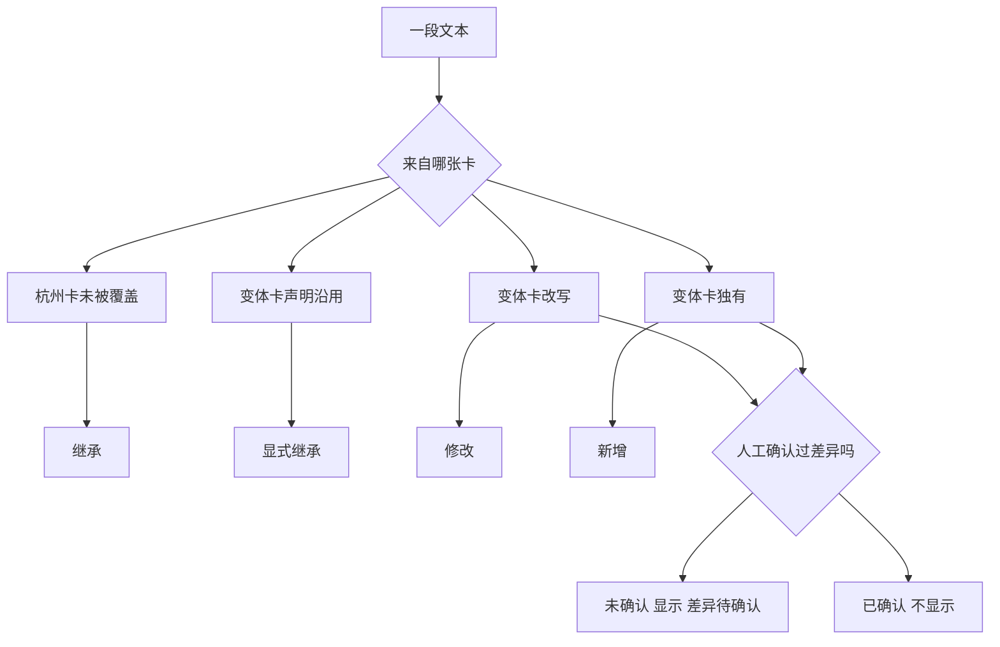

# 生成文档的标记说明

## 概述

`documents/<变体>/需求全文.md` 是 Rule Studio 从规则卡自动生成的需求全文。正文里会出现若干方括号标记，例如：

```
- 「修改」「差异待确认」「待裁决 XS-U-003」 番型·取档键：本次胡牌方式下、同一套合法拆法里成立的番型（对照杭麻：`HJ-K-FANXING-HUCHI`）
```

这些标记**不是排版装饰**，每一个都对应 `document.json` 里的一个机器字段。本文说明每个标记的含义、出现条件，以及看到它时应该做什么。

## 一句话总表

| 标记 | 回答的问题 | 对应字段 |
| --- | --- | --- |
| 「继承」 | 这段内容哪来的 | `lineage = default_inherited` |
| 「显式继承」 | 这段内容哪来的 | `lineage = explicit_inherited` |
| 「修改」 | 这段内容哪来的 | `lineage = modified` |
| 「新增」 | 这段内容哪来的 | `lineage = added` |
| 「差异待确认」 | 这段差异可信吗 | `diff_status = candidate` |
| 「待裁决 XS-U-00x」 | 这段有结论吗 | `release_blocker_refs` 非空 |
| 「数值·不可改写」 | 这段能让人改吗 | `editable = false` 且为纯数值/公式 |

四个维度互不替代：**来源**说明这段和杭州的关系，**确认状态**说明差异有没有人工签字，**待裁决**说明规则本身是否还没定，**可编辑性**说明这段能不能用自然语言改。

## 三个维度各管一件事



## 来源标记：「继承」「显式继承」「修改」「新增」

这一组只在**变体文档**（如萧山）里出现。杭州基座文档不显示，因为杭州全文本身就是基座，全部内容都是自己的。

| 标记 | 含义 | 典型情况 |
| --- | --- | --- |
| 「继承」 | 杭州的卡原封不动沿用过来，萧山没有自己的卡覆盖它 | 吃、碰、杠、发牌、界面布局 |
| 「显式继承」 | 变体卡存在，但卡里明确写了"沿用杭州"（`change_type: inherited`） | 萧山显式声明某条不变 |
| 「修改」 | 变体卡改写了杭州规则的某个维度，卡是完整有效规则 | 连庄牢数、庄闲倍率、番型档位 |
| 「新增」 | 杭州没有这条，萧山独有 | 跟庄、拖底、飘财限制 |

**「修改」不是补丁片段。** 按 `AGENTS.md` 约束 2，一张 `modified` 卡必须是完整有效规则，读者只看变体卡就能知道萧山怎么算。杭州原文不作为有效规则的一部分出现在正文里 —— 它只在行尾的 `（对照杭麻：HJ-xxx）` 里给一个对照指针。

看到 `（对照杭麻：`HJ-F-ZHUANGXIAN-BEILV`）` 表示：这段是萧山规则，后面那个 ID 是"改写自哪张杭州卡"，用于追溯，不是让你去按杭州算。

## 确认状态：「差异待确认」

表示这段差异是**机器比对出来的候选**（`diff_status = candidate`），还没有人工确认。

出现条件：`lineage` 是「修改」或「新增」。

两件事要说清楚：

1. 它的含义是"待确认差异是否属实"，不是"待确认文字写得好不好"。文字建议走表达层（`editorial-overrides.yaml`），与差异状态无关。
2. 变体文档里「修改」「新增」段落**全部**是 candidate，这是 P1 的初始状态。人工逐条确认后改 `confirmed`，标记才会消失。

## 待裁决：「待裁决 XS-U-002」

表示这条规则在 `unresolved.yaml` 里还挂着未决项，且该项 `release_blocker: true`。

编号规则是 `XS-U-###`（未决项 ID），**不是规则卡 ID**。要看具体争什么，去 `rulebook/specs/variants/xiaoshan/unresolved.yaml` 查同 ID 条目：

```yaml
- id: XS-U-003
  card_ref: XS-K-FANXING
  description: 十风的倍数原文未单列，K-FAN 表里写「原文未定」。影响算分
  status: unresolved
  release_blocker: true
  resolution: null
```

当前萧山有 3 条发布阻塞项：`XS-U-001`（翻财神归属）、`XS-U-002`（飘财第 3 次档）、`XS-U-003`（十风倍数）。

**看到这个标记不能自行填数。** 按 `AGENTS.md` 约束 5，未决项必须由规则方裁决：改 `status: confirmed` 并填非空 `resolution`，然后重新编译。

## 可编辑性：「数值·不可改写」

表示这段文本里的数值或公式**不允许用自然语言改写**（`editable = false`），必须由 `calculators/` 的确定性函数渲染。

为什么必须有这个标记：倍率、封顶、赔付这类数值一旦允许 LLM 润色，就会出现"文字读起来通顺但算错了"的文档，而这种错误最难被发现。所以数值只能是计算的产物。

读者该做什么：发现数值不对，**不要改文档**，要改规则卡或计算器，然后重新生成。改文档的文字改不动数值。

注意这个标记只对**纯数值/公式片段**显示。段落里出现一个 `=` 或 `×` 不一定带标签，因为判定 `editable = false` 的条件更宽（公式特征即不可编辑），而显示标签的门槛更高，避免长句刷屏。

## 组合含义速查

| 组合 | 怎么读 |
| --- | --- |
| 「继承」 | 萧山照杭州执行，无需关注 |
| 「继承」「待裁决 XS-U-001」 | 沿用的杭州内容也被未决项牵连，一起等裁决 |
| 「修改」「差异待确认」 | 萧山改写了，但改法本身待人工确认 |
| 「修改」「差异待确认」「待裁决 XS-U-003」 | 改写了、差异未确认、且规则本身还没定 —— 三件事都要人处理 |
| 「新增」「差异待确认」 | 萧山独有规则，差异待确认 |
| 任意 + 「数值·不可改写」 | 这段数值由计算器给出，只能改源头 |

## 不建议出现的组合

| 组合 | 为什么不对 |
| --- | --- |
| 「继承」+「差异待确认」 | 没改写就没有差异可比 |
| 「新增」+「对照杭麻」 | 新增没有杭州对照物 |
| 「待裁决」+ 无 `XS-U-###` 编号 | 未决引用必须是 `unresolved.yaml` 里的 ID，不能写规则卡 ID |
| 杭州基座文档出现「继承」「修改」等来源标记 | 基座文档没有对照对象 |

这些组合由 `tests/studio/pipeline/*.test.ts` 断言覆盖，不是靠人记。

## 标记从哪来

| 环节 | 做了什么 |
| --- | --- |
| 规则卡 `front matter` | 声明 `origin`、`change_type`、`base_rule_ref`、`release_blocker` |
| `compiler/compile.ts` | 合并杭州与变体，得到每条规则的 `origin` 与 `change_type` |
| `studio/pipeline/generate-variant.ts` | 把卡片级字段落到片段级 `lineage` / `diff_status` |
| `unresolved.yaml` | 提供 `XS-U-###` 与 `card_ref` 的映射，卡级阻塞据此变成片段级 `release_blocker_refs` |
| `studio/pipeline/render.ts` | 只负责把字段渲染成中文标记，不产生任何判断 |

换句话说：**标记是字段的显示形式，改标记等于改字段，改字段等于改规则卡或编译产物。** 渲染层没有任何"智能判断"，它只翻译。

## 相关文档

- 生成命令：仓库根 `studio/pipeline/run-p0b.ts`（杭州）、`run-p1.ts`（萧山）
- 数据契约：`studio/contracts/document.ts`
- 未决清单：`rulebook/specs/variants/xiaoshan/unresolved.yaml`
- 规则卡格式：`AGENTS.md`「规则卡格式」一节
- 设计依据：`dev-docs/design/2026-11-24-需求全文生成与变体差异标注.md`
